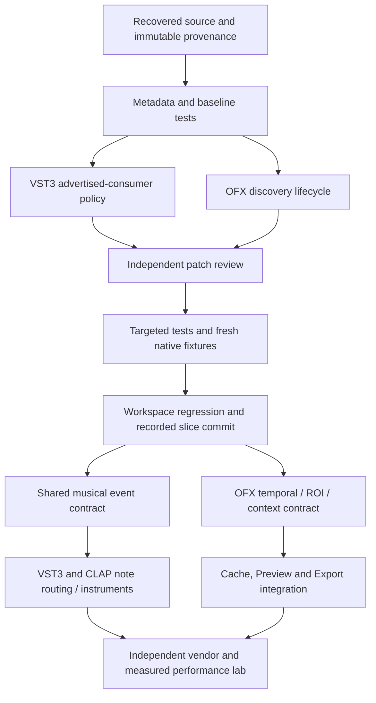

# Plugin host engineering sprint

Updated 2026-10-11 (Asia/Shanghai). This is the recoverable coordination record
for the OpenFX / VST3 / CLAP sprint. Detailed contracts remain in the existing
[plugin architecture](../architecture/plugin-system.md),
[audio pipeline](../architecture/audio-pipeline.md),
[audio standard matrix](native-audio-standard-features.md),
[OpenFX standard matrix](native-openfx-standard-features.md), and
[compatibility evidence](native-plugin-compatibility.md). Source capability and
historical qualification are distinct; stale matrix rows must be checked against
their actual consumer before changing a support claim.

## Recovered baseline and evidence

The original isolated checkout was clean at `a1925ca`, an ancestor of the prior
`a808891c8c91d122798c01ec633202c08ca2d9eb` worktree. The coordinator created
`feature/plugin-host-sprint` at that prior base and restored its retained tracked
and untracked production sources, rather than reimplementing its native adapters.
The source worktree at `E:/dev/mondrian/.claude/worktrees/nle-backlog` remained
read-only. Recovery verified all 2,100 source file hashes; 817 files required
copying and one obsolete file required removal. The original destination is
recoverable from `.scratch/plugin-host-sprint/source-recovery/pre-recovery.zip`.
The manifest and pre/post stability evidence are in that directory's
`receipt.json`. Recovery checkpoint `13fefdf33747a907a25075d7449c1f473a9264e9`
records that snapshot separately from this round's changes. An alternate index
staged only the recovery manifest; the real index was aligned without touching
working files. A pre-existing empty index lock was removed only after checking
the exact path, absence of Git processes and unchanged parent index. All 2,100
original and 1,772 current source hashes remained stable. The checkpoint is not
a native acceptance claim.

Current round evidence:

| Gate | Result | Scope |
| --- | --- | --- |
| Source recovery | PASS | Exact file hashes and stable source tree; no execution claim |
| Cargo metadata | PASS | Workspace/path package resolution; `.scratch/plugin-host-sprint/cargo-metadata.json` |
| CLAP source provenance | PASS | Official generated source/package identity; no runtime claim |
| Clack source provenance | RED then PASS | Audited metadata repair, original checker unchanged, 252 shipped paths |
| Audio baseline | PASS | 331 passed, zero failed, 50 ignored; `.scratch/plugin-host-sprint/audio-baseline-receipt.json` and log |
| Audio after VST3 declaration policy | PASS within library scope | 331 passed, zero failed, 50 ignored; `audio-after-vst-policy-r2.log`, native ignored cases remain separate |
| Shared domain baseline | PASS | Audio scheduling 8, Effects 327, Timeline 247 passed; one scheduling case ignored |
| VST3 consumer policy | PASS within COM scope | Five actual policy/instance/default/builder controls; native vendor initialization remains separate |
| Native lab process owner | PASS within Windows scope | 12 library tests passed, four fixture functions ignored; four new controls execute real owned child/grandchild processes |
| Strict workspace Clippy | PASS | All targets/all features, `-D warnings`, exit zero in 2m06s; 1,772 frozen source hashes stable; `workspace-clippy-r6-receipt.json` |
| Frozen lab controller | PASS within selected scope | Seven tests in three groups, 1,771 source hashes stable; five negative controls refuse wrong count/hash, duplicate ID, timeout and a live descendant |
| DXC build environment / renderer check | PASS within build scope | Original immutable API and SHA-256 checks executed; exact cached archive reused; `renderer-build-environment-r6.log`. No GPU output or performance claim |
| Fresh Basic / SessionProbe binaries | Verified within selected native cases | Fresh build r5 / freeze19: 15 original native groups; no full OFX/GPU qualification |
| Active native catalog shutdown | Verified within two controlled Windows cases | Actual discovery/describe worker retirement and native HANDLE exit; other GUI lifecycle remains separate |
| Independent vendor discovery | Verified within List/Probe/capture only | Airwindows CLAP/VST3 eight runs and Ring Out CLAP four runs; no full compatibility claim |
| Initial VST3 value restart consumer | Verified within owned initial/fresh-object controls | Commit0bd39c4; SDK10/10, prior native10/10, ordinary Audio332 and vendor269, independently accepted source26 |
| Signed-zero buffer fidelity | Verified within owned buffer controls and limited native VST3 replay | Source27 RED270/1 to source28 GREEN271/0; Audio332/0; Airwindows two rounds pass unchanged strict oracle; no SDK violation/performance claim |
| External native PCM | VST3 limited PASS; CLAP RED | Airwindows VST3 default-state offline bypass partitions1/17/64 and distinct finite non-bypass output; CLAP schema drift remains unresolved |
| CLAP read-only metadata / default state load | Verified within Ring Out two-round controls | Source29 Audio336/0, exact native2/2 and independent raw state/author/payload checks; existing core behavior, new verification gate only; no PCM/full-project claim |
| Periodic App ordinary regression | Verified within source29 default libtest scope | 2,778 passed/zero failed; exact ordinary inventory, current producer, 1,786 source hashes and four native Job retirements independently accepted; 124 ignored cases remain separate |
| New performance/platform qualification | Not run | Historical results below do not transfer to new changes |

Clack's RED reproduced in both source and destination. The GUI wrapper differed
from its sealed `clap-gui-refusal-v1` preimage only in three method-chain line
wraps. The sealed manifest already identifies the current documentation bytes,
but its local metadata still held an older documentation hash. The note-port
source matched its declared unsigned-carrier delta while `shipped_files` retained
an old hash. Only `vendor/clack/PROVENANCE.json` and
`vendor/clack/LOCAL-FORMAT-CHANGES.json` changed. Runtime, upstream input and checker
bytes are unchanged. Original RED, metadata preimages, sealed witnesses and GREEN
are saved in `.scratch/plugin-host-sprint/clack-provenance-repair/`.
Original LF was restored to avoid a whole-file Windows newline diff; the dependent
raw receipt hash was updated without another semantic change. The unchanged
checker again passed 252 paths. Final provenance SHA-256 is
`e90ace85359e950ed8419cbb9ffdd4228770d4189d4320b24cf8a0bc3c0f53f0`.
This repairs source attribution; it does not qualify runtime compatibility.
Commit `c5337e5` contains only the metadata files. Commit `87db4dd` contains the
separately reviewed VST3 instance policy, and `3572a3c` the Windows lab owner.
The controller's later outer-wait fix remains a separate acceptance slice.

The prior `handoff-6oqHh9.md` records matching r584 strict checks and default-stack
workspace tests: 8,440 passed, zero failed, 303 ignored. Native r561 records 36
owned cases and GPU r562 records 10 portable plus seven actual RTX 3050/DX12
cases. Those results bind their exact source/artifact/environment hashes. Their
ignored, unexercised and platform limitations remain. Fresh compilation and
execution are required for this restored tree and every subsequent patch.

Literal include audit found 118 unique Rust `include_str!`/`include_bytes!`
inputs, all present and none ignored. No tracked symlink/submodule was found.
This is a source audit, not an exhaustive proof of dynamic runtime dependencies.
`.scratch`, `.claude`, `target`, generated DLLs and secrets were excluded from
production recovery. Historical receipts remain in the original evidence store.
Native build prerequisites include OCIO, FFmpeg, MSVC/ATL and pinned static DXC;
the source snapshot does not include their compiled outputs.

## Capability status

`Verified` means the stated boundary has matching executed evidence. `Implemented
— Not Fully Verified` means source exists without the required vendor/platform/
performance evidence. `Partially Supported` means an admitted finite subset.
`Unsupported` means no product execution contract. `Blocked` records a concrete
missing prerequisite, not merely unfinished engineering. No complete standard
has current-round `Verified` status.

| Format / capability | Status | Boundary and acceptance still required |
| --- | --- | --- |
| VST3 discovery, class/fingerprint, supervised worker | Implemented — Not Fully Verified | Repeated actual load/unload, errors and permitted vendor corpus |
| VST3 PCM/buses | Partially Supported | Float32 product, mono/stereo main, up to 31 admitted same-layout auxiliary inputs; mixed/surround and multiple outputs absent |
| VST3 sample-offset parameters | Implemented — Not Fully Verified | Normalized bounded queues; native output, saturation, allocation and full callback deadline gates |
| VST3 state | Partially Supported | Bounded component/controller envelope; arbitrary DSP checkpoint not implied |
| VST3 transport | Partially Supported | Exact signed signal sample/rate; unavailable musical facts remain unavailable |
| VST3 MIDI/notes/instruments | Unsupported | Vendor event APIs exist; product author/event/output routing does not |
| VST3 GUI | Partially Supported | Windows same-object editor path; later destructive entry, DPI/focus/keyboard and vendor matrix pending |
| VST3 dynamic reprepare/PDC | Partially Supported | Cohort/hold/seed controls; canonical installation and retained author acceptance pending |
| VST3 complete vendor/platform certification | Blocked | Matching fresh fixtures/vendor permissions and Linux/macOS execution hosts unavailable in this round |
| CLAP discovery, descriptor/fingerprint, supervised worker | Implemented — Not Fully Verified | Actual repeated lifecycle and vendor controls required |
| CLAP audio ports | Partially Supported | Admitted Float32 mono/stereo main and auxiliary topology; notes/instrument/multi-output contracts absent |
| CLAP parameter events | Implemented — Not Fully Verified | Plain scalar values, ordered bounded carrier; full allocation/deadline and author closure pending |
| CLAP state | Partially Supported | Bounded state/configuration; state seed is not proven DSP continuity |
| CLAP transport | Partially Supported | Exact signed seconds; musical time/tempo-map facts unavailable |
| CLAP note/MIDI/polyphonic modulation | Unsupported | No canonical product event route or note-port execution |
| CLAP GUI/main services | Partially Supported | Windows same-object roles/timers exist; exact callbacks and native platform loops need separate gates |
| CLAP sleep/request-process scheduler | Unsupported | Callback presence alone does not schedule sole Audio DAG |
| CLAP dynamic ports/latency/restart | Partially Supported | Sticky request/control path; actual canonical graph candidate installation unfinished |
| CLAP complete vendor/platform certification | Blocked | No installed independent CLAP binary found; permitted corpus and other platforms still need provisioning |
| OpenFX Filter CPU execution | Partially Supported | Current-frame full-frame progressive RGBA Float32 Source/Output, resident instances and explicit alpha contract |
| OpenFX numeric/text/resource parameters | Partially Supported | Canonical curves/transactions; spatial/hierarchy/custom/dynamic/plugin-origin edits incomplete |
| OpenFX Generator/Transition/General/Retimer | Unsupported | Do not adapt these silently to a single-input Filter |
| OpenFX temporal images, ROI/RoD, tiles/multiresolution | Unsupported | Full-frame current-time subset; scheduling/cache dependencies must be added before advertisement |
| OpenFX components/depth/fields | Partially Supported | Declared CPU Float32/progressive subset; mixed formats/fields/PAR admission remains explicit |
| OpenFX required/aux/thread suites | Implemented — Not Fully Verified | Native ownership/callback evidence finite; full vendor suite conformance is unqualified |
| OpenFX overlay/interact | Unsupported | A descriptor/API presence is not a product interactive workflow |
| OpenFX GPU interoperability | Unsupported | wgpu numeric Mix is not an OpenFX GPU Suite; no native-resource/sync contract |
| OpenFX discovery shutdown in qualified Windows cases | Verified | Actual blocked discovery/describe Host Drop settles child and thread without publication; OS-wide failure/latency guarantees remain unqualified |
| OpenFX full vendor/platform certification | Blocked | Official Basic and owned SessionProbe qualify a finite subset; broader vendor corpus and Linux/macOS/native UI/hardware execution remain unavailable |

The `Verified` category applies to source recovery/provenance and the finite
current Windows COM and process-supervision controls above. It does not upgrade
whole format capabilities. Historical narrowly verified host cases remain recorded
with their original receipts in `native-plugin-compatibility.md`; they are not
upgraded to full third-party compatibility here.

## Shared contracts and ownership

Keep one author Session/transaction/history authority and exact occurrence IDs.
Plugin output observations are execution feedback until an explicit canonical
author transaction accepts them. A state seed, local epoch, Bind or GUI view
does not mint a new installed owner, DSP position or accepted clock anchor.

Audio uses the existing typed Routing DAG, prepared PDC, sample-rate/block/mode
admission and signed signal time. VST normalized values and CLAP plain values
remain distinct adapters. Note events require one future canonical time/bus/
payload contract before either format introduces product event routes. Main/UI
affinity, symbolic audio role and physical scheduling registration are distinct.
Realtime/offline requests must reach actual native preparation.

Video uses the compiled Effects graph and existing Renderer/Cache authority for
both Preview and Export. Render requests carry exact occurrence, time, scale,
extent, pixel/alpha identity, generation and cancellation. Native image ownership,
temporal requests, ROI and cache invalidation must extend that authority. Native
GPU handles require an independently negotiated resource and synchronization
contract. CPU transfers may be measured; zero-copy must never be inferred.

Parent Session owns resource grants and root checkpoint/deadline. Known native
buffers/SDK owners are measured under that grant; arbitrary plugin heaps, OS/CRT,
thread bookkeeping and unmeasured SDK ownership remain explicit frontiers.
Operation timeouts protect recovery; they do not certify audio deadlines.

| Owner | Exclusive responsibility | Concurrent write exclusions |
| --- | --- | --- |
| Coordinator | Git, source recovery, Cargo/native execution, shared contracts, integration | All writes paused during source/artifact qualification leases |
| Audio slice agent | VST3 instance-local immutable `IPlugInterfaceSupport` policy, loader propagation and independent COM tests | No Audio DAG/Session/protocol/SDK rewrite |
| OpenFX slice agent | Cancelable discovery/describe, correct packaged helper, catalog worker/child settlement, owner-thread definition registration and controls | No Render Graph/pixel/suite-domain redesign |
| Independent verification agent | This record; Clack provenance metadata repair; read-only review of final slice patches | No runtime source changes or Cargo execution |

This round uses disjoint module ownership within the already isolated worktree;
it does not claim per-agent worktrees were created. Contract changes require the
coordinator to approve scope, dependent consumers, migration and regression gates.
Expensive builds are serialized by the coordinator.

## Compatibility lab

The initial inventory is `.scratch/plugin-host-sprint/plugin-inventory.json`.
The installed Coda VST3 shell was found, but version/authorization/class inventory
and execution remain unverified. Duplicate package copies are one binary/class
identity, not extra test coverage. Owned fixture DLLs and the SDK Basic OFX sample
exist under the prior target directory; their historical hashes do not prove
fresh matching build selection.

The following 24 planned objects prioritize different boundaries. They are a
candidate queue, not 24 installed or compatible plugins. Owned/SDK objects remain
separate from independent vendor counts. Each format build and plugin class must
be inventoried before execution; external candidates are not silently installed.

| Object | Kind | Primary purpose / entry dependency |
| --- | --- | --- |
| CLAP sample gain | Owned fixture | Scalar events and range/partition PCM |
| CLAP sidechain | Owned fixture | Auxiliary mapping, delay, state and partitions |
| CLAP output probe | Owned fixture | Bounded output parameter/event observations |
| CLAP process author | Owned fixture | Native-origin author transaction closure |
| VST3 sidechain | Owned fixture | Bus mapping, state/delay and partition PCM |
| VST3 editor | Owned fixture | Same-object HWND and first-signal state |
| Stateful VST3 gain | Owned fixture | Component/controller state round-trip |
| VST3 Gain bundle | Reference fixture | Bundle resolution and repeated lifecycle |
| OpenFX SDK Basic | Official sample | Declared Filter processing and image law |
| OpenFX contract fixtures | Owned fixture family | Error/ownership/callback/teardown boundaries; individual IDs must be recorded |
| Coda VST3 shell | Installed independent candidate | Shell classes, discovery and permitted state/GUI execution |
| Surge XT instrument, VST3 | Independent candidate | Requires musical events and instrument output routing first |
| Surge XT instrument, CLAP | Independent candidate | Note lifecycle and polyphonic modulation after shared contract |
| Surge XT Effects, VST3 | Independent candidate | Effect chain, parameters/state and GUI |
| Surge XT Effects, CLAP | Independent candidate | Adapter comparison, parameters/state and GUI |
| Chow Tape Model | Independent candidate | Nonlinear PCM, state and automation; inspect actual format build |
| BYOD | Independent candidate | Complex state and processing graph; VST3/CLAP artifact checks |
| DPF example effect | Independent framework reference | Second implementation stack; choose actual built descriptor |
| DPF example instrument | Independent framework reference | Zero-input/event admission after shared contract |
| openfx-misc Blur | Independent candidate | Spatial/ROI/tiles and exact image comparison |
| openfx-misc ColorCorrect | Independent candidate | Float HDR/negative/alpha and colour contract |
| openfx-misc TimeBlur | Independent candidate | Temporal image requests and caching |
| openfx-misc Merge | Independent candidate | Required multi-input General context |
| openfx-misc Transform | Independent candidate | Bounds/ROI/PAR/multiresolution and interaction |

Primary project sources checked for candidate selection:
[Surge](https://github.com/surge-synthesizer/surge),
[Surge CLAP capabilities](https://surge-synthesizer.github.io/clap/),
[ChowDSP products](https://chowdsp.com/products.html),
[DPF format build targets](https://github.com/DISTRHO/DPF/blob/main/cmake/DPF-plugin.cmake),
[openfx-misc](https://github.com/NatronGitHub/openfx-misc).
These sources establish candidate projects, not local binaries or compatibility.
Choose immutable release/commit/license inputs when provisioning; no third-party
core code or license constraint is imported by this candidate list.

Every result records binary/class/version/SDK, source and artifact hashes, license
and activation, OS/CPU/GPU, input/parameters/rate/block/pixel format, selectors,
actual output, repetitions, failure/cleanup and performance. Native tests use
matching fresh helper/fixture artifacts, run serially and explicitly select
ignored cases. Ordinary unit success does not execute these cases.

## Acceptance gates and priority risks

Each slice needs a reviewable diff, independent semantic oracle, matching build,
targeted regression and explicit unresolved boundary. Preserve RED failures;
do not refresh identity metadata until each source delta has independent evidence.
Before integration, test cross-module lifecycle, state and Preview/Export contracts.
Run periodic workspace fmt, strict Clippy and all-feature tests; ignored cases
remain separately reported. Finish a verified slice with an auditable commit.

Highest priority risks are truthful capability advertisement, OFX discovery
children/dispatch, incomplete native author/reprepare installation, and absent
musical event routing. Follow with GUI thread/lifetime controls and callback
allocation/IPC deadline measurements. Existing zero-feedback budget controls do
not certify the known nonzero-feedback capacity-growth frontier. GPU Mix only
admits its documented Coverage/Opaque targets; Float alpha refusal remains.

Historical CPU HD/UHD Mix misses frame deadlines. Cold GPU pipeline creation is
material; 16/64-size eight-sample costs do not qualify full-frame playback/export.
Audio MMCSS admission is not callback deadline evidence. Measure actual whole-root
DSP, IPC, preflight, handoff and copies at declared sample rates/blocks with
p50/p95/p99/max and misses. Compare matched plugin/input/hardware/quality against
the restored baseline and a permitted mature host; a 10% target is provisional,
not a universal certification line.

Windows source and owned native evidence do not qualify Linux/macOS. The existing
environment has FFmpeg 7/libavcodec 61; release guard requires FFmpeg 8/62 and must
remain enforced. OCIO native prefix and ATL/pinned DXC downloads are build
prerequisites, not product semantic fallbacks. Physical DAC, full modal/save/reopen
workflows, whole-App RSS and commercial activation remain separate evidence needs.

## Recoverable 30-day cadence

Day 1–3: recover/audit real sources, reconcile provenance, baseline tests, freeze
shared contracts and complete independent lifecycle/capability slices. Day 4–12:
prioritize shared event/transport contract, audio notes/instruments/buses/state and
native author/reprepare closure. Day 13–21: contexts, temporal images/ROI/tiles and
Preview/Export/cache integration; independent OFX work may start earlier. Day
22–26: permitted vendor corpus, repeated lifecycle, platform verification and
measured bottlenecks. Day 27–30: stop discretionary feature expansion, regressions,
risks, evidence and final five-state matrix.

These are engineering phases, not a claim of continuous unattended execution.
Each resumed cycle reads this record, receipts, Git status and the last accepted
slice before selecting the next dependency-ready task. No recurring automation
has been created by this document. Coordinator updates evidence/status when a
gate actually finishes; pending work must never become `Verified` by elapsed time.

## Independent review record

The initial Clack recovery RED is independently explained by sealed source
preimages, not a new semantic source delta. `clack-provenance-repair/` retains
source/destination RED, both old metadata files, sealed GUI/document/manifest
witnesses and a GREEN receipt. GUI preimage SHA-256 is
`58c4e6de6964c2021a5a464df2577ab992b5026ced04b7e80c9eed4de20935b3`;
current unchanged runtime SHA-256 is
`3e240c8241083251efc521bb00f7186b2dbdc650f4dfe716fcb423fbf3652efb`.
The diff has only three whitespace line-wrap changes. Current document hash
`bc1801148ce69b8d375fd07c00ded9fa248f242c98499e3b46e41918855e5158`
matches the sealed package manifest. Note-port hash
`306ac1f8042b2d42d6a138b9ef3827b8be4cc11def6d530f6a7d03cca613d20f`
already matched its declared source delta. The immutable input receipt/tree and
checker hash are recorded unchanged in GREEN. The initial repaired format receipt is
`00a7eebb54007548132996a6ec7320b31aaac7262bc9e9a26b613086b946cf83`.
Preserving baseline LF yields final raw receipt hash
`616b67d39bbd90ef55eacfc6a577a07959e035084e452097cbf1df241ed0ec1f`;
independent JSON-leaf review confirms the same approved semantic changes.

The first read-only lab-runner review found two pending issues. Its parent
`WaitForExit` deadline did not bound subsequent asynchronous output drain when
an already-exited parent leaves inherited pipe handles in a child. Parent exit
and complete output drain require separate bounded outcomes; killing a live
parent tree does not prove normal-exit child settlement. Its final manifest hash
also reread the mutable input file rather than hashing the frozen evidence copy.
The controller now delegates to the existing validation launcher's native Job
owner: suspended spawn, assignment before resume, kernel active-process counts,
termination even after parent exit, and bounded cleanup. Logs are create-only
files. Frozen manifest bytes define the receipt digest. Independent follow-up
also found and corrected late-exit acceptance and duplicate group overwrite.
The matching `lab-frozen-r2/receipt.json` passes three groups/seven tests with
1,771 source hashes stable. `lab-negative-controls-r2.json` records actual refusal
of wrong counts/hashes, duplicate IDs, a deadline and a parent that exits with a
live child. The last two include actual native Job settlement evidence. These
controls qualify Windows test supervision; they do not establish full native
plugin compatibility, arbitrary OS failure recovery or real-time performance.

A later audit found two indefinite waits in the PowerShell fallback for a hung
runner. The follow-up removes them, uses one bounded observation budget, preserves
errors and requires the native Job receipt for descendant settlement. Killing
the runner does not prove tree settlement or impose a hard bound on the operating
system's kill operation. Actual `controller-followup-r3/summary.json` passes
nine positive controls (four process-owner controls and five COM controls) and
rejects wrong counts, a live descendant, a deadline and a deliberately hung
outer runner. The last case failed after 11,088 ms, observed runner exit during
seven ms of cleanup and retained the missing native-owner receipt as a failure.
Independent review checked receipt hashes and raw native flags. These results
qualify this finite Windows supervision behavior, not a hard OS kill deadline.

VST3's five real COM/policy controls passed after the original declaration RED.
OpenFX's four direct-child controls passed after the original cancellation RED.
Independent review also found and corrected a missing checkpoint argument in
the resident preparation caller; the first workspace Clippy run was canceled
before product checking to preserve a single-source build. This is a canceled
gate, not a passing check or an executed compiler failure. App/native Basic and
active catalog shutdown still require the integration gate.

## Current integration and next contract

The second and third strict workspace Clippy attempts stopped in the external
DXC build script: system curl could not acquire Schannel credentials. They did
not diagnose product code and are not passing gates. An actual Rust 1.97.1
resolution probe confirmed that the build executable directory precedes the
system directory when no child PATH is explicitly supplied. A task-local curl
launcher forwards literal arguments to installed Git OpenSSL curl. The live
release API still reports an immutable release. For the one exact archive URL,
an explicit cache binding copies the actual existing 26,115,841-byte archive;
the unchanged build script verifies its SHA-256
`2db15ab14e6eee9b9931d75d1690b4f7d81cad446fecccfe4e36e218dee25cce`
before extraction/linking. This round did not download a new complete archive.
The slow renderer attempt was canceled before the cache-backed successful check.
Registry sources and upstream checks were not patched. Task-local launcher,
probe, cache preflight and independent review receipts remain in `.scratch`.

The fourth strict Clippy attempt exposed an omitted resident `std::thread`
import and a test's invalid `PropertyBag::new` call; both were repaired without
changing their contracts or assertions. The fifth rejected the deliberately
orphaning negative fixture. A scoped `expect(clippy::zombie_processes)` documents
that exact control's external Job owner and retains strict enforcement for the
rest of the code. The sixth workspace attempt passed. The owner suite then
passed again: 12 tests, zero failures, four explicitly ignored fixture functions.
Neither compilation nor these supervision controls qualify native plugin output.

The OpenFX fixture now has explicit test-only modes that block inside actual
`OfxSetHost` or `Describe`, after validating host capabilities and recording a
native PID. The Windows AppUiHost tests dispatch the real install action, retain
the native child process and catalog worker thread handles, and invoke the real
Host destructor once. Both objects must signal exit; registry revision and an
isolated preferences file must remain unchanged. A five-second Drop gate is
below the original discovery/describe timeouts and distinguishes cancellation
from merely waiting for them. It is a broad integration gate, not a real-time UI
guarantee. Failed tests require the external lab Job owner; cleanup cannot turn
a failure into a pass. Fresh native controls passed: first-run discovery and
describe Host Drop took 19 and 22 ms respectively, with actual process/thread
handles signaled and no registry/preferences publication. Repeated frozen gates
also passed. These observations do not establish a universal latency bound.

App/native build r2 completed successfully in 13m05s. The first native execution
passed 12 of 15 selected groups before an inherited NaN test expected the wrong
error variant. A diagnostic-only rerun retained that failing assertion and
captured `Frame(InvalidSample { index: 7, alpha: StraightFloat })`. Independent
review proved the canonical validator and error variant unchanged from recovery.
The test now checks that exact typed refusal; no production validator changed.
Native execution r2 passed 13 groups, including that strict NaN control, then
exposed a real resident lifecycle defect: admission returned `Canceled` without
retiring the instance, so the following render still succeeded. The original
retirement assertion remains; the local fix retires on admission cancellation or
deadline and adds an equivalent deadline regression. Invalid authored frame
errors, output resource refusal and user-blocked semantics retain their existing
handling. Native execution r3 passes all 15 groups across eight exact selectors,
with 1,773 frozen source hashes stable and every Job report proving zero exit,
no errors or outliving descendants and complete settlement. Independent
acceptance is `ofx-native-r3-independent-acceptance.json`. Both failed native
runs remain preserved under `.scratch/plugin-host-sprint`. Strict Clippy must be
rerun after the new admission change.

The ordinary App library regression first exceeded a 15-minute serial budget.
The second run completed in 691.70 seconds with 2,836 passing tests, four failures
and 121 ignored tests. All four failures were the new direct-child supervision
controls; the Job reported exit 101, no deadline, no errors and complete cleanup.
The same App executable starts both ignored child fixtures correctly when launched
directly. A minimal Rust reproduction subsequently proved that the inherited
Windows environment contains different `PATH` and `Path` values: rebuilding that
environment for a child folds the keys and loses the prepended FFmpeg DLL path.
Changing output redirection or process creation flags did not resolve it.
Normalizing the outer launch environment with `ProcessStartInfo.Environment`
then passes all four original controls in 0.95 seconds, without changing source,
assertions or their five-second readiness budget. A frozen lab repeat also passes
four controls with zero ignored tests. This finite result does not substitute for
a fresh complete App regression. Raw RED, environment folding and GREEN evidence
are retained in `app-child-entry-diagnosis-r1` and
`ofx-child-supervision-frozen-r2`. Separately, 18 ordinary OFX module tests pass;
their selectors did not include these four new child controls.

Fresh audio fixture compilation exposed a non-Send error returned from a scoped
CLAP background log thread. The fixture now transports an owned error string and
converts it back on the caller; SDK and host threading remain unchanged. Both
native fixture builds and the audio library build completed. The first selected
CLAP native PCM lifecycle gate nevertheless fails because `start_processing`
returns false. The original predicate required audio callbacks to also be main
callbacks. A complete diagnostic record now proves the first failure was
`start_processing`: main=false, audio=true, prior validity=true and actual DLL
ThreadId(1) -> ThreadId(3). The initial teardown-only publication produced empty
files; a later run also failed earlier at bounded validation shutdown. Both
remain preserved. Temporary fault-path file instrumentation was used only for
diagnosis and has been completely removed from the current fixture.

The corrected fixture checks main identity against its own initialization
ThreadId, accepts audio on either physical thread and accepts main or audio for
Tail. All original PCM/state/bus algorithms and sticky refusal remain. Its one
table test covers 54 role/identity assertions and passes. Native execution r2
then passes four groups: CLAP and VST3 PCM lifecycle and signed signal time. The
fifth VST3 object-binding group fails because it assumes the very first Enter
reloads the initialized object, whereas the worker explicitly preserves that
object on first entry. The second round is unexecuted. A separate CLAP native log
gate fails an assertion that object observation is unavailable, although the
current adapter returns an actual object. These tests require contract review
and fresh strict replacements, not removal of their binding/log/PCM assertions.
The complete audio matrix remains unqualified. Diagnostic builds and these
functional timing observations are excluded from realtime/performance acceptance.

Independent review also confirmed a separate retained risk:
`ProcessOwner::terminate` ignores a kill error before waiting unconditionally.
An OS refusal while the child stays alive can therefore strand a resident
caller. The external lab Job bounds test recovery, not the product method.
This requires its own settlement slice and is not qualified by successful
normal-OS cancellation tests. No full production lifecycle claim is made.

The next audio contract is canonical Note routing, followed by a real input-free
instrument graph role. A native zero-input admission change alone would still
inherit the current main-PCM contribution and its latency and cannot qualify an
instrument. Note author data must remain in the sole Sequence AudioProgram,
with exact TimelineTime, target instance and definition-owned note-input identity;
compiled/prepared sample schedules are derived execution state. Event capacity,
ordering, continuity epoch, seek/preroll and releasing voices need explicit
admission and independent PCM oracles before adapters are expanded.

CLAP second-based Note routing can be verified as a first finite slice. VST3's
event PPQ position has no unavailable flag and requires a real musical projection;
the standalone vendor Timeline or an invented 120 BPM must not become product
authority. VST3 separate parameter queues and event lists also cannot promise
CLAP's cross-kind FIFO. The common contract can preserve same-sample application
and stable order within each stream. No project schema, musical map or shared
event API change is approved by this investigation alone. The detailed coordinated
change request is `.scratch/plugin-host-sprint/note-routing-contract-proposal.md`.

## Integration checkpoint: accepted slices and outstanding native shutdown

Accepted commits are `ae00fa2` (exact typed NaN refusal assertion), `04ae31a`
(catalog cancellation and worker settlement), and `c4debc6` (resident admission
cancellation/deadline retires the instance). The normalized full App regression
now passes **2,840 / 0 failed / 121 ignored**, in 726.87 seconds. Its source,
artifact and normalized Windows environment binding are preserved in
`.scratch/plugin-host-sprint/app-lib-regression-r3`. The earlier four failures
and serial timeout remain recorded; environment normalization is part of the
lab launch, not a product compatibility workaround. Workspace strict Clippy r7
and audio strict Clippy r8 both pass.

Two stricter audio test corrections are independently reviewed:
VST3 first Enter retains the initial object and second Enter must replace it;
CLAP log observations retain the actual initial native object identity. All
original PCM, stale-binding and complete log assertions remain. Eight earlier
finite PCM/signal-time groups passed across two rounds. The fresh r3 matrix
passes seven of ten groups, including the corrected VST3 object test, before
CLAP factory validation shutdown fails again. The corrected CLAP log gate also
fails at factory creation. Neither run qualifies the complete matrix. Temporary
parent-libtest diagnostics preserve the original shutdown budgets and observe
ACK versus process exit; diagnosis and any lifecycle contract change are pending.

The finite fixture and test-oracle slices are subsequently committed as
`b882d53` and `70522b3`; temporary supervisor diagnostics are excluded. Eight
serial diagnostic groups pass, with 56 normal shutdown records and actual exit
observed in 57.634–79.390 ms. A separate two-stream native stress run completes
18 groups (17 passing, one failing during factory validation). Three complete
records show `Completed` ACK in approximately 0.3–0.4 ms followed by the original
100 ms post-ACK exit deadline and forced cleanup. The failed factory's Job still
settles its process tree. Passing groups can contain failing Drop shutdowns and
are not graceful-lifecycle acceptance. The child subphase and natural exit time
after the original cap are unknown because forced termination interrupts them.
A second diagnostic-only shadow observation retains the original failure
verdict, delays cleanup by at most an extra second and records natural exit
separately; it is not a production budget change or realtime qualification.

Real third-party Airwindows Consolidated **1.2026.285**, publisher commit
`8a67b80e04230a5cf40e84d6e8b9a2fd70b13a75`, completes two List and two Probe
runs for each of CLAP and VST3 on Windows x64. All eight native Job reports
have zero exit, no deadline/errors/outliving descendants and complete settlement.
Each format reports 14 parameters, latency zero and tail 96,000 samples. Opaque
default state capture is 314 bytes for CLAP and 373 bytes for VST3. Evidence is
`.scratch/plugin-host-sprint/airwindows-native-discovery-r1/receipt.json`
(SHA256 `5C9216E16338D49C14B0A21B4A7E820B51612736F6AF996BF03ACCAF951902E9`).
Only these finite discovery/initialization/capture cases are verified. PCM,
state restore, GUI, project integration, realtime safety, comparative performance
and complete format compatibility remain unverified. The package is a private
external lab input; its complete binary license composition remains unverified.

The OFX kill-refusal fix is implemented only in an isolated worktree and awaits
independent review, fresh builds and seven Job-contained native controls. It
separates Running / Retiring / Settled, retains the Child for cleanup retry, and
prohibits wait after an unconfirmed kill refusal. No native result is yet claimed.

## Current checkpoint: terminal reader and process retirement

The temporary parent Shutdown diagnostics were removed before freeze19. The
original 100 ms acknowledgement/exit policy remains. Two diagnostic shadow runs
observed four children naturally exiting with code zero at approximately
171–184 ms after the unchanged original failure verdict. These are diagnostic
observations, not altered production acceptance, realtime or performance results.

An independent actual TCP regression demonstrates a separate terminal-reader
bug: after acknowledged Shutdown, the original reader attempts another decode
while the connection remains open. The original behavior fails the new test;
the corrected reader returns after terminal acknowledgement and all eight reader
module controls pass. The scoped-thread cleanup guard closes slots and socket
before join on assertion/unwind paths. It proves loop completion, not an OS
thread-exit deadline, and does not explain every observed slow teardown.
Evidence and independent review are in `native-reader-terminal-r1` and
`native-reader-terminal-independent-review.json` under the sprint scratch store.

The OFX owner slice is now integrated. Its private Running / Retiring / Settled
state revokes admission before cleanup, never waits after an unconfirmed kill
refusal, and retains the same Child for retry. Freeze19 fresh App build r5 passes
15 original native OFX groups and seven new Job-contained retirement controls.
Independent source/producer/artifact/Job acceptance is recorded in
`ofx-freeze19-normal-and-retirement-independent-review.json`. The affected
ordinary OFX modules also pass 18 tests and the child supervision module passes
four controls. Kill-refusal controls inject errors around actual children; they
do not prove an actual OS ACL refusal. Successful OS kill/wait latency is not
universally bounded; permanent refusal can leave a live process after finite
Drop attempts. GPU interop and complete OFX compatibility remain unqualified.

Freeze19 Audio build r6 passes the full ten selected native audio groups and two
strict CLAP log groups. These retain PCM, bus/state, signed signal time, actual
object identity, complete callback logs and the original factory-shutdown gate.
Independent ten-group receipt is
`audio-freeze19-ten-gates-independent-review.json`. Passing processing groups
still cannot prove each ignored Drop shutdown returned true.

The ordinary audio regression on the same build is **RED: 327 passed / five
failed / zero ignored / 50 explicitly skipped**, in 20.18 seconds. The first
paused GUI test observes Active=1 and AcceptedEvents=0 instead of three; four
later tests fail from its poisoned fixture serialization mutex. An isolated
repeat passes without changes. Read-only review identifies a valid completion
race in the embedded fixture: the audio callback publishes ACTIVE_FLUSHES before
sending events, and main inspects the later event counter immediately. This
embedded path does not use the native reader or external worker. The correction
publishes that existing SeqCst count after exchange, preserving all event, PCM,
thread, Process-count and two-second assertions. Original RED and independent
source-bound review remain in `audio-ordinary-execution-r6` and
`clap-paused-flush-race-review-r1`. Fresh full regression is pending.

Strict workspace Clippy r9 refuses one nested-if warning in the new OFX fixture;
a semantically equivalent let-chain resolves it. Fresh freeze21 Clippy r10
passes all targets/features with `-D warnings` in 1m38s. Historical App full
2,840-pass regression predates these slices and must not be reported as a fresh
full regression of the current tree.

The audio process-owner r2 and generic external-vendor PCM/state test slices
remain isolated, independently reviewable deliveries. Neither has root build
or native qualification yet. The vendor test uses opaque captured default state,
canonical author parameters and plugin-owned Bypass for bit-exact PCM, with a
non-bypass discrimination control; default state alone cannot prove nondefault
state restoration. Upcoming admission must preserve the existing factory
shutdown failure rather than bypassing it. Current fresh binary bytes are saved
in `native-artifact-archive-r6` before further rebuilds.

Freeze21 Audio build r7 subsequently completes the full ordinary regression:
**332 passed / zero failed / zero ignored / 50 explicitly filtered**, 30.44s.
The fresh Job exits zero with no deadline/errors/outliving descendants and full
settlement. `audio-ordinary-execution-r7/receipt.json` binds the exact successful
summary, 1,773 source hashes and current Cargo-produced audio executable.
This supersedes the ordinary-test pending status above; the original r6 RED
remains. It does not execute the 50 native/installed ignored cases or qualify the
isolated audio owner/vendor additions.

The three accepted slices are committed independently as `afa6614` (terminal
reader), `9cff2bf` (OFX owner) and `586acde` (fixture completion). Subsequent root
integration changes audio supervisor/Cargo and adds the reviewed external vendor
test module; an offline metadata resolution adds only the existing workspace
tracing dependency to mondrian-audio's Cargo.lock entry. Freeze22 explicitly
includes the new source file (1,774 inputs). Strict build and all new native
qualification remain pending. Freeze21 gates are historical accepted artifacts,
not a claim that this newer tree matches their hashes. Exact existing App and
Audio executables were archived before rebuilding.

## Latest checkpoint: Audio owner and external vendor admission

Freeze23 contains 1,774 selected repository inputs (SHA256
`97A8F42DD3BA581EDD4291F6BFF8E6139C9026360DAF2079E22DF8DC1492CB69`).
Fresh default-feature Audio build r8 and App build r6 succeed. Strict workspace
Clippy r12 passes all targets/features with `-D warnings` in 1m40s. These replace
the build-pending status above; they do not certify plugin compatibility.

The integrated audio owner has private Running / Retiring / Settled states and
a startup guard immediately after spawn. It revokes admission before cleanup,
preserves the primary startup error, retains the same Child after unconfirmed
kill refusal, and forbids wait on that refusal path. Eleven actual Windows
Job-contained controls pass and have independent source/artifact/output review:
`audio-owner-native-eleven-independent-review-r1.json` (SHA256
`069C3D5CBC2D15721F2D67A7C791D946414ED6678CA21FE9F4BE2D51EFD8A6E3`).
Those controls inject operation errors around actual children; they do not
establish actual OS ACL refusal, bounded successful kill/wait, whole-tree product
containment, real SDK teardown, or realtime safety. Permanent kill refusal may
leave a live process after finite Drop attempts. The Running shutdown policy
and existing native factory-shutdown assertion remain unchanged.

Fresh `audio-native-execution-r7/summary.json` records **10/10 original native
audio groups passing** on this owner, across two rounds of CLAP/VST3 PCM,
signal/time and actual VST3 object lifecycle controls. Independent review is in
`audio-freeze23-ten-native-gates-independent-review-r1.json` (SHA256
`3302EFF8B9A1343B300873D6EF66044E05EA8BD739645B7A8EF858D4BABB7217`).
Current ordinary Audio subsequently passes **332 / zero failed / zero ignored /
64 explicitly filtered**, 30.38s, with all actual test names matching the derived
ordinary set. Independent receipt
`source23-audio-owner-ordinary-and-inventory-independent-acceptance-r1.json`
has SHA256 `650174277E49458F3FBEF3259EF16A57AE22A045B2561940219FF1F1BE273C47`.
The owner slice is committed as `9ebc35c`. The generic external lab tests are
separately committed as `21f1827`, retaining actual vendor RED results. Full
current App regression is pending.

The generic external-vendor test uses actual opaque state capture, canonical
author parameters, native discovery/resolve, plugin Bypass and asymmetric PCM
with multiple block partitions. Its current four-case plan binds exact Airwindows
binaries and fresh product helper. Actual first CLAP execution is **RED: zero
passed / one failed**, before DSP: the resolver reports
`authored CLAP parameter contract differs from the plugin`. The Job exits 101
without deadline, owner errors or outliving
descendants; the failure is preserved under
`external-vendor-native-frozen-r1/round-1-clap-controller-evidence`.

The independent first VST3 case subsequently reaches factory validation and a
fresh native instance, but is **RED before PCM** at state entry:
`ReprepareRequired(Vst3Restart { flags: 4 })`. Current bindings identify this as
`kParamValuesChanged`. Its native Job also settles with exit 101 and no deadline,
errors or outliving descendants. Evidence is in the same generation directory's
`round-1-vst3-controller-evidence`; both second-round cases remain unexecuted.
The required parameter-authority/reprepare integration is under investigation;
the flag has not been ignored or reclassified as a successful entry.

The saved initial and bypass author snapshots differ only in Bypass automation
constant, zero to one; schema and opaque state are identical. Publisher source
contains an uninitialized default-value array with entries written only for
active algorithm parameters. This is a candidate explanation for fresh-instance
schema drift, **not yet confirmed by the actual failing descriptor**. Strict
schema admission remains intact. No plugin-name exception, default normalization,
fabricated state or relaxed output assertion has been introduced. Vendor PCM,
restore, GUI, performance and full compatibility are still unqualified.

Exact current Audio/App/OFX executable bytes are retained in
`native-artifact-archive-r8/receipt.json` before diagnostic rebuilds. These PE
archives do not establish the entire runtime DLL dependency closure. Raw logs,
plans, source hashes and independent reviews remain in the sprint scratch store;
this document is the Git-persisted coordination index.

Fresh App build r6 also passes all 15 original OFX native groups under the
unchanged controller (`ofx-native-execution-r7/summary.json`). Each actual exact
selector produces the required successful test summary and Job settlement.
No separate fresh selector-list preflight was executed in this run. The retained
old plan was correctly refused for stale source/marker bindings; a new plan only
rebinds the current source and fresh catalog marker paths. Independent review of
this new execution is recorded in
`ofx-freeze23-fifteen-native-independent-review-r1.json` (SHA256
`F9276459F19FE55E3E4F50CC0DC7EF9354E879FA66C8DA8271B2EBEBA8BFC4A3`).
Complete current App regression remains pending.

## Actual vendor diagnosis and next isolated slice

A temporary test-only same-refused-probe diagnostic was independently reviewed
and compiled as Audio build r9 / freeze24. The existing helper remains App6,
built from source23; it was not relabeled as a source24 product build. Actual
diagnostic attempts fail at different native gates: startup metadata admission,
discovery/restore, and then the existing strict restored-author assertion.
A third-case preparation error (missing required empty evidence directory) is
retained separately from its corrected continuation. No attempt passes PCM.

The corrected third continuation provides actual metadata drift: after one
successful restored author snapshot with default zero, a second fresh restore
reports parameter `2944917345` with default `4.5906537691281007e-41` instead of
`0.0`. The schema equality compares allocation contents, so differing diagnostic
allocation UUIDs do not explain the refusal. The test-only resolver diagnostics
did not print: this failure occurs earlier in the existing assertion. The value
is consistent with the publisher's uninitialized inactive default slot; complete
binary/source cause attribution remains an inference. Keep the strict refusal
and do not suppress inactive parameters or normalize the default.

Exact diagnostic executable bytes are archived in `native-artifact-archive-r9`.
Temporary diagnostics were removed and all 1,774 source23 hashes restored.
Cargo build r10 was **rejected as restoration evidence**: Copy-Item preserved an
older source timestamp, so Cargo reported fresh=true and reused diagnostic r9
bytes. Touching only the restored file timestamp forced an actual r11 compile
(fresh=false), producing SHA256
`8A7CE34E4E839533177A0A0365E1D7A205BA2765D2617741494F629FF40704AE`.
Original r10 logs/cache refusal and restoration proofs are retained. No restored
source claim relies on its stale executable.

Actual default App6 inventory contains 2,778 ordinary and 124 ignored tests;
historical 2,840/121 used the validation feature. Inventory alone executes no
tests. Bulk inventory tool r1 failed before child launch on a scalar --list JSON
argument; r2 corrects array serialization and provides the successful actual
inventory/Audio run. Tool r3 additionally guarantees cleanup attempts when
evidence publication fails; its syntax and extracted-finally fault controls pass.
These scratch tool changes do not alter production budgets or assertions.

VST3 restart flag4 has a documented initial control-consumer gap, distinct from
latency flag8. The existing latency service cannot consume it before first DSP.
Its reviewed CCR is in `vst3-param-values-restart-independent-ccr-r1`. A new
isolated worktree at `.scratch/agent-worktrees/vst3-initial-value-restart`
(base `9ebc35c`) owns only the VST3 adapter, narrow bounded controller-query
support and a dedicated SDK fixture. The accepted design supports pure4 only on
proven initial/fresh-reload control phases, preserves canonical author and
last-DSP authority, and retires only the exact observed cohort after all reads.
Runtime/mixed/newer/exhausted requests remain pending. Implementation, native
controls, independent review and actual vendor retest are still required before
integration. No shared domain, graph, schema or global time contract is changed.

## Restored executable regression and second corpus checkpoint

The actual source23 Audio r11 executable passes all 332 ordinary tests again,
with zero failures/ignored and 64 filtered native gates (26.60 seconds). Evidence
is `audio-ordinary-execution-r9/receipt.json`; actual four-Job inventory r3 is
`libtest-inventory-execution-r3/inventory-receipt.json` (SHA256
`1305CC6DD98881EAFC07B48EE9F498D05D5045B6E61953B529F68B5A115ECE6A`).
This binds the restored r11 producer and executable, rather than the rejected
fresh=true r10 build. Independent acceptance is pending. The current default
App6 ordinary regression is running in `app-lib-regression-r4`, against its
actual inventory of 2,778 ordinary and 124 ignored tests; no result is claimed
before its final output, source checks and native Job settlement.

The App r4 run subsequently completed successfully: 2,778 passed, zero failed,
124 ignored, zero filtered, 677.99 seconds. The runner and outer controller
exit codes are zero, native owner errors are empty, no deadline or outliving
descendants were reported, and descendants were reaped. All source checks passed
under 1,853 read leases. `app-lib-regression-r4/receipt.json` binds App6 SHA256
`68E8CB85254E5791F666247BD542AB45F3809B958C3863BC755E909799562D47` and source23;
ignored native tests were not executed by this ordinary regression. Independent
review is pending. Exact restored Audio11 bytes are now preserved separately in
`native-artifact-archive-r10`; accepted App6/product/OFX bytes remain in archive r8.

The isolated VST3 initial-value service is now frozen for review in
`vst3-initial-value-service-r1/delivery-receipt.json`. Its relative seed patch
SHA256 is `66944FF29064F29F0F6C02F0584EF25F3E9A3D1B6E2750B7A90DD45D16C99B6B`.
There are 15 owned paths, including five ignored actual SDK fixture controls.
Rustfmt parsing and pinned SDK provenance checks passed; no Cargo/native test
or root integration has happened for this slice.

The second real CLAP corpus is DuskAudio RingOut v1.0.0. Official ZIP SHA256 is
`9DEA8EC30F9F69362BF95F7FDD1108870F2982423953C9A46748C7E7DE8AC3E4`;
the extracted x64 CLAP SHA256 is
`DF86E10F2B0AADA4A3EB5F4F0BDA315A941960B587B4B9513CD7BA8A9F8BD99B`.
Static acceptance evidence is `second-clap-corpus-r1/static-candidate-acceptance.json`
(SHA256 `9041967F04688860B0B5EE62CB303CC7B57AE15894605048E2C91BB9892D7277`).
Only CLAP and actual license/notices were extracted; no installer or plugin
execution occurred. GPL-3.0-or-later plus ISC/MIT notices are recorded, while
complete binary composition remains unverified. Its 11 parameters include two
read-only meters, bypass smooths over 10 ms, and default processing can be
identity. These legitimate semantics make the existing first external PCM
slice ineligible. Preserve that gate and design separate read-only authoring,
controlled nondefault state and bypass-settling oracles before runtime claims.

## Initial VST3 value consumer candidate: actual first gates

Independent acceptance of the previous source23 ordinary Audio/App runs is now
recorded in `source23-audio-app-ordinary-independent-acceptance-r2.json` (SHA256
`ADE048B3048391F79BEF99D794DBAB3FF642C12E73E4A425F9AFE710B69D340E`).
Its 28 checks include exact executed names versus actual List inventories,
producer/profile identity and Job settlement. The source23 timestamped hash
snapshot was retained before later candidate writes.

The initial-value candidate is statically accepted in
`vst3-initial-value-service-independent-review-r2.json` (SHA256
`9ED4F81F4F0AD9D28644FCE8D2C96FEA22511A9239F3AF67C78475AB2FE03BFF`).
Root preserved LF in two existing files; other 13 snapshots remain identical.
Integration is a candidate, not an accepted feature commit. Freeze25 covers
1,785 inputs, including every owned fixture/license/provenance path; SHA256
`A03B96AB419323063AD2E80CD04B15D2CBE1D4D1D55606CCAF3ECD83BC83FAC7`.
Strict workspace Clippy r13 passed (2m11s), actual new SDK fixture build r1
passed, and Audio12/App7 builds passed with all 1,785 source read leases held.
Their `*-source-receipt.json` records producer/source checks. None alone proves
plugin compatibility.

Actual five fresh exact ignored List Jobs passed in
`vst3-initial-values-native-preflight-r1.json`. Actual positive SDK control1
passed: current values observed without setters/synthetic Process, followed by
expected PCM and sample-offset automation. Control2 is **RED**, preserved in
`vst3-initial-values-native-execution-r1-2`: Enter correctly returns the exact
pending restart request, but a subsequent direct Process assertion at line231
expects ReprepareRequired. The worker still has no accepted continuity anchor;
the existing signal path checks that anchor first. Independent diagnosis of this
new test's contract assumption is pending. No production error-order change or
test weakening has been made. Native owner exit101 is settled with no deadline,
outliving descendants or owner errors. Remaining controls, second round and the
external real VST3 retest have not executed; initial-only compatibility remains
Implemented — Not Fully Verified.

## Initial-value slice: source26 accepted SDK gates and external boundary

The source25 negative control exposed an incorrect direct-worker test assumption,
not a new production error-order defect. The existing signal contract refuses
Process without an accepted continuity anchor before inspecting restart flags.
Independent reports `vst3-initial-values-direct-process-contract-independent-review-r1.json`
and `vst3-initial-negative-test-source26-independent-review-r1.json` accepted the
test-only correction. Exact Enter refusal, pending cohort, author source,
query/setter counts, object identity and untouched PCM assertions remain; direct
Process now asserts the existing typed continuity refusal and retained state.
The original RED receipt and Audio12 executable remain preserved.

Freeze26 SHA256 is
`203C8D3777CB8E64A8919BEC4BCB85D0DD3BE6CB29EBBC487FD6E0C1FD005562`.
Only the new test changed from freeze25; the other 1,784 inputs are identical.
Strict workspace Clippy r14 passed. Actual Audio13/App8 builds passed under all
1,785 source read leases, with completed Cargo JSONL and source receipts.
App8 also compiled default integration targets; compilation does not qualify
their runtime, GPU, UI or release behavior.

Five fresh exact SDK List Jobs and all five controls in two rounds passed:
`vst3-initial-values-native-execution-r2/summary.json` records **10/10**.
Independent acceptance `vst3-initial-values-ten-native-independent-acceptance-r2.json`
SHA256 `824C854E3F42440A13D33F6EF9AD83DAF419F02D713FECE6E562C9EBCDCA1B0B`
checks actual producers, source/artifact bindings, exact selectors and settled
owners. This verifies the owned DLL's initial/fresh-only pure4 observation and
negative controls; runtime pure4, wider controllers, UI, real-time guarantees
and full third-party compatibility remain outside that scope.

Actual fresh inventory r4 contains Audio401 tests /69 ignored /332 ordinary,
and App2902 /124 ignored /2778 ordinary. Source26 ordinary Audio r10 passed
**332/0/0**. The original five native controls passed twice in
`audio-native-execution-r9/summary.json` (**10/10**). Their generator first
rejected a failed historical CLAP fixture producer before launch; regeneration
explicitly used the accepted CLAP r3 producer. That refusal is retained.
The previous full App ordinary run remains source23 evidence, not source26.

The unchanged strict Airwindows VST3 case now reaches actual first Enter and
DSP, and its native child exits0. It is still **RED**:
`external-vendor-native-vst3-initial-execution-r2-round1` records eight PCM bit
differences, all right-channel `-0.0` to `+0.0` in partition1. All nonzero samples
are bit-identical; partitions17/64, non-bypass discrimination and round2 were
not reached. Raw output/state/author/owner evidence and the bit analysis
`external-vst3-first-pcm-eight-differences-r1.json` are retained. The host's
numeric-zero silence optimization can canonicalize signed zero; pinned SDK
silence flags are optional and do not promise signed-zero preservation, so this
is not classified as a demonstrated SDK violation. A generic conservative
silence-detection fidelity change is under review; no normalization, plugin-name
special case, deleted assertion or compatibility PASS has been introduced.

Ring Out List/Probe preparation r1 remains unexecuted. Independent review found
whole-file hashing before response/owner size admission. A separate scratch r2
will repair that bounded-input guard before actual product discovery; Ring Out
PCM, state restore, authoring and GUI are still unverified.

Source26 standalone `vst3-host` no-default-feature ordinary regression passed
**269/0/0**, after actual fresh all/ignored inventories under native Job owners:
`vst3-vendor-ordinary-execution-r1/ordinary/receipt.json`. Build r2 used the
actual standalone manifest and all 1,785 source read leases. A preceding script
derivation accidentally retained the App command and was interrupted/rejected;
`vst3-vendor-build-r1-rejection.json` records it, and no vendor qualification is
derived from that output.

Ring Out staged preparation r2 received independent acceptance
`ring-out-discovery-plan-r2-independent-review-r1.json`, SHA256
`5CF44529CA7543F5C504CFC431A75288D48E7792FA77D0CC46FB3D1455774B85`.
Root then executed **two List and two Probe Jobs**, all passing with actual
App8/source26 and the accepted runner. The actual sole identity is
`com.duskaudio.ring-out`; discovery version is null and package version remains
the separately evidenced1.0.0. Probe retains all 11 parameters, including the
two read-only meters, and captured184 bytes of default opaque state. Round1
state SHA256 is `1CC8E19194558D2B72358549FDF9516FB41631A58B1D784EB95E70036095B7C1`.
Raw responses, states and owner receipts are in `ring-out-list-native-r1` and
`ring-out-probe-native-r1`; independent actual-run review is pending. This is
Verified only for those discovery/default-capture controls, not state restore,
PCM, bypass settling, project workflows, GUI, performance or full compatibility.

The finite initial-value slice's integrated gates received independent acceptance
in `initial-values-integrated-gates-independent-acceptance-r1.json`, SHA256
`144E44D8AC0ED78ECB8BE8C060A7A31EF43AD774FCAC71527308D78C3B074180`.
It binds1,913 evidence/source files, the unchanged source26, exact332 ordinary
Audio names,269 vendor names, both native control groups, and the earlier SDK
acceptance. The actual Airwindows signed-zero RED is explicitly retained; this
acceptance permits the limited initial/fresh-object slice commit and does not
qualify third-party compatibility or source26 full-App runtime regression.

Ring Out's four actual discovery/default-capture Jobs subsequently received
independent limited acceptance in `ring-out-native-independent-final-receipt-r2.json`
(SHA256 `49B783932E2A1389CDEAA40F2023E3FBB8DF40FC0D58B8798308D94AED2EF3A4`).
Both raw List responses and both raw Probe responses are identical; both opaque
states have the same184-byte length/hash. All four native owners exit0, report
no deadline/errors/outliving descendants and report descendants reaped. The
review binds the earlier exact source26 timestamped snapshot; subsequent
source27/28 buffer-test/policy edits are explicitly outside that qualification.
Root-observed controller exit0 returns are recorded separately from the
independently rehashed native owner proof. State restore and PCM remain untested.

The signed-zero regression is now experimentally established. Source27 adds
only two owned buffer tests. `vst3-signed-zero-red-execution-r1` records
**270 PASS /1 FAIL**, with flags7 versus expected1 on the preceding numeric-zero
policy; native owner exit101 is fully settled. The RED executable is retained in
archive r12. Source28 changes the same private scan's predicate to positive-zero
bits in all four f32/f64 input/output consumers, preserving native-declared
flags and existing missing/inactive behavior. Both new tests and the original
269 pass (**271/0/0**) in `vst3-signed-zero-green-execution-r1`. This demonstrates
the owned buffer fidelity policy, not full third-party or performance acceptance.
Audio/product rebuilds and unchanged real-vendor PCM regression are pending.

## Source28 signed-zero native acceptance and resource checkpoint

The actual source28 App9 product build completed in22m15s with exit0 and
all1,785 source read leases held. Its actual compiler-artifact is the Windows
`mondrian` binary, features[], test=false, fresh=false, SHA256
`2A60BF23C236F9BC0F9B9520D237057165D153D96F788DEC80066E399A77DB56`.
`app-native-build-r9-source-receipt.json` binds the actual producer and frozen
source28. Audio14 ordinary regression passes332/0/0 against fresh actual
all401/ignored69 Job inventories in `audio-ordinary-execution-r11`.
Workspace strict Clippy15 passes all targets/all features with `-D warnings`,
exit0 and all1,785 source read leases; its scope is the workspace check.

Two actual Airwindows VST3 Jobs now pass the unchanged strict oracle:
`external-vendor-native-signed-zero-execution-r1-round1` and `-round2`.
Each executes4 actual processing instances. The six bypass outputs for
partitions1/17/64 are all exactly32,768 input bytes, including8 negative zeros,
SHA256 `0C54BF849A05BEA1F80494BA50ADDD3828C31736DA3C179A5CC735CB2450BB2`.
Both non-bypass64 outputs are finite and differ in all8,192 sample bit patterns.
Actual restored default opaque state, author/native-bypass distinctions,
instance serials and observed post-Drop child exits are retained. Both outer
Jobs exit0 without deadlines, errors or outliving descendants; all8 processing
children have observed normal exit0. Independent limited acceptance is
`airwindows-vst3-signed-zero-two-rounds-independent-acceptance-r1.json`, SHA256
`4CE1D486422F6C7C1B19C67487164A51B80AC51307EDF2457C6FE3859AADD587`.
This verifies only Windows48kHz/stereo/offline/default-state processing under
these inputs. It does not qualify GUI, realtime safety, project reload,
nondefault-state discrimination, graceful Shutdown ACK, performance or full
standard compatibility. Historical RED evidence remains intact.

An extra standalone `vst3-host` lib/tests strict Clippy check fails with78
reported diagnostics in `vst3-vendor-strict-clippy-r1.log`; its exit101 receipt
is retained. Workspace Clippy success does not cover this separate check.
Independent diagnostic-to-baseline review maps all78 diagnostics to unchanged
source lines at0bd39c4:72 unnecessary casts,3 manual is-multiple-of checks,
one borrowed box, one missing transmute annotation and one vector initialization.
None originates in the new predicate or signed-zero tests. Mapping receipt
`vst3-vendor-strict78-independent-baseline-mapping-r1.json` has SHA256
`AF48B7807DFDF6296EC231F0912B0B7A537A843019825711C89344B48E55EB3B`.
This is static baseline attribution, not a claim of an actual baseline Clippy
execution. No warning suppressions, assertion deletions or broad vendor cleanup
have been made to force a PASS. The source28 SDK initial-value replay passes
10/10 and the original CLAP/VST3 native replay passes10/10 in
`vst3-initial-values-native-execution-r3` and `audio-native-execution-r10`.
Both use current Audio14/App9 and freeze28. Legacy selector admission verifies
exact membership in the earlier actual current all401/ignored69 Job inventories;
SDK admission executes five new exact selector Job Lists. Historical source26
results remain separately bounded.

The cold product/check builds reduced free disk space to about256MiB. Root
applied reversible NTFS LZX compression to21 historical executable copies and
the completed product debug-symbol file (two paths refer to the same stored
file). Before/after raw SHA256 agrees for every compressed file; no file was
deleted and no source or active executable was changed. Receipts are
`native-archive-lossless-compression-r1.json` and
`product-debug-symbol-lossless-compression-r1.json`; after debug-symbol
compression the measured free space is1,267,945,472 bytes. This is a storage
maintenance action, not a processing performance claim.

The isolated CLAP read-only metadata/default-load test slice received static
acceptance after removing an unused, unavailable Serialize derive; original
r1 remains rejected and immutable. Delivery r2 SHA256 is
`DF67F8F4D21EB812118AD31FA1710F6DFF695702BCB886FE335799C9026167A3`;
independent static review SHA256 is
`F3AB7A5ADF7B4F846F7BC54D144C3DC14636D1C5CBDA379F09E4DE2FB2109F70`.
It adds a separate lab gate while preserving the existing strict PCM gate.
Core CLAP already retains11 metadata descriptors and filters the two read-only
meters from the9 writable author values. No second parameter model is needed.
This candidate is not yet integrated, built or natively executed.

Surge XT1.3.4 remains a proposed instrument corpus member, not an acquired or
compatible plugin. Official checksum asset185292289 was obtained, with MD5
`d318e95ca79a5ee70ddafec04313a00c` for the49,093,875-byte Windowsx64 plugins-only
ZIP. Two finite whole-file attempts and two bounded range batches failed under
actual HTTPS timeout/reset conditions. Only about7.4MB of partial evidence is
retained; no complete archive, binary hash, package-license inventory, executable
extraction, installation or native result exists. Evidence is sealed in
`third-corpus-acquisition-r2` (delivery receipt SHA256
`F307D063039C89E933178936608E4F83400D657D94E240E513537A52A4EDAE77`).
Acquisition is Blocked by observed transfer reliability. Any retry must use
fresh finite receipts and complete length/official-MD5/local-SHA validation;
instrument admission requires musical events, bus and audio-output oracles.

## Next CLAP metadata/default-load slice (candidate)

The signed-zero slice is committed as `cb48b86`. Its comprehensive independent
acceptance is `signed-zero-source28-integrated-independent-acceptance-r1.json`,
SHA256 `3B21C997EB421A2A0F3F5B91C89F3A8FA7B9FA60CE8DEF7F3AD357131F5A5DF7`.
The separate source28 root-terminal observation supplement binds actual
controller returns without treating them as substitute native-owner proof.

Root then integrated the independent r2 CLAP test-only candidate. The existing
`external_vendor.rs` changes only by a three-line module declaration, retaining
all old PCM code. The new `external_vendor/readonly.rs` was formatted with
Rust2024 rustfmt; its current SHA256 is
`3F43305CD0CCCDE214322A08A2E6E2C57B910D9C6E5B94C9D9DC9F8660CA27A9`.
The original isolated r2 remains unchanged. Freeze29 binds1,786 sources, SHA256
`5431C3AAC636DBBF087C2876F56979A3AE4184D258D8FDCEB365DE967BDC9F0B`.
At that source29 capture, the four ordinary tests and single native ignored gate
had not yet executed and central Audio15 compilation was in progress. Its status
then was Implemented — Not Fully Verified; the accepted gates below supersede
that candidate state. No production CLAP interface changed.

The actual readonly native case/manifest preparation is assigned to the Audio
Agent in scratch, with fresh current compiler producers, the admitted original
Ring Out List/Probe/state and two bounded root-owned execution rounds. A source
file's mtime was invalidated with identical raw bytes to force an actual new
product build despite this being a test-only addition; that action is separately
recorded in `clap-readonly-product-force-rebuild-r1.json`. No old helper is
relabeled as a fresh current producer and no declared test count is acceptance.
Source29 centralized gates now pass: Audio15 actual fresh build exit0;
App10 actual fresh product build exit0 (5m36s), helper SHA256
`7B8FD326F0EC6E2033666FE1C7DB5F8D4695E21070CAAADEBD0FCAA48B9B5B05`;
actual all406/ignored70 native Job inventories admit exactly336 ordinary names,
all passing including the four new negative controls. Workspace strict Clippy16
passes all targets/all features `-D warnings` with all1,786 source read leases
held (1m42s). Existing standalone vendor strict RED debt is unchanged, not rerun
or suppressed by this test-only slice.

Independent format review confirms the r2 child changed only whitespace,
19 optional trailing commas and three return-false semicolons; the raw captured
JSON and all other protected tokens are retained. Its receipt SHA256 is
`232A81B96F5D25D4730232A319E8400C386A1F7450E0FDF618C84B6564E9D224`.
The data-only preparation packet has independent static acceptance SHA256
`C2A143C8DBF3225D1E16D468B4C5E9EDA5C56C831B51BB54974839536F1A516C`.
It generated actual current cases/manifests under `clap-readonly-native-frozen-r1`.
Its first attempt refused nonexistent historical PATH directories before any
output creation or native launch; explicit existing runtime directories then
passed without weakening the admission rule.

The new preflight r1 was never executed. Independent review found missing full
freeze-path admission and possible original-error masking during receipt write.
A separate scratch r2 reuses the existing full Lease-Freeze admission and
retains original errors while always releasing leases. It preserves the existing
30-second Job/40-second outer wait/two-second cleanup budgets and validates
bounded held-handle owner/stdout inputs before hashing. Exact r2 SHA256 is
`6E4010DAFDC5E5E82BFA48172B1A8D70BFB6B81CDE49459B9C555CBC95F9171C`.
Root executed its actual sole ignored-test List Job successfully; no List output
was counted as a positive test. The original scripts/old preflight readers were
not modified.

Root then executed two real Ring Out default-load Jobs, both passing exactly
one test/zero failed/zero ignored/405 filtered, with native owners exit0,
no deadline/errors/outliving descendants and descendants reaped. Evidence is
`clap-readonly-native-frozen-r1/round-{1,2}/controller-evidence` and
`test-evidence`. Actual default opaque load, serde reopen, nine writable author
values, full11-descriptor resolver payload and refusal of RO IDs9/10 are checked.
The184-byte opaque state agrees with the original admitted raw default state.
The runtime discovery version remains null. This establishes validation of
existing production CLAP behavior; the code addition itself is only a lab gate.
Raw test output does not certify its own outer Job. Independent final native
review accepts the three-file verification slice in
`clap-readonly-source29-two-rounds-independent-acceptance-r1.json`, SHA256
`DF9D77C07C3668FF0F49D47C16FA47B166EC88959EE5DC060C9C89E939A2C12E`.
It checks all1,786 source hashes before/after,1,820 generation bindings and
3,614 preflight bindings, both actual Jobs, raw state/author/native descriptors
and resolver payload. No PCM/DSP, nondefault-state discrimination,
project archive, actual author gestures/Undo, GUI, realtime, performance,
Preview/Export, instrument/events, other-platform or full-standard acceptance
is inferred. Root terminal observations are separately sealed in
`clap-readonly-root-controller-observations-r1.json`.

## Periodic App regression and next independent slices (in progress)

The source29 CLAP verification slice is committed as `1080db0`; the accepted
source28 signed-zero change remains `cb48b86`. Central App11 library-test
compilation actually completed with exit0 in7m25s, holding all1,786 source29
read leases. Its sole current Cargo libtest artifact has empty features,
`fresh=false`, and PE SHA256
`4C840D336FE8175F3C39B99EDB64166D283BAB9A5633126534D880A8AD50A501`.
Producer `app-native-build-r11.jsonl` SHA256 is
`DE911BB7681AA13199AC6291882B16E5A71812A8C4EEE93B90E760D311604F80`.
The old source23 App2778-pass result is historical evidence, not a source29
regression qualification.

Independent static review rejected the unexecuted generic ordinary-runner r3
for inherited unbounded tree cleanup, possible substring skips and insufficient
current producer binding. An App-only runner uses exact current package/lib/src,
producer/source receipt and full frozen-source leases with the existing bounded
native Job owner. Its early r3 attempt stopped before output/native launch on a
PowerShell null-extension filename error. The corrected r4 executed successful
all/ignored List Jobs (2,902/124), then stopped before the ordinary suite because
`viewer_gpu_output_budget_smoke` is a substring of the ordinary
`viewer_gpu_output_budget_smoke_report_serializes_health_report`. Both attempts
are retained; neither is an ordinary-suite pass or native-plugin failure.
The next candidate adds `--exact` and a third actual filtered List Job whose
entire name set must equal the2,778 ordinary names before executing them.
The installed Rust1.97.1 primary libtest source confirms exact matching also
applies to skip filters. Current full App regression remains pending.

The accepted r6 runner actually admitted three Lists, including an exact-skip
name set equal to all-minus-ignored, and then ran the entire ordinary suite.
Its first full result is retained RED:2,775 passed/3 failed/0 ignored/124 filtered
in656.94s. All three failures involve unavailable media CLI under the narrow
five-directory PATH reused from the Ring Lab. The packaging/tracking failures
explicitly report ffmpeg spawn NotFound; the invalid-media verifier never
obtained its required real ffprobe cleanup receipt. This is not a passing App
regression or evidence of a plugin-source fix. Root corrected only the admitted
environment, adding the existing actual FFmpeg/ffprobe6.1.1 tool directory with
both executable hashes held; source, assertions, inventory, threads and budget
remain unchanged. The original three exact failed selectors then all pass in
`app-media-cli-recovery-r1/execution`, native owner exit0/descendants reaped,
3.426s controller elapsed. The complete serial r7 outcome is recorded below.
The CLI version is separate from the product's FFmpeg8/avcodec62 qualification
guard; no guard, product linkage, license or test assertion changed.

Current App11 libtest is archived in `native-artifact-archive-r15`, raw SHA256
unchanged after NTFS LZX compression (144,880,640 logical/42,762,240 stored bytes).
Only its archive copy is compressed, preserving the active executable.

The new independent OFX corpus is **acquired, not compatibility verified**:
official purzos-ofx v0.2.0 Windowsx64 asset472588157,3,436,652 bytes, publisher
and local SHA256
`EC707E12E6474E5512ECC3935ABC233EC4D5F205D42D14DEC5424D0CADC18625`.
Bounded archive inventory admits131 members/8,641,200 unpacked bytes. The selected
BitCrush module is130,560 bytes. Actual MIT and static OFX Support BSD3 notices
match pinned source after newline normalization; the exact SDK build commit and
complete linked composition remain unknown. Acquisition receipt is
`ofx-third-party-corpus-acquisition-r1/delivery-receipt.json`, SHA256
`D403EF40046A53C5037D8F51E12D0EC2FBB28B674E0ECECD71884D20231B0302`.
No native descriptor, DSP, GUI, GPU, other-platform or performance result is
claimed. The next finite slice must use the existing isolated CPU Filter path
and an independently fixed numeric image oracle; the plugin's own normalized
clamp must not be described as a host precision conversion.

The audio prerequisite audit finds no canonical note producer in AudioProgram
or process/wire consumer, and production clack dependencies do not currently
enable note-ports. Existing execution demand already conservatively executes
active processors on silent PCM and must be preserved. The proposed next
vertical boundary is authored sample-time notes through the existing Audio DAG
to a CLAP note-controlled effect; zero-input/multi-output instruments and VST3
quarter-note project projection require separate contracts. The first candidate
is opt-in, versioned note-input metadata in the existing discovery worker,
preserving old List/Probe/payload shapes and advertising no executable note
dialect. It is a prerequisite proposal, not implemented event or instrument
support. All production/shared changes remain centrally coordinated; agents
only own isolated proposals/candidates and root alone runs expensive builds.
For Surge XT,185292432 identifies the plugins ZIP;185292289 identifies its
checksum text asset. The incomplete transfer remains acquisition Blocked.

The selected BitCrush module has now been safely extracted and statically read:
SHA256 `AE266A44A17F4140DCB819DF3AE013B97A9F9E0246EEBD29A95DB7183DA2C3C7`,
AMD64 PE32+ DLL, standard OFX entry exports. Static imports and local runtime-file
presence do not certify dynamic loading. Its frozen normalized5x3 image oracle
uses bits8/mix1, bits4/mix1, mix0 and repeat, probability0, exact Float32 endpoint
quantization/alpha bits; no tolerance, HDR or temporal claim. The assigned agent
may implement only a generic external OFX test candidate in its isolated scratch
directory. No native execution or root-source integration has yet occurred.

Independent review conditionally accepts the metadata-only CLAP R2 candidate:
checked native count must distinguish absent function from valid zero; raw getters
must start with initialized scratch, preserve unsigned IDs and unknown dialect
bits, reject missing/failed functions, and cap counts before allocation. The
agent owns the isolated candidate including its minimum vendor accessor; root
owns integration/builds. Broad NoteGate implementation remains unapproved until
quantization, ordering, occurrence/epoch voice lifetime, atomic window admission
and NoteEnd matching are fully specified. NoteEnd matches the original input
note tuple and its timestamp is ignored; current parameter-output time ordering
must not be blindly reused. A separate inherited discovery risk is also explicit:
kill failure currently precedes unconditional wait. The5s work deadline therefore
does not prove bounded fault cleanup. A focused reuse/ownership CCR must address
it without creating a second process-management authority.

The complete source29 App r7 ordinary regression is now independently accepted:
2,778 passed/zero failed/zero ignored/124 filtered in648.87s (649,360ms controller).
All2,902 names,124 ignored names and the exact2,778 ordinary name set agree;
the ordinary prefix-neighbor test remains included. All four actual native Job
owners exit0, with no deadline/error/outliving descendants and successful
retirement. The current fresh App11 producer and PE, all1,786 source hashes and
1,807 input bindings were rechecked. Execution receipt SHA256 is
`AA5C26A55CBF47555471574D3515ABB4EB9D00F31566A3414417124409531BEE`;
independent final receipt is
`app-ordinary-source29-r7-independent-final-acceptance-r1.json`, SHA256
`8F0FD2EA36F5D9B31B70822AD31FDF49305A2F12ED50EA4FA78A62E820C8C9A6`.
The original r6 RED and exact-three recovery remain retained. This is a current
App default-feature ordinary regression, not full Workspace/all-feature runtime,
ignored native-plugin, realtime, GPU/UI or performance qualification.

The OFX external lab r1 candidate is statically conditionally accepted, with
actual API signatures checked. Execution is withheld until a fresh r2 candidate
adds exact first-description animation/numeric metadata expectations, precise
fresh product producer/package/source/terminal validation and local FFI safety
invariants. Existing bit-exact image and primary-failure checks remain required.
No OFX candidate compilation or actual BitCrush invocation is claimed yet.