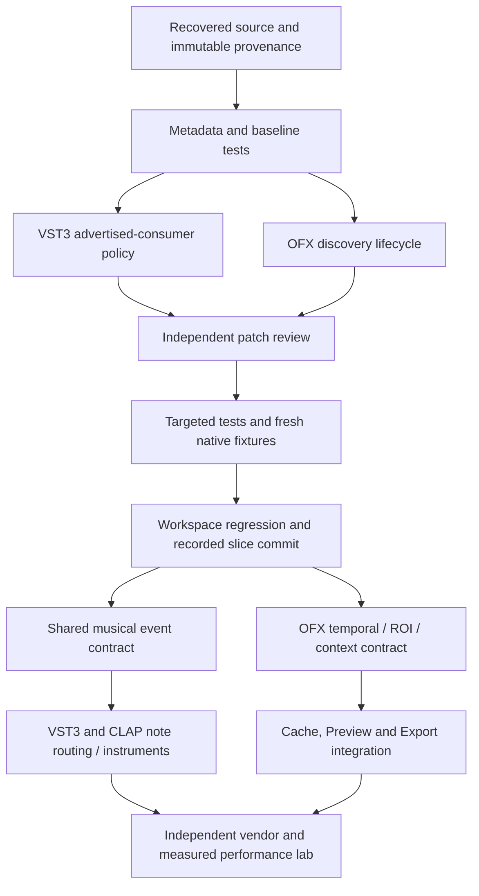

# Plugin host engineering sprint

Updated 2026-10-13 (Asia/Shanghai). This is the recoverable coordination record
for the OpenFX / VST3 / CLAP sprint. Detailed contracts remain in the existing
[plugin architecture](../architecture/plugin-system.md),
[audio pipeline](../architecture/audio-pipeline.md),
[audio standard matrix](native-audio-standard-features.md),
[OpenFX standard matrix](native-openfx-standard-features.md), and
[compatibility evidence](native-plugin-compatibility.md). Source capability and
historical qualification are distinct; stale matrix rows must be checked against
their actual consumer before changing a support claim.

## Recovered baseline and evidence

The original isolated checkout was clean at `a1925ca`, an ancestor of the prior
`a808891c8c91d122798c01ec633202c08ca2d9eb` worktree. The coordinator created
`feature/plugin-host-sprint` at that prior base and restored its retained tracked
and untracked production sources, rather than reimplementing its native adapters.
The source worktree at `E:/dev/mondrian/.claude/worktrees/nle-backlog` remained
read-only. Recovery verified all 2,100 source file hashes; 817 files required
copying and one obsolete file required removal. The original destination is
recoverable from `.scratch/plugin-host-sprint/source-recovery/pre-recovery.zip`.
The manifest and pre/post stability evidence are in that directory's
`receipt.json`. Recovery checkpoint `13fefdf33747a907a25075d7449c1f473a9264e9`
records that snapshot separately from this round's changes. An alternate index
staged only the recovery manifest; the real index was aligned without touching
working files. A pre-existing empty index lock was removed only after checking
the exact path, absence of Git processes and unchanged parent index. All 2,100
original and 1,772 current source hashes remained stable. The checkpoint is not
a native acceptance claim.

Current round evidence:

Source-numbered sections retain their historical source and artifact identities.
Source42's six expected negative OpenFX observations have independent acceptance
`23BEBC34...`; this accepts defect reproduction, not passing compatibility tests.
Source44 retains Source43's six-line native correction and adds a test-only
exact factory-budget correction. Its fresh full1796 cohort `89B37442...` has
passed the original Main13 and Supplemental13 native groups, two real BitCrush
rounds with 18 bit-exact Float32 rasters, 2778 ordinary App tests and strict
workspace/all-targets/all-features Clippy. Independent acceptances are
`442E684E...`, `897FEF69...`, `3C22F360...`, `00FFEAF7...` and `D3DA3245...`.
The old Source43 supplemental failure remains preserved as historical evidence.
These are finite Windows CPU and regression qualifications; they do not upgrade
full standards, other platforms, GUI, native GPU interoperability or comparative
performance claims. Local commit `93f4865` records the reviewed implementation,
tests, fixtures and documentation.

Source45 records the CLAP structure diagnostic's historical TDD RED, not a
production fix or third-party compatibility pass. Fresh Audio producer
`F7E5C5A2...`, independently admitted by `1E06BFCC...`, binds freeze `200D12DB...`
and the current default-profile test image. Its controlled Lists preserve all
433 original names and 74 ignored cases, adding exactly four ordinary controls.
The sole consumer test fails with the original generic refusal instead of the
required fixed site, default field and direct bits (owned fixture: expected
`3FE0000000000000`, actual `3FF0000000000000`). Receipt `E08C610E...` preserves
native exit101, runner exit1, the failed positive gate and settled descendants.
Source46 GREEN now binds freeze `6FBD0947...` and fresh Audio producer
`A16273BC...`. The existing 180-second ordinary gate passed 363/0, with all 74
ignored cases explicitly excluded; actual receipt is `5007E297...`. Independent
inventory/output review `B5220B59...` confirms all 363 unique raw passes,
unchanged ignored membership and settled native owners. Fresh-product
real-plugin replay was still pending at that stage.
This diagnostic does not change the parameter comparison or state authority.
Scoped worker formatting passes. The broader workspace format check returned1
(`07A4A628...`) for four unchanged files: `openfx_host/resident.rs`,
`native_worker_ingress.rs`, `tests/native_host_log.rs` and
`tests/native_owner_binding.rs`. Source47 applies only canonical test-statement
formatting to these four files; freeze `FD9BE7A2...` retains all other 1792 source
hashes, including the CLAP diagnostic and native OpenFX implementation. The
workspace format check now passes (`C1FE6B16...`); the failed check is retained.
Fresh Audio producer `2C66BA06...` and actual PE `E39942DE...` are independently
admitted by `474909B8...`. The first full ordinary run (`D8BDC607...`) returned
362 passed and one failed: the binary-fingerprint oversized-file fixture could
not grow its file to 512 MiB plus one byte because Windows returned StorageFull
(OS112). It failed before the oversized-file rejection assertion. The original
test, 180-second budget and failed raw output remain unchanged. Retry r2
(`5C1A570A...`) passed 363/0 with the same source closure and test image after
bounded cache recovery. Independent acceptance `9640BAD5...` confirms all 437
names, unchanged 74 ignored cases, every ordinary raw pass and four settled
native owners; the original two-thread and 180-second settings are preserved.
Strict Audio Clippy with `--all-targets --all-features -- -D warnings` passed
(`265DE02B...`, independent `E0841061...`) with full source pre/post checks,
jobs1 and incremental0. Fresh locked metadata captures all 30 workspace
packages (`7CF4C99F...`); these checks assign no real-plugin compatibility or
performance qualification. Normal Product LAST r1 failed while compiling the
App library: `rustc-LLVM ERROR: out of memory` and `Allocation failed`, Cargo101
(`E56F7AE4...`, raw producer `92996F1E...`, log `25CC9EBC...`). The completed
source receipt binds the unchanged 1796-source freeze and completed pre/post
checks, with the unchanged normal
opt1/debug2 command. No new Product PE is qualified. The memory-allocation
failure does not by itself establish disk capacity, paging or another process
as its cause. A later independent disk observation reported 5.03 GB free on C;
its external cause is unestablished. Root made no OS, paging, cache relocation
or build-profile change. Unchanged normal Product retry r2 completed in 6m41s
(`EE8D78C4...`, producer `ACB17663...`, log `EE01F103...`), with one fresh normal
opt1/debug2 bin artifact and actual PE `737D53D7...` (95,336,960 bytes). Independent
artifact admission `709A77FC...` and actual DATA admission `06399951...` preceded
the two original real CLAP state/PCM rounds. Live memory observation `BD5F73D3...` covers
56 samples starting about 134 seconds after launch: minimum observed available
physical memory 1,154,785,280 bytes and API-reported available PageFile
402,751,488 bytes. This is partial observation, not a complete peak or an
explanation of r1's failure; the failed build remains retained.

Source47's two original Airwindows CLAP positive gates both failed; observation
receipt `A28FB237...` records both settled native101/runner1 outcomes without
changing the 180-second oracles. Round1 failed at the first partition1 startup:
the existing post-state/render-mode comparison reported index5, native ID
2944917345 on both sides, `default_value`, expected bits `0000000000000000` and
actual bits `378FFE4000000000`. This is the first concrete native structural
projection; it does not identify a plugin/host writer or prove either violated
the standard. Round2 reached the first partition1 but failed earlier at native
spec resolution because the discovery worker exited1, with no descriptor fields.
Neither round completed a PCM partition. Historical Source40's partition1/17
boundary must not be attributed to this execution. ObservationComplete is true,
DiagnosticCaptureComplete and ActualOriginalSelectedGatesPassed are false;
third-party compatibility remains failed and root-cause investigation continues.

The Source44 current artifacts remain recoverable on E. Resource preparation
preserves the failed cache-copy r1; its out-of-scope vendor/fixture counterpart
references were removed from a distinct r2 plan without expanding the main
target boundary. The actual r2 copy and literal cleanup retained all 83 selected
old RLIBs (648,787,832 logical bytes), with complete pre-unlink source/copy hashes
and retained-copy postchecks; independent custody is `3C9791D5...`. Two separately
verified product aliases were also released, with their E copies preserved.
Measured C free space was approximately 1.72 GB after the RLIB cleanup; logical
file sizes do not establish physical reclamation or comparative performance.
Before the Source47 retry, the two remaining content-matched Product aliases in
`target/debug/deps` were released after verifying both source files and both E
copies (`B85BDD32...`, independent `3D7294AC...`). Their Rustc placement paths
are not claimed as Cargo-reported filenames. After the retry settled, the three
old Source44 test PE aliases were also released with all six actual source/copy
hashes checked before unlink (`07016D4D...`, independent `789A2459...`). Their
retained E copies preserve recovery; they must be explicitly restored or rebuilt
before future execution. Measured C free space reached 1,189,961,728 bytes.

| Gate | Result | Scope |
| --- | --- | --- |
| Source recovery | PASS | Exact file hashes and stable source tree; no execution claim |
| Cargo metadata | PASS | Workspace/path package resolution; `.scratch/plugin-host-sprint/cargo-metadata.json` |
| CLAP source provenance | PASS | Official generated source/package identity; no runtime claim |
| Clack source provenance | RED then PASS | Audited metadata repair, original checker unchanged, 252 shipped paths |
| Audio baseline | PASS | 331 passed, zero failed, 50 ignored; `.scratch/plugin-host-sprint/audio-baseline-receipt.json` and log |
| Audio after VST3 declaration policy | PASS within library scope | 331 passed, zero failed, 50 ignored; `audio-after-vst-policy-r2.log`, native ignored cases remain separate |
| Shared domain baseline | PASS | Audio scheduling 8, Effects 327, Timeline 247 passed; one scheduling case ignored |
| VST3 consumer policy | PASS within COM scope | Five actual policy/instance/default/builder controls; native vendor initialization remains separate |
| Native lab process owner | PASS within Windows scope | 12 library tests passed, four fixture functions ignored; four new controls execute real owned child/grandchild processes |
| Strict workspace Clippy | PASS | All targets/all features, `-D warnings`, exit zero in 2m06s; 1,772 frozen source hashes stable; `workspace-clippy-r6-receipt.json` |
| Frozen lab controller | PASS within selected scope | Seven tests in three groups, 1,771 source hashes stable; five negative controls refuse wrong count/hash, duplicate ID, timeout and a live descendant |
| DXC build environment / renderer check | PASS within build scope | Original immutable API and SHA-256 checks executed; exact cached archive reused; `renderer-build-environment-r6.log`. No GPU output or performance claim |
| Fresh Basic / SessionProbe binaries | Verified within selected native cases | Fresh build r5 / freeze19: 15 original native groups; no full OFX/GPU qualification |
| Active native catalog shutdown | Verified within two controlled Windows cases | Actual discovery/describe worker retirement and native HANDLE exit; other GUI lifecycle remains separate |
| Independent vendor discovery | Verified within List/Probe/capture only | Airwindows CLAP/VST3 eight runs and Ring Out CLAP four runs; no full compatibility claim |
| Initial VST3 value restart consumer | Verified within owned initial/fresh-object controls | Commit0bd39c4; SDK10/10, prior native10/10, ordinary Audio332 and vendor269, independently accepted source26 |
| Signed-zero buffer fidelity | Verified within owned buffer controls and limited native VST3 replay | Source27 RED270/1 to source28 GREEN271/0; Audio332/0; Airwindows two rounds pass unchanged strict oracle; no SDK violation/performance claim |
| External native PCM | VST3 limited PASS; CLAP RED | Airwindows VST3 default-state offline bypass partitions1/17/64 and distinct finite non-bypass output; CLAP schema drift remains unresolved |
| CLAP read-only metadata / default state load | Verified within Ring Out two-round controls | Source29 Audio336/0, exact native2/2 and independent raw state/author/payload checks; existing core behavior, new verification gate only; no PCM/full-project claim |
| Periodic App ordinary regression | Verified within source29 default libtest scope | 2,778 passed/zero failed; exact ordinary inventory, current producer, 1,786 source hashes and four native Job retirements independently accepted; 124 ignored cases remain separate |
| External OpenFX CPU Filter | Verified within Source31/43/44 selected BitCrush Windows CPU Float32 cases | Each batch has two actual rounds, each one passed/zero failed; 18 bit-exact Float32 rasters across direct and existing graph execution, parameter changes and instance retirement; GPU/temporal/full OFX remain unqualified |
| CLAP input-note metadata / discovery staging | Verified within source32 owned metadata and ownership controls | Audio345/0, original11 plus3 new owner controls and two metadata rounds; strict workspace Clippy; no note dispatch/instrument/RT qualification |
| Source32 shared audio and real CLAP regression | PASS within existing finite workflows | Two rounds of five CLAP/VST3 sidechain/PCM/time/object cases and two real Ring Out metadata/default-load rounds; current host, separately retained historical fixture binaries |
| CLAP factory slot admission | Verified within source36 Windows controls | Cached count capped before List/Probe/Note traversal; two actual RED controls, six GREEN ABI-counter controls, ordinary351/0 and current native regressions;4096 is host policy, not a CLAP limit |
| Source36 audio regression | PASS within existing finite workflows | Ordinary351/0; owner14 and metadata2; original CLAP/VST3 cases10; real Ring Out metadata/default-load2; strict workspace Clippy. No new Note DSP, GUI, RT or performance qualification |
| CLAP parameter-refusal detail | Verified within source38 finite Windows controls | Original admission preserved; same rejected snapshot's first reason, unsigned ID/index and direct numeric bits; ordinary355/0 and two real failed Airwindows startup observations, without compatibility/root-cause qualification |
| CLAP startup refusal consumer sites | Implemented — Not Fully Verified | Source40 owned controls exercise three existing consumers; real Airwindows rounds failed without a tagged descriptor refusal, so third-party site capture remains unverified |
| CLAP structural mismatch detail | Verified within Source47 owned controls and one failed native startup | Four new controls, Audio363/0 and strict Clippy; original comparison/order/query count unchanged. One actual default-value projection captured; second round failed earlier without fields. Vendor PCM compatibility remains failed |
| Source40 audio regression | PASS within existing finite Windows workflows | Ordinary359/0; owner14 and metadata2; original CLAP/VST3 cases10; real Ring Out metadata/default-load2; strict workspace Clippy. Original vendor PCM gate remains failed |
| New performance/platform qualification | Not run | Historical results below do not transfer to new changes |

Clack's RED reproduced in both source and destination. The GUI wrapper differed
from its sealed `clap-gui-refusal-v1` preimage only in three method-chain line
wraps. The sealed manifest already identifies the current documentation bytes,
but its local metadata still held an older documentation hash. The note-port
source matched its declared unsigned-carrier delta while `shipped_files` retained
an old hash. Only `vendor/clack/PROVENANCE.json` and
`vendor/clack/LOCAL-FORMAT-CHANGES.json` changed. Runtime, upstream input and checker
bytes are unchanged. Original RED, metadata preimages, sealed witnesses and GREEN
are saved in `.scratch/plugin-host-sprint/clack-provenance-repair/`.
Original LF was restored to avoid a whole-file Windows newline diff; the dependent
raw receipt hash was updated without another semantic change. The unchanged
checker again passed 252 paths. Final provenance SHA-256 is
`e90ace85359e950ed8419cbb9ffdd4228770d4189d4320b24cf8a0bc3c0f53f0`.
This repairs source attribution; it does not qualify runtime compatibility.
Commit `c5337e5` contains only the metadata files. Commit `87db4dd` contains the
separately reviewed VST3 instance policy, and `3572a3c` the Windows lab owner.
The controller's later outer-wait fix remains a separate acceptance slice.

The prior `handoff-6oqHh9.md` records matching r584 strict checks and default-stack
workspace tests: 8,440 passed, zero failed, 303 ignored. Native r561 records 36
owned cases and GPU r562 records 10 portable plus seven actual RTX 3050/DX12
cases. Those results bind their exact source/artifact/environment hashes. Their
ignored, unexercised and platform limitations remain. Fresh compilation and
execution are required for this restored tree and every subsequent patch.

Literal include audit found 118 unique Rust `include_str!`/`include_bytes!`
inputs, all present and none ignored. No tracked symlink/submodule was found.
This is a source audit, not an exhaustive proof of dynamic runtime dependencies.
`.scratch`, `.claude`, `target`, generated DLLs and secrets were excluded from
production recovery. Historical receipts remain in the original evidence store.
Native build prerequisites include OCIO, FFmpeg, MSVC/ATL and pinned static DXC;
the source snapshot does not include their compiled outputs.

## Capability status

`Verified` means the stated boundary has matching executed evidence. `Implemented
— Not Fully Verified` means source exists without the required vendor/platform/
performance evidence. `Partially Supported` means an admitted finite subset.
`Unsupported` means no product execution contract. `Blocked` records a concrete
missing prerequisite, not merely unfinished engineering. No complete standard
has current-round `Verified` status.

| Format / capability | Status | Boundary and acceptance still required |
| --- | --- | --- |
| VST3 discovery, class/fingerprint, supervised worker | Implemented — Not Fully Verified | Repeated actual load/unload, errors and permitted vendor corpus |
| VST3 PCM/buses | Partially Supported | Float32 product, mono/stereo main, up to 31 admitted same-layout auxiliary inputs; mixed/surround and multiple outputs absent |
| VST3 sample-offset parameters | Implemented — Not Fully Verified | Normalized bounded queues; native output, saturation, allocation and full callback deadline gates |
| VST3 state | Partially Supported | Bounded component/controller envelope; arbitrary DSP checkpoint not implied |
| VST3 transport | Partially Supported | Exact signed signal sample/rate; unavailable musical facts remain unavailable |
| VST3 MIDI/notes/instruments | Unsupported | M1 supplies the canonical Note author model and persistence; native event/instrument execution is not implemented |
| VST3 GUI | Partially Supported | Windows same-object editor path; later destructive entry, DPI/focus/keyboard and vendor matrix pending |
| VST3 dynamic reprepare/PDC | Partially Supported | Cohort/hold/seed controls; canonical installation and retained author acceptance pending |
| VST3 complete vendor/platform certification | Blocked | Limited independent Windows discovery/metadata/state controls exist; repeated stress, broader vendor behavior and other platforms remain unqualified |
| CLAP discovery, descriptor/fingerprint, supervised worker | Implemented — Not Fully Verified | Actual repeated lifecycle and vendor controls required |
| CLAP audio ports | Partially Supported | Admitted Float32 mono/stereo main and auxiliary topology; notes/instrument/multi-output contracts absent |
| CLAP parameter events | Implemented — Not Fully Verified | Plain scalar values, ordered bounded carrier; full allocation/deadline and author closure pending |
| CLAP state | Partially Supported | Bounded state/configuration; state seed is not proven DSP continuity |
| CLAP transport | Partially Supported | Exact signed seconds; musical time/tempo-map facts unavailable |
| CLAP note/MIDI/polyphonic modulation | Unsupported | M1 supplies the canonical Note author model and persistence; note-port dispatch, voice ownership and instruments remain pending |
| CLAP GUI/main services | Partially Supported | Windows same-object roles/timers exist; exact callbacks and native platform loops need separate gates |
| CLAP sleep/request-process scheduler | Unsupported | Callback presence alone does not schedule sole Audio DAG |
| CLAP dynamic ports/latency/restart | Partially Supported | Sticky request/control path; actual canonical graph candidate installation unfinished |
| CLAP complete vendor/platform certification | Blocked | Independent Windows corpora include Airwindows, Ring Out and Surge XT Effects; finite discovery/metadata evidence does not certify processing, GUI, instruments or other platforms |
| OpenFX Filter CPU execution | Partially Supported | Current-frame full-frame progressive RGBA Float32 Source/Output, resident instances and explicit alpha contract |
| OpenFX numeric/text/resource parameters | Partially Supported | Canonical curves/transactions; spatial/hierarchy/custom/dynamic/plugin-origin edits incomplete |
| OpenFX Generator/Transition/General/Retimer | Unsupported | Do not adapt these silently to a single-input Filter |
| OpenFX temporal images, ROI/RoD, tiles/multiresolution | Unsupported | Full-frame current-time subset; scheduling/cache dependencies must be added before advertisement |
| OpenFX components/depth/fields | Partially Supported | Declared CPU Float32/progressive subset; mixed formats/fields/PAR admission remains explicit |
| OpenFX required/aux/thread suites | Implemented — Not Fully Verified | Native ownership/callback evidence finite; full vendor suite conformance is unqualified |
| OpenFX overlay/interact | Unsupported | A descriptor/API presence is not a product interactive workflow |
| OpenFX GPU interoperability | Unsupported | wgpu numeric Mix is not an OpenFX GPU Suite; no native-resource/sync contract |
| OpenFX discovery shutdown in qualified Windows cases | Verified | Actual blocked discovery/describe Host Drop settles child and thread without publication; OS-wide failure/latency guarantees remain unqualified |
| OpenFX full vendor/platform certification | Blocked | Official Basic, owned SessionProbe and third-party BitCrush have finite Windows evidence; BitCrush qualification is limited to Source31/43/44 selected CPU Float32 Filter cases; other contexts, temporal/GPU workflows and platforms remain unqualified |

The `Verified` category applies to source recovery/provenance and the finite
current Windows COM and process-supervision controls above. It does not upgrade
whole format capabilities. Historical narrowly verified host cases remain recorded
with their original receipts in `native-plugin-compatibility.md`; they are not
upgraded to full third-party compatibility here.

## Shared contracts and ownership

Keep one author Session/transaction/history authority and exact occurrence IDs.
Plugin output observations are execution feedback until an explicit canonical
author transaction accepts them. A state seed, local epoch, Bind or GUI view
does not mint a new installed owner, DSP position or accepted clock anchor.

Audio uses the existing typed Routing DAG, prepared PDC, sample-rate/block/mode
admission and signed signal time. VST normalized values and CLAP plain values
remain distinct adapters. Note events require one future canonical time/bus/
payload contract before either format introduces product event routes. Main/UI
affinity, symbolic audio role and physical scheduling registration are distinct.
Realtime/offline requests must reach actual native preparation.

Video uses the compiled Effects graph and existing Renderer/Cache authority for
both Preview and Export. Render requests carry exact occurrence, time, scale,
extent, pixel/alpha identity, generation and cancellation. Native image ownership,
temporal requests, ROI and cache invalidation must extend that authority. Native
GPU handles require an independently negotiated resource and synchronization
contract. CPU transfers may be measured; zero-copy must never be inferred.

Parent Session owns resource grants and root checkpoint/deadline. Known native
buffers/SDK owners are measured under that grant; arbitrary plugin heaps, OS/CRT,
thread bookkeeping and unmeasured SDK ownership remain explicit frontiers.
Operation timeouts protect recovery; they do not certify audio deadlines.

| Owner | Exclusive responsibility | Concurrent write exclusions |
| --- | --- | --- |
| Coordinator | Git, source recovery, Cargo/native execution, shared contracts, integration | All writes paused during source/artifact qualification leases |
| Audio slice agent | VST3 instance-local immutable `IPlugInterfaceSupport` policy, loader propagation and independent COM tests | No Audio DAG/Session/protocol/SDK rewrite |
| OpenFX slice agent | Cancelable discovery/describe, correct packaged helper, catalog worker/child settlement, owner-thread definition registration and controls | No Render Graph/pixel/suite-domain redesign |
| Independent verification agent | This record; Clack provenance metadata repair; read-only review of final slice patches | No runtime source changes or Cargo execution |

This round uses disjoint module ownership within the already isolated worktree;
it does not claim per-agent worktrees were created. Contract changes require the
coordinator to approve scope, dependent consumers, migration and regression gates.
Expensive builds are serialized by the coordinator.

## Compatibility lab

The initial inventory is `.scratch/plugin-host-sprint/plugin-inventory.json`.
The installed Coda VST3 shell was found, but version/authorization/class inventory
and execution remain unverified. Duplicate package copies are one binary/class
identity, not extra test coverage. Owned fixture DLLs and the SDK Basic OFX sample
exist under the prior target directory; their historical hashes do not prove
fresh matching build selection.

The following 24 planned objects prioritize different boundaries. They are a
candidate queue, not 24 installed or compatible plugins. Owned/SDK objects remain
separate from independent vendor counts. Each format build and plugin class must
be inventoried before execution; external candidates are not silently installed.

| Object | Kind | Primary purpose / entry dependency |
| --- | --- | --- |
| CLAP sample gain | Owned fixture | Scalar events and range/partition PCM |
| CLAP sidechain | Owned fixture | Auxiliary mapping, delay, state and partitions |
| CLAP output probe | Owned fixture | Bounded output parameter/event observations |
| CLAP process author | Owned fixture | Native-origin author transaction closure |
| VST3 sidechain | Owned fixture | Bus mapping, state/delay and partition PCM |
| VST3 editor | Owned fixture | Same-object HWND and first-signal state |
| Stateful VST3 gain | Owned fixture | Component/controller state round-trip |
| VST3 Gain bundle | Reference fixture | Bundle resolution and repeated lifecycle |
| OpenFX SDK Basic | Official sample | Declared Filter processing and image law |
| OpenFX contract fixtures | Owned fixture family | Error/ownership/callback/teardown boundaries; individual IDs must be recorded |
| Coda VST3 shell | Installed independent candidate | Shell classes, discovery and permitted state/GUI execution |
| Surge XT instrument, VST3 | Independent candidate | Requires musical events and instrument output routing first |
| Surge XT instrument, CLAP | Independent candidate | Note lifecycle and polyphonic modulation after shared contract |
| Surge XT Effects, VST3 | Independent vendor; Windows discovery verified | Two identical native Lists at1.3.4; Probe, processing, state and GUI pending |
| Surge XT Effects, CLAP | Independent vendor; Windows discovery verified | Two identical native Lists at1.3.4; Probe, processing, state and GUI pending |
| Chow Tape Model | Independent candidate | Nonlinear PCM, state and automation; inspect actual format build |
| BYOD | Independent candidate | Complex state and processing graph; VST3/CLAP artifact checks |
| DPF example effect | Independent framework reference | Second implementation stack; choose actual built descriptor |
| DPF example instrument | Independent framework reference | Zero-input/event admission after shared contract |
| openfx-misc Blur | Independent candidate | Spatial/ROI/tiles and exact image comparison |
| openfx-misc ColorCorrect | Independent candidate | Float HDR/negative/alpha and colour contract |
| openfx-misc TimeBlur | Independent candidate | Temporal image requests and caching |
| openfx-misc Merge | Independent candidate | Required multi-input General context |
| openfx-misc Transform | Independent candidate | Bounds/ROI/PAR/multiresolution and interaction |

Primary project sources checked for candidate selection:
[Surge](https://github.com/surge-synthesizer/surge),
[Surge CLAP capabilities](https://surge-synthesizer.github.io/clap/),
[ChowDSP products](https://chowdsp.com/products.html),
[DPF format build targets](https://github.com/DISTRHO/DPF/blob/main/cmake/DPF-plugin.cmake),
[openfx-misc](https://github.com/NatronGitHub/openfx-misc).
These sources establish candidate projects, not local binaries or compatibility.
Choose immutable release/commit/license inputs when provisioning; no third-party
core code or license constraint is imported by this candidate list.

Every result records binary/class/version/SDK, source and artifact hashes, license
and activation, OS/CPU/GPU, input/parameters/rate/block/pixel format, selectors,
actual output, repetitions, failure/cleanup and performance. Native tests use
matching fresh helper/fixture artifacts, run serially and explicitly select
ignored cases. Ordinary unit success does not execute these cases.

## Acceptance gates and priority risks

Each slice needs a reviewable diff, independent semantic oracle, matching build,
targeted regression and explicit unresolved boundary. Preserve RED failures;
do not refresh identity metadata until each source delta has independent evidence.
Before integration, test cross-module lifecycle, state and Preview/Export contracts.
Run periodic workspace fmt, strict Clippy and all-feature tests; ignored cases
remain separately reported. Finish a verified slice with an auditable commit.

Highest priority risks are truthful capability advertisement, OFX discovery
children/dispatch, incomplete native author/reprepare installation, and absent
musical event routing. Follow with GUI thread/lifetime controls and callback
allocation/IPC deadline measurements. Existing zero-feedback budget controls do
not certify the known nonzero-feedback capacity-growth frontier. GPU Mix only
admits its documented Coverage/Opaque targets; Float alpha refusal remains.

Historical CPU HD/UHD Mix misses frame deadlines. Cold GPU pipeline creation is
material; 16/64-size eight-sample costs do not qualify full-frame playback/export.
Audio MMCSS admission is not callback deadline evidence. Measure actual whole-root
DSP, IPC, preflight, handoff and copies at declared sample rates/blocks with
p50/p95/p99/max and misses. Compare matched plugin/input/hardware/quality against
the restored baseline and a permitted mature host; a 10% target is provisional,
not a universal certification line.

Windows source and owned native evidence do not qualify Linux/macOS. The existing
environment has FFmpeg 7/libavcodec 61; release guard requires FFmpeg 8/62 and must
remain enforced. OCIO native prefix and ATL/pinned DXC downloads are build
prerequisites, not product semantic fallbacks. Physical DAC, full modal/save/reopen
workflows, whole-App RSS and commercial activation remain separate evidence needs.

## Recoverable 30-day cadence

Day 1–3: recover/audit real sources, reconcile provenance, baseline tests, freeze
shared contracts and complete independent lifecycle/capability slices. Day 4–12:
prioritize shared event/transport contract, audio notes/instruments/buses/state and
native author/reprepare closure. Day 13–21: contexts, temporal images/ROI/tiles and
Preview/Export/cache integration; independent OFX work may start earlier. Day
22–26: permitted vendor corpus, repeated lifecycle, platform verification and
measured bottlenecks. Day 27–30: stop discretionary feature expansion, regressions,
risks, evidence and final five-state matrix.

These are engineering phases, not a claim of continuous unattended execution.
Each resumed cycle reads this record, receipts, Git status and the last accepted
slice before selecting the next dependency-ready task. No recurring automation
has been created by this document. Coordinator updates evidence/status when a
gate actually finishes; pending work must never become `Verified` by elapsed time.

## Independent review record

The initial Clack recovery RED is independently explained by sealed source
preimages, not a new semantic source delta. `clack-provenance-repair/` retains
source/destination RED, both old metadata files, sealed GUI/document/manifest
witnesses and a GREEN receipt. GUI preimage SHA-256 is
`58c4e6de6964c2021a5a464df2577ab992b5026ced04b7e80c9eed4de20935b3`;
current unchanged runtime SHA-256 is
`3e240c8241083251efc521bb00f7186b2dbdc650f4dfe716fcb423fbf3652efb`.
The diff has only three whitespace line-wrap changes. Current document hash
`bc1801148ce69b8d375fd07c00ded9fa248f242c98499e3b46e41918855e5158`
matches the sealed package manifest. Note-port hash
`306ac1f8042b2d42d6a138b9ef3827b8be4cc11def6d530f6a7d03cca613d20f`
already matched its declared source delta. The immutable input receipt/tree and
checker hash are recorded unchanged in GREEN. The initial repaired format receipt is
`00a7eebb54007548132996a6ec7320b31aaac7262bc9e9a26b613086b946cf83`.
Preserving baseline LF yields final raw receipt hash
`616b67d39bbd90ef55eacfc6a577a07959e035084e452097cbf1df241ed0ec1f`;
independent JSON-leaf review confirms the same approved semantic changes.

The first read-only lab-runner review found two pending issues. Its parent
`WaitForExit` deadline did not bound subsequent asynchronous output drain when
an already-exited parent leaves inherited pipe handles in a child. Parent exit
and complete output drain require separate bounded outcomes; killing a live
parent tree does not prove normal-exit child settlement. Its final manifest hash
also reread the mutable input file rather than hashing the frozen evidence copy.
The controller now delegates to the existing validation launcher's native Job
owner: suspended spawn, assignment before resume, kernel active-process counts,
termination even after parent exit, and bounded cleanup. Logs are create-only
files. Frozen manifest bytes define the receipt digest. Independent follow-up
also found and corrected late-exit acceptance and duplicate group overwrite.
The matching `lab-frozen-r2/receipt.json` passes three groups/seven tests with
1,771 source hashes stable. `lab-negative-controls-r2.json` records actual refusal
of wrong counts/hashes, duplicate IDs, a deadline and a parent that exits with a
live child. The last two include actual native Job settlement evidence. These
controls qualify Windows test supervision; they do not establish full native
plugin compatibility, arbitrary OS failure recovery or real-time performance.

A later audit found two indefinite waits in the PowerShell fallback for a hung
runner. The follow-up removes them, uses one bounded observation budget, preserves
errors and requires the native Job receipt for descendant settlement. Killing
the runner does not prove tree settlement or impose a hard bound on the operating
system's kill operation. Actual `controller-followup-r3/summary.json` passes
nine positive controls (four process-owner controls and five COM controls) and
rejects wrong counts, a live descendant, a deadline and a deliberately hung
outer runner. The last case failed after 11,088 ms, observed runner exit during
seven ms of cleanup and retained the missing native-owner receipt as a failure.
Independent review checked receipt hashes and raw native flags. These results
qualify this finite Windows supervision behavior, not a hard OS kill deadline.

VST3's five real COM/policy controls passed after the original declaration RED.
OpenFX's four direct-child controls passed after the original cancellation RED.
Independent review also found and corrected a missing checkpoint argument in
the resident preparation caller; the first workspace Clippy run was canceled
before product checking to preserve a single-source build. This is a canceled
gate, not a passing check or an executed compiler failure. App/native Basic and
active catalog shutdown still require the integration gate.

## Current integration and next contract

The second and third strict workspace Clippy attempts stopped in the external
DXC build script: system curl could not acquire Schannel credentials. They did
not diagnose product code and are not passing gates. An actual Rust 1.97.1
resolution probe confirmed that the build executable directory precedes the
system directory when no child PATH is explicitly supplied. A task-local curl
launcher forwards literal arguments to installed Git OpenSSL curl. The live
release API still reports an immutable release. For the one exact archive URL,
an explicit cache binding copies the actual existing 26,115,841-byte archive;
the unchanged build script verifies its SHA-256
`2db15ab14e6eee9b9931d75d1690b4f7d81cad446fecccfe4e36e218dee25cce`
before extraction/linking. This round did not download a new complete archive.
The slow renderer attempt was canceled before the cache-backed successful check.
Registry sources and upstream checks were not patched. Task-local launcher,
probe, cache preflight and independent review receipts remain in `.scratch`.

The fourth strict Clippy attempt exposed an omitted resident `std::thread`
import and a test's invalid `PropertyBag::new` call; both were repaired without
changing their contracts or assertions. The fifth rejected the deliberately
orphaning negative fixture. A scoped `expect(clippy::zombie_processes)` documents
that exact control's external Job owner and retains strict enforcement for the
rest of the code. The sixth workspace attempt passed. The owner suite then
passed again: 12 tests, zero failures, four explicitly ignored fixture functions.
Neither compilation nor these supervision controls qualify native plugin output.

The OpenFX fixture now has explicit test-only modes that block inside actual
`OfxSetHost` or `Describe`, after validating host capabilities and recording a
native PID. The Windows AppUiHost tests dispatch the real install action, retain
the native child process and catalog worker thread handles, and invoke the real
Host destructor once. Both objects must signal exit; registry revision and an
isolated preferences file must remain unchanged. A five-second Drop gate is
below the original discovery/describe timeouts and distinguishes cancellation
from merely waiting for them. It is a broad integration gate, not a real-time UI
guarantee. Failed tests require the external lab Job owner; cleanup cannot turn
a failure into a pass. Fresh native controls passed: first-run discovery and
describe Host Drop took 19 and 22 ms respectively, with actual process/thread
handles signaled and no registry/preferences publication. Repeated frozen gates
also passed. These observations do not establish a universal latency bound.

App/native build r2 completed successfully in 13m05s. The first native execution
passed 12 of 15 selected groups before an inherited NaN test expected the wrong
error variant. A diagnostic-only rerun retained that failing assertion and
captured `Frame(InvalidSample { index: 7, alpha: StraightFloat })`. Independent
review proved the canonical validator and error variant unchanged from recovery.
The test now checks that exact typed refusal; no production validator changed.
Native execution r2 passed 13 groups, including that strict NaN control, then
exposed a real resident lifecycle defect: admission returned `Canceled` without
retiring the instance, so the following render still succeeded. The original
retirement assertion remains; the local fix retires on admission cancellation or
deadline and adds an equivalent deadline regression. Invalid authored frame
errors, output resource refusal and user-blocked semantics retain their existing
handling. Native execution r3 passes all 15 groups across eight exact selectors,
with 1,773 frozen source hashes stable and every Job report proving zero exit,
no errors or outliving descendants and complete settlement. Independent
acceptance is `ofx-native-r3-independent-acceptance.json`. Both failed native
runs remain preserved under `.scratch/plugin-host-sprint`. Strict Clippy must be
rerun after the new admission change.

The ordinary App library regression first exceeded a 15-minute serial budget.
The second run completed in 691.70 seconds with 2,836 passing tests, four failures
and 121 ignored tests. All four failures were the new direct-child supervision
controls; the Job reported exit 101, no deadline, no errors and complete cleanup.
The same App executable starts both ignored child fixtures correctly when launched
directly. A minimal Rust reproduction subsequently proved that the inherited
Windows environment contains different `PATH` and `Path` values: rebuilding that
environment for a child folds the keys and loses the prepended FFmpeg DLL path.
Changing output redirection or process creation flags did not resolve it.
Normalizing the outer launch environment with `ProcessStartInfo.Environment`
then passes all four original controls in 0.95 seconds, without changing source,
assertions or their five-second readiness budget. A frozen lab repeat also passes
four controls with zero ignored tests. This finite result does not substitute for
a fresh complete App regression. Raw RED, environment folding and GREEN evidence
are retained in `app-child-entry-diagnosis-r1` and
`ofx-child-supervision-frozen-r2`. Separately, 18 ordinary OFX module tests pass;
their selectors did not include these four new child controls.

Fresh audio fixture compilation exposed a non-Send error returned from a scoped
CLAP background log thread. The fixture now transports an owned error string and
converts it back on the caller; SDK and host threading remain unchanged. Both
native fixture builds and the audio library build completed. The first selected
CLAP native PCM lifecycle gate nevertheless fails because `start_processing`
returns false. The original predicate required audio callbacks to also be main
callbacks. A complete diagnostic record now proves the first failure was
`start_processing`: main=false, audio=true, prior validity=true and actual DLL
ThreadId(1) -> ThreadId(3). The initial teardown-only publication produced empty
files; a later run also failed earlier at bounded validation shutdown. Both
remain preserved. Temporary fault-path file instrumentation was used only for
diagnosis and has been completely removed from the current fixture.

The corrected fixture checks main identity against its own initialization
ThreadId, accepts audio on either physical thread and accepts main or audio for
Tail. All original PCM/state/bus algorithms and sticky refusal remain. Its one
table test covers 54 role/identity assertions and passes. Native execution r2
then passes four groups: CLAP and VST3 PCM lifecycle and signed signal time. The
fifth VST3 object-binding group fails because it assumes the very first Enter
reloads the initialized object, whereas the worker explicitly preserves that
object on first entry. The second round is unexecuted. A separate CLAP native log
gate fails an assertion that object observation is unavailable, although the
current adapter returns an actual object. These tests require contract review
and fresh strict replacements, not removal of their binding/log/PCM assertions.
The complete audio matrix remains unqualified. Diagnostic builds and these
functional timing observations are excluded from realtime/performance acceptance.

Independent review also confirmed a separate retained risk:
`ProcessOwner::terminate` ignores a kill error before waiting unconditionally.
An OS refusal while the child stays alive can therefore strand a resident
caller. The external lab Job bounds test recovery, not the product method.
This requires its own settlement slice and is not qualified by successful
normal-OS cancellation tests. No full production lifecycle claim is made.

The next audio contract is canonical Note routing, followed by a real input-free
instrument graph role. A native zero-input admission change alone would still
inherit the current main-PCM contribution and its latency and cannot qualify an
instrument. Note author data must remain in the sole Sequence AudioProgram,
with exact TimelineTime, target instance and definition-owned note-input identity;
compiled/prepared sample schedules are derived execution state. Event capacity,
ordering, continuity epoch, seek/preroll and releasing voices need explicit
admission and independent PCM oracles before adapters are expanded.

CLAP second-based Note routing can be verified as a first finite slice. VST3's
event PPQ position has no unavailable flag and requires a real musical projection;
the standalone vendor Timeline or an invented 120 BPM must not become product
authority. VST3 separate parameter queues and event lists also cannot promise
CLAP's cross-kind FIFO. The common contract can preserve same-sample application
and stable order within each stream. No project schema, musical map or shared
event API change is approved by this investigation alone. The detailed coordinated
change request is `.scratch/plugin-host-sprint/note-routing-contract-proposal.md`.

## Integration checkpoint: accepted slices and outstanding native shutdown

Accepted commits are `ae00fa2` (exact typed NaN refusal assertion), `04ae31a`
(catalog cancellation and worker settlement), and `c4debc6` (resident admission
cancellation/deadline retires the instance). The normalized full App regression
now passes **2,840 / 0 failed / 121 ignored**, in 726.87 seconds. Its source,
artifact and normalized Windows environment binding are preserved in
`.scratch/plugin-host-sprint/app-lib-regression-r3`. The earlier four failures
and serial timeout remain recorded; environment normalization is part of the
lab launch, not a product compatibility workaround. Workspace strict Clippy r7
and audio strict Clippy r8 both pass.

Two stricter audio test corrections are independently reviewed:
VST3 first Enter retains the initial object and second Enter must replace it;
CLAP log observations retain the actual initial native object identity. All
original PCM, stale-binding and complete log assertions remain. Eight earlier
finite PCM/signal-time groups passed across two rounds. The fresh r3 matrix
passes seven of ten groups, including the corrected VST3 object test, before
CLAP factory validation shutdown fails again. The corrected CLAP log gate also
fails at factory creation. Neither run qualifies the complete matrix. Temporary
parent-libtest diagnostics preserve the original shutdown budgets and observe
ACK versus process exit; diagnosis and any lifecycle contract change are pending.

The finite fixture and test-oracle slices are subsequently committed as
`b882d53` and `70522b3`; temporary supervisor diagnostics are excluded. Eight
serial diagnostic groups pass, with 56 normal shutdown records and actual exit
observed in 57.634–79.390 ms. A separate two-stream native stress run completes
18 groups (17 passing, one failing during factory validation). Three complete
records show `Completed` ACK in approximately 0.3–0.4 ms followed by the original
100 ms post-ACK exit deadline and forced cleanup. The failed factory's Job still
settles its process tree. Passing groups can contain failing Drop shutdowns and
are not graceful-lifecycle acceptance. The child subphase and natural exit time
after the original cap are unknown because forced termination interrupts them.
A second diagnostic-only shadow observation retains the original failure
verdict, delays cleanup by at most an extra second and records natural exit
separately; it is not a production budget change or realtime qualification.

Real third-party Airwindows Consolidated **1.2026.285**, publisher commit
`8a67b80e04230a5cf40e84d6e8b9a2fd70b13a75`, completes two List and two Probe
runs for each of CLAP and VST3 on Windows x64. All eight native Job reports
have zero exit, no deadline/errors/outliving descendants and complete settlement.
Each format reports 14 parameters, latency zero and tail 96,000 samples. Opaque
default state capture is 314 bytes for CLAP and 373 bytes for VST3. Evidence is
`.scratch/plugin-host-sprint/airwindows-native-discovery-r1/receipt.json`
(SHA256 `5C9216E16338D49C14B0A21B4A7E820B51612736F6AF996BF03ACCAF951902E9`).
Only these finite discovery/initialization/capture cases are verified. PCM,
state restore, GUI, project integration, realtime safety, comparative performance
and complete format compatibility remain unverified. The package is a private
external lab input; its complete binary license composition remains unverified.

The OFX kill-refusal fix is implemented only in an isolated worktree and awaits
independent review, fresh builds and seven Job-contained native controls. It
separates Running / Retiring / Settled, retains the Child for cleanup retry, and
prohibits wait after an unconfirmed kill refusal. No native result is yet claimed.

## Current checkpoint: terminal reader and process retirement

The temporary parent Shutdown diagnostics were removed before freeze19. The
original 100 ms acknowledgement/exit policy remains. Two diagnostic shadow runs
observed four children naturally exiting with code zero at approximately
171–184 ms after the unchanged original failure verdict. These are diagnostic
observations, not altered production acceptance, realtime or performance results.

An independent actual TCP regression demonstrates a separate terminal-reader
bug: after acknowledged Shutdown, the original reader attempts another decode
while the connection remains open. The original behavior fails the new test;
the corrected reader returns after terminal acknowledgement and all eight reader
module controls pass. The scoped-thread cleanup guard closes slots and socket
before join on assertion/unwind paths. It proves loop completion, not an OS
thread-exit deadline, and does not explain every observed slow teardown.
Evidence and independent review are in `native-reader-terminal-r1` and
`native-reader-terminal-independent-review.json` under the sprint scratch store.

The OFX owner slice is now integrated. Its private Running / Retiring / Settled
state revokes admission before cleanup, never waits after an unconfirmed kill
refusal, and retains the same Child for retry. Freeze19 fresh App build r5 passes
15 original native OFX groups and seven new Job-contained retirement controls.
Independent source/producer/artifact/Job acceptance is recorded in
`ofx-freeze19-normal-and-retirement-independent-review.json`. The affected
ordinary OFX modules also pass 18 tests and the child supervision module passes
four controls. Kill-refusal controls inject errors around actual children; they
do not prove an actual OS ACL refusal. Successful OS kill/wait latency is not
universally bounded; permanent refusal can leave a live process after finite
Drop attempts. GPU interop and complete OFX compatibility remain unqualified.

Freeze19 Audio build r6 passes the full ten selected native audio groups and two
strict CLAP log groups. These retain PCM, bus/state, signed signal time, actual
object identity, complete callback logs and the original factory-shutdown gate.
Independent ten-group receipt is
`audio-freeze19-ten-gates-independent-review.json`. Passing processing groups
still cannot prove each ignored Drop shutdown returned true.

The ordinary audio regression on the same build is **RED: 327 passed / five
failed / zero ignored / 50 explicitly skipped**, in 20.18 seconds. The first
paused GUI test observes Active=1 and AcceptedEvents=0 instead of three; four
later tests fail from its poisoned fixture serialization mutex. An isolated
repeat passes without changes. Read-only review identifies a valid completion
race in the embedded fixture: the audio callback publishes ACTIVE_FLUSHES before
sending events, and main inspects the later event counter immediately. This
embedded path does not use the native reader or external worker. The correction
publishes that existing SeqCst count after exchange, preserving all event, PCM,
thread, Process-count and two-second assertions. Original RED and independent
source-bound review remain in `audio-ordinary-execution-r6` and
`clap-paused-flush-race-review-r1`. Fresh full regression is pending.

Strict workspace Clippy r9 refuses one nested-if warning in the new OFX fixture;
a semantically equivalent let-chain resolves it. Fresh freeze21 Clippy r10
passes all targets/features with `-D warnings` in 1m38s. Historical App full
2,840-pass regression predates these slices and must not be reported as a fresh
full regression of the current tree.

The audio process-owner r2 and generic external-vendor PCM/state test slices
remain isolated, independently reviewable deliveries. Neither has root build
or native qualification yet. The vendor test uses opaque captured default state,
canonical author parameters and plugin-owned Bypass for bit-exact PCM, with a
non-bypass discrimination control; default state alone cannot prove nondefault
state restoration. Upcoming admission must preserve the existing factory
shutdown failure rather than bypassing it. Current fresh binary bytes are saved
in `native-artifact-archive-r6` before further rebuilds.

Freeze21 Audio build r7 subsequently completes the full ordinary regression:
**332 passed / zero failed / zero ignored / 50 explicitly filtered**, 30.44s.
The fresh Job exits zero with no deadline/errors/outliving descendants and full
settlement. `audio-ordinary-execution-r7/receipt.json` binds the exact successful
summary, 1,773 source hashes and current Cargo-produced audio executable.
This supersedes the ordinary-test pending status above; the original r6 RED
remains. It does not execute the 50 native/installed ignored cases or qualify the
isolated audio owner/vendor additions.

The three accepted slices are committed independently as `afa6614` (terminal
reader), `9cff2bf` (OFX owner) and `586acde` (fixture completion). Subsequent root
integration changes audio supervisor/Cargo and adds the reviewed external vendor
test module; an offline metadata resolution adds only the existing workspace
tracing dependency to mondrian-audio's Cargo.lock entry. Freeze22 explicitly
includes the new source file (1,774 inputs). Strict build and all new native
qualification remain pending. Freeze21 gates are historical accepted artifacts,
not a claim that this newer tree matches their hashes. Exact existing App and
Audio executables were archived before rebuilding.

## Latest checkpoint: Audio owner and external vendor admission

Freeze23 contains 1,774 selected repository inputs (SHA256
`97A8F42DD3BA581EDD4291F6BFF8E6139C9026360DAF2079E22DF8DC1492CB69`).
Fresh default-feature Audio build r8 and App build r6 succeed. Strict workspace
Clippy r12 passes all targets/features with `-D warnings` in 1m40s. These replace
the build-pending status above; they do not certify plugin compatibility.

The integrated audio owner has private Running / Retiring / Settled states and
a startup guard immediately after spawn. It revokes admission before cleanup,
preserves the primary startup error, retains the same Child after unconfirmed
kill refusal, and forbids wait on that refusal path. Eleven actual Windows
Job-contained controls pass and have independent source/artifact/output review:
`audio-owner-native-eleven-independent-review-r1.json` (SHA256
`069C3D5CBC2D15721F2D67A7C791D946414ED6678CA21FE9F4BE2D51EFD8A6E3`).
Those controls inject operation errors around actual children; they do not
establish actual OS ACL refusal, bounded successful kill/wait, whole-tree product
containment, real SDK teardown, or realtime safety. Permanent kill refusal may
leave a live process after finite Drop attempts. The Running shutdown policy
and existing native factory-shutdown assertion remain unchanged.

Fresh `audio-native-execution-r7/summary.json` records **10/10 original native
audio groups passing** on this owner, across two rounds of CLAP/VST3 PCM,
signal/time and actual VST3 object lifecycle controls. Independent review is in
`audio-freeze23-ten-native-gates-independent-review-r1.json` (SHA256
`3302EFF8B9A1343B300873D6EF66044E05EA8BD739645B7A8EF858D4BABB7217`).
Current ordinary Audio subsequently passes **332 / zero failed / zero ignored /
64 explicitly filtered**, 30.38s, with all actual test names matching the derived
ordinary set. Independent receipt
`source23-audio-owner-ordinary-and-inventory-independent-acceptance-r1.json`
has SHA256 `650174277E49458F3FBEF3259EF16A57AE22A045B2561940219FF1F1BE273C47`.
The owner slice is committed as `9ebc35c`. The generic external lab tests are
separately committed as `21f1827`, retaining actual vendor RED results. Full
current App regression is pending.

The generic external-vendor test uses actual opaque state capture, canonical
author parameters, native discovery/resolve, plugin Bypass and asymmetric PCM
with multiple block partitions. Its current four-case plan binds exact Airwindows
binaries and fresh product helper. Actual first CLAP execution is **RED: zero
passed / one failed**, before DSP: the resolver reports
`authored CLAP parameter contract differs from the plugin`. The Job exits 101
without deadline, owner errors or outliving
descendants; the failure is preserved under
`external-vendor-native-frozen-r1/round-1-clap-controller-evidence`.

The independent first VST3 case subsequently reaches factory validation and a
fresh native instance, but is **RED before PCM** at state entry:
`ReprepareRequired(Vst3Restart { flags: 4 })`. Current bindings identify this as
`kParamValuesChanged`. Its native Job also settles with exit 101 and no deadline,
errors or outliving descendants. Evidence is in the same generation directory's
`round-1-vst3-controller-evidence`; both second-round cases remain unexecuted.
The required parameter-authority/reprepare integration is under investigation;
the flag has not been ignored or reclassified as a successful entry.

The saved initial and bypass author snapshots differ only in Bypass automation
constant, zero to one; schema and opaque state are identical. Publisher source
contains an uninitialized default-value array with entries written only for
active algorithm parameters. This is a candidate explanation for fresh-instance
schema drift, **not yet confirmed by the actual failing descriptor**. Strict
schema admission remains intact. No plugin-name exception, default normalization,
fabricated state or relaxed output assertion has been introduced. Vendor PCM,
restore, GUI, performance and full compatibility are still unqualified.

Exact current Audio/App/OFX executable bytes are retained in
`native-artifact-archive-r8/receipt.json` before diagnostic rebuilds. These PE
archives do not establish the entire runtime DLL dependency closure. Raw logs,
plans, source hashes and independent reviews remain in the sprint scratch store;
this document is the Git-persisted coordination index.

Fresh App build r6 also passes all 15 original OFX native groups under the
unchanged controller (`ofx-native-execution-r7/summary.json`). Each actual exact
selector produces the required successful test summary and Job settlement.
No separate fresh selector-list preflight was executed in this run. The retained
old plan was correctly refused for stale source/marker bindings; a new plan only
rebinds the current source and fresh catalog marker paths. Independent review of
this new execution is recorded in
`ofx-freeze23-fifteen-native-independent-review-r1.json` (SHA256
`F9276459F19FE55E3E4F50CC0DC7EF9354E879FA66C8DA8271B2EBEBA8BFC4A3`).
Complete current App regression remains pending.

## Actual vendor diagnosis and next isolated slice

A temporary test-only same-refused-probe diagnostic was independently reviewed
and compiled as Audio build r9 / freeze24. The existing helper remains App6,
built from source23; it was not relabeled as a source24 product build. Actual
diagnostic attempts fail at different native gates: startup metadata admission,
discovery/restore, and then the existing strict restored-author assertion.
A third-case preparation error (missing required empty evidence directory) is
retained separately from its corrected continuation. No attempt passes PCM.

The corrected third continuation provides actual metadata drift: after one
successful restored author snapshot with default zero, a second fresh restore
reports parameter `2944917345` with default `4.5906537691281007e-41` instead of
`0.0`. The schema equality compares allocation contents, so differing diagnostic
allocation UUIDs do not explain the refusal. The test-only resolver diagnostics
did not print: this failure occurs earlier in the existing assertion. The value
is consistent with the publisher's uninitialized inactive default slot; complete
binary/source cause attribution remains an inference. Keep the strict refusal
and do not suppress inactive parameters or normalize the default.

Exact diagnostic executable bytes are archived in `native-artifact-archive-r9`.
Temporary diagnostics were removed and all 1,774 source23 hashes restored.
Cargo build r10 was **rejected as restoration evidence**: Copy-Item preserved an
older source timestamp, so Cargo reported fresh=true and reused diagnostic r9
bytes. Touching only the restored file timestamp forced an actual r11 compile
(fresh=false), producing SHA256
`8A7CE34E4E839533177A0A0365E1D7A205BA2765D2617741494F629FF40704AE`.
Original r10 logs/cache refusal and restoration proofs are retained. No restored
source claim relies on its stale executable.

Actual default App6 inventory contains 2,778 ordinary and 124 ignored tests;
historical 2,840/121 used the validation feature. Inventory alone executes no
tests. Bulk inventory tool r1 failed before child launch on a scalar --list JSON
argument; r2 corrects array serialization and provides the successful actual
inventory/Audio run. Tool r3 additionally guarantees cleanup attempts when
evidence publication fails; its syntax and extracted-finally fault controls pass.
These scratch tool changes do not alter production budgets or assertions.

VST3 restart flag4 has a documented initial control-consumer gap, distinct from
latency flag8. The existing latency service cannot consume it before first DSP.
Its reviewed CCR is in `vst3-param-values-restart-independent-ccr-r1`. A new
isolated worktree at `.scratch/agent-worktrees/vst3-initial-value-restart`
(base `9ebc35c`) owns only the VST3 adapter, narrow bounded controller-query
support and a dedicated SDK fixture. The accepted design supports pure4 only on
proven initial/fresh-reload control phases, preserves canonical author and
last-DSP authority, and retires only the exact observed cohort after all reads.
Runtime/mixed/newer/exhausted requests remain pending. Implementation, native
controls, independent review and actual vendor retest are still required before
integration. No shared domain, graph, schema or global time contract is changed.

## Restored executable regression and second corpus checkpoint

The actual source23 Audio r11 executable passes all 332 ordinary tests again,
with zero failures/ignored and 64 filtered native gates (26.60 seconds). Evidence
is `audio-ordinary-execution-r9/receipt.json`; actual four-Job inventory r3 is
`libtest-inventory-execution-r3/inventory-receipt.json` (SHA256
`1305CC6DD98881EAFC07B48EE9F498D05D5045B6E61953B529F68B5A115ECE6A`).
This binds the restored r11 producer and executable, rather than the rejected
fresh=true r10 build. Independent acceptance is pending. The current default
App6 ordinary regression is running in `app-lib-regression-r4`, against its
actual inventory of 2,778 ordinary and 124 ignored tests; no result is claimed
before its final output, source checks and native Job settlement.

The App r4 run subsequently completed successfully: 2,778 passed, zero failed,
124 ignored, zero filtered, 677.99 seconds. The runner and outer controller
exit codes are zero, native owner errors are empty, no deadline or outliving
descendants were reported, and descendants were reaped. All source checks passed
under 1,853 read leases. `app-lib-regression-r4/receipt.json` binds App6 SHA256
`68E8CB85254E5791F666247BD542AB45F3809B958C3863BC755E909799562D47` and source23;
ignored native tests were not executed by this ordinary regression. Independent
review is pending. Exact restored Audio11 bytes are now preserved separately in
`native-artifact-archive-r10`; accepted App6/product/OFX bytes remain in archive r8.

The isolated VST3 initial-value service is now frozen for review in
`vst3-initial-value-service-r1/delivery-receipt.json`. Its relative seed patch
SHA256 is `66944FF29064F29F0F6C02F0584EF25F3E9A3D1B6E2750B7A90DD45D16C99B6B`.
There are 15 owned paths, including five ignored actual SDK fixture controls.
Rustfmt parsing and pinned SDK provenance checks passed; no Cargo/native test
or root integration has happened for this slice.

The second real CLAP corpus is DuskAudio RingOut v1.0.0. Official ZIP SHA256 is
`9DEA8EC30F9F69362BF95F7FDD1108870F2982423953C9A46748C7E7DE8AC3E4`;
the extracted x64 CLAP SHA256 is
`DF86E10F2B0AADA4A3EB5F4F0BDA315A941960B587B4B9513CD7BA8A9F8BD99B`.
Static acceptance evidence is `second-clap-corpus-r1/static-candidate-acceptance.json`
(SHA256 `9041967F04688860B0B5EE62CB303CC7B57AE15894605048E2C91BB9892D7277`).
Only CLAP and actual license/notices were extracted; no installer or plugin
execution occurred. GPL-3.0-or-later plus ISC/MIT notices are recorded, while
complete binary composition remains unverified. Its 11 parameters include two
read-only meters, bypass smooths over 10 ms, and default processing can be
identity. These legitimate semantics make the existing first external PCM
slice ineligible. Preserve that gate and design separate read-only authoring,
controlled nondefault state and bypass-settling oracles before runtime claims.

## Initial VST3 value consumer candidate: actual first gates

Independent acceptance of the previous source23 ordinary Audio/App runs is now
recorded in `source23-audio-app-ordinary-independent-acceptance-r2.json` (SHA256
`ADE048B3048391F79BEF99D794DBAB3FF642C12E73E4A425F9AFE710B69D340E`).
Its 28 checks include exact executed names versus actual List inventories,
producer/profile identity and Job settlement. The source23 timestamped hash
snapshot was retained before later candidate writes.

The initial-value candidate is statically accepted in
`vst3-initial-value-service-independent-review-r2.json` (SHA256
`9ED4F81F4F0AD9D28644FCE8D2C96FEA22511A9239F3AF67C78475AB2FE03BFF`).
Root preserved LF in two existing files; other 13 snapshots remain identical.
Integration is a candidate, not an accepted feature commit. Freeze25 covers
1,785 inputs, including every owned fixture/license/provenance path; SHA256
`A03B96AB419323063AD2E80CD04B15D2CBE1D4D1D55606CCAF3ECD83BC83FAC7`.
Strict workspace Clippy r13 passed (2m11s), actual new SDK fixture build r1
passed, and Audio12/App7 builds passed with all 1,785 source read leases held.
Their `*-source-receipt.json` records producer/source checks. None alone proves
plugin compatibility.

Actual five fresh exact ignored List Jobs passed in
`vst3-initial-values-native-preflight-r1.json`. Actual positive SDK control1
passed: current values observed without setters/synthetic Process, followed by
expected PCM and sample-offset automation. Control2 is **RED**, preserved in
`vst3-initial-values-native-execution-r1-2`: Enter correctly returns the exact
pending restart request, but a subsequent direct Process assertion at line231
expects ReprepareRequired. The worker still has no accepted continuity anchor;
the existing signal path checks that anchor first. Independent diagnosis of this
new test's contract assumption is pending. No production error-order change or
test weakening has been made. Native owner exit101 is settled with no deadline,
outliving descendants or owner errors. Remaining controls, second round and the
external real VST3 retest have not executed; initial-only compatibility remains
Implemented — Not Fully Verified.

## Initial-value slice: source26 accepted SDK gates and external boundary

The source25 negative control exposed an incorrect direct-worker test assumption,
not a new production error-order defect. The existing signal contract refuses
Process without an accepted continuity anchor before inspecting restart flags.
Independent reports `vst3-initial-values-direct-process-contract-independent-review-r1.json`
and `vst3-initial-negative-test-source26-independent-review-r1.json` accepted the
test-only correction. Exact Enter refusal, pending cohort, author source,
query/setter counts, object identity and untouched PCM assertions remain; direct
Process now asserts the existing typed continuity refusal and retained state.
The original RED receipt and Audio12 executable remain preserved.

Freeze26 SHA256 is
`203C8D3777CB8E64A8919BEC4BCB85D0DD3BE6CB29EBBC487FD6E0C1FD005562`.
Only the new test changed from freeze25; the other 1,784 inputs are identical.
Strict workspace Clippy r14 passed. Actual Audio13/App8 builds passed under all
1,785 source read leases, with completed Cargo JSONL and source receipts.
App8 also compiled default integration targets; compilation does not qualify
their runtime, GPU, UI or release behavior.

Five fresh exact SDK List Jobs and all five controls in two rounds passed:
`vst3-initial-values-native-execution-r2/summary.json` records **10/10**.
Independent acceptance `vst3-initial-values-ten-native-independent-acceptance-r2.json`
SHA256 `824C854E3F42440A13D33F6EF9AD83DAF419F02D713FECE6E562C9EBCDCA1B0B`
checks actual producers, source/artifact bindings, exact selectors and settled
owners. This verifies the owned DLL's initial/fresh-only pure4 observation and
negative controls; runtime pure4, wider controllers, UI, real-time guarantees
and full third-party compatibility remain outside that scope.

Actual fresh inventory r4 contains Audio401 tests /69 ignored /332 ordinary,
and App2902 /124 ignored /2778 ordinary. Source26 ordinary Audio r10 passed
**332/0/0**. The original five native controls passed twice in
`audio-native-execution-r9/summary.json` (**10/10**). Their generator first
rejected a failed historical CLAP fixture producer before launch; regeneration
explicitly used the accepted CLAP r3 producer. That refusal is retained.
The previous full App ordinary run remains source23 evidence, not source26.

The unchanged strict Airwindows VST3 case now reaches actual first Enter and
DSP, and its native child exits0. It is still **RED**:
`external-vendor-native-vst3-initial-execution-r2-round1` records eight PCM bit
differences, all right-channel `-0.0` to `+0.0` in partition1. All nonzero samples
are bit-identical; partitions17/64, non-bypass discrimination and round2 were
not reached. Raw output/state/author/owner evidence and the bit analysis
`external-vst3-first-pcm-eight-differences-r1.json` are retained. The host's
numeric-zero silence optimization can canonicalize signed zero; pinned SDK
silence flags are optional and do not promise signed-zero preservation, so this
is not classified as a demonstrated SDK violation. A generic conservative
silence-detection fidelity change is under review; no normalization, plugin-name
special case, deleted assertion or compatibility PASS has been introduced.

Ring Out List/Probe preparation r1 remains unexecuted. Independent review found
whole-file hashing before response/owner size admission. A separate scratch r2
will repair that bounded-input guard before actual product discovery; Ring Out
PCM, state restore, authoring and GUI are still unverified.

Source26 standalone `vst3-host` no-default-feature ordinary regression passed
**269/0/0**, after actual fresh all/ignored inventories under native Job owners:
`vst3-vendor-ordinary-execution-r1/ordinary/receipt.json`. Build r2 used the
actual standalone manifest and all 1,785 source read leases. A preceding script
derivation accidentally retained the App command and was interrupted/rejected;
`vst3-vendor-build-r1-rejection.json` records it, and no vendor qualification is
derived from that output.

Ring Out staged preparation r2 received independent acceptance
`ring-out-discovery-plan-r2-independent-review-r1.json`, SHA256
`5CF44529CA7543F5C504CFC431A75288D48E7792FA77D0CC46FB3D1455774B85`.
Root then executed **two List and two Probe Jobs**, all passing with actual
App8/source26 and the accepted runner. The actual sole identity is
`com.duskaudio.ring-out`; discovery version is null and package version remains
the separately evidenced1.0.0. Probe retains all 11 parameters, including the
two read-only meters, and captured184 bytes of default opaque state. Round1
state SHA256 is `1CC8E19194558D2B72358549FDF9516FB41631A58B1D784EB95E70036095B7C1`.
Raw responses, states and owner receipts are in `ring-out-list-native-r1` and
`ring-out-probe-native-r1`; independent actual-run review is pending. This is
Verified only for those discovery/default-capture controls, not state restore,
PCM, bypass settling, project workflows, GUI, performance or full compatibility.

The finite initial-value slice's integrated gates received independent acceptance
in `initial-values-integrated-gates-independent-acceptance-r1.json`, SHA256
`144E44D8AC0ED78ECB8BE8C060A7A31EF43AD774FCAC71527308D78C3B074180`.
It binds1,913 evidence/source files, the unchanged source26, exact332 ordinary
Audio names,269 vendor names, both native control groups, and the earlier SDK
acceptance. The actual Airwindows signed-zero RED is explicitly retained; this
acceptance permits the limited initial/fresh-object slice commit and does not
qualify third-party compatibility or source26 full-App runtime regression.

Ring Out's four actual discovery/default-capture Jobs subsequently received
independent limited acceptance in `ring-out-native-independent-final-receipt-r2.json`
(SHA256 `49B783932E2A1389CDEAA40F2023E3FBB8DF40FC0D58B8798308D94AED2EF3A4`).
Both raw List responses and both raw Probe responses are identical; both opaque
states have the same184-byte length/hash. All four native owners exit0, report
no deadline/errors/outliving descendants and report descendants reaped. The
review binds the earlier exact source26 timestamped snapshot; subsequent
source27/28 buffer-test/policy edits are explicitly outside that qualification.
Root-observed controller exit0 returns are recorded separately from the
independently rehashed native owner proof. State restore and PCM remain untested.

The signed-zero regression is now experimentally established. Source27 adds
only two owned buffer tests. `vst3-signed-zero-red-execution-r1` records
**270 PASS /1 FAIL**, with flags7 versus expected1 on the preceding numeric-zero
policy; native owner exit101 is fully settled. The RED executable is retained in
archive r12. Source28 changes the same private scan's predicate to positive-zero
bits in all four f32/f64 input/output consumers, preserving native-declared
flags and existing missing/inactive behavior. Both new tests and the original
269 pass (**271/0/0**) in `vst3-signed-zero-green-execution-r1`. This demonstrates
the owned buffer fidelity policy, not full third-party or performance acceptance.
Audio/product rebuilds and unchanged real-vendor PCM regression are pending.

## Source28 signed-zero native acceptance and resource checkpoint

The actual source28 App9 product build completed in22m15s with exit0 and
all1,785 source read leases held. Its actual compiler-artifact is the Windows
`mondrian` binary, features[], test=false, fresh=false, SHA256
`2A60BF23C236F9BC0F9B9520D237057165D153D96F788DEC80066E399A77DB56`.
`app-native-build-r9-source-receipt.json` binds the actual producer and frozen
source28. Audio14 ordinary regression passes332/0/0 against fresh actual
all401/ignored69 Job inventories in `audio-ordinary-execution-r11`.
Workspace strict Clippy15 passes all targets/all features with `-D warnings`,
exit0 and all1,785 source read leases; its scope is the workspace check.

Two actual Airwindows VST3 Jobs now pass the unchanged strict oracle:
`external-vendor-native-signed-zero-execution-r1-round1` and `-round2`.
Each executes4 actual processing instances. The six bypass outputs for
partitions1/17/64 are all exactly32,768 input bytes, including8 negative zeros,
SHA256 `0C54BF849A05BEA1F80494BA50ADDD3828C31736DA3C179A5CC735CB2450BB2`.
Both non-bypass64 outputs are finite and differ in all8,192 sample bit patterns.
Actual restored default opaque state, author/native-bypass distinctions,
instance serials and observed post-Drop child exits are retained. Both outer
Jobs exit0 without deadlines, errors or outliving descendants; all8 processing
children have observed normal exit0. Independent limited acceptance is
`airwindows-vst3-signed-zero-two-rounds-independent-acceptance-r1.json`, SHA256
`4CE1D486422F6C7C1B19C67487164A51B80AC51307EDF2457C6FE3859AADD587`.
This verifies only Windows48kHz/stereo/offline/default-state processing under
these inputs. It does not qualify GUI, realtime safety, project reload,
nondefault-state discrimination, graceful Shutdown ACK, performance or full
standard compatibility. Historical RED evidence remains intact.

An extra standalone `vst3-host` lib/tests strict Clippy check fails with78
reported diagnostics in `vst3-vendor-strict-clippy-r1.log`; its exit101 receipt
is retained. Workspace Clippy success does not cover this separate check.
Independent diagnostic-to-baseline review maps all78 diagnostics to unchanged
source lines at0bd39c4:72 unnecessary casts,3 manual is-multiple-of checks,
one borrowed box, one missing transmute annotation and one vector initialization.
None originates in the new predicate or signed-zero tests. Mapping receipt
`vst3-vendor-strict78-independent-baseline-mapping-r1.json` has SHA256
`AF48B7807DFDF6296EC231F0912B0B7A537A843019825711C89344B48E55EB3B`.
This is static baseline attribution, not a claim of an actual baseline Clippy
execution. No warning suppressions, assertion deletions or broad vendor cleanup
have been made to force a PASS. The source28 SDK initial-value replay passes
10/10 and the original CLAP/VST3 native replay passes10/10 in
`vst3-initial-values-native-execution-r3` and `audio-native-execution-r10`.
Both use current Audio14/App9 and freeze28. Legacy selector admission verifies
exact membership in the earlier actual current all401/ignored69 Job inventories;
SDK admission executes five new exact selector Job Lists. Historical source26
results remain separately bounded.

The cold product/check builds reduced free disk space to about256MiB. Root
applied reversible NTFS LZX compression to21 historical executable copies and
the completed product debug-symbol file (two paths refer to the same stored
file). Before/after raw SHA256 agrees for every compressed file; no file was
deleted and no source or active executable was changed. Receipts are
`native-archive-lossless-compression-r1.json` and
`product-debug-symbol-lossless-compression-r1.json`; after debug-symbol
compression the measured free space is1,267,945,472 bytes. This is a storage
maintenance action, not a processing performance claim.

The isolated CLAP read-only metadata/default-load test slice received static
acceptance after removing an unused, unavailable Serialize derive; original
r1 remains rejected and immutable. Delivery r2 SHA256 is
`DF67F8F4D21EB812118AD31FA1710F6DFF695702BCB886FE335799C9026167A3`;
independent static review SHA256 is
`F3AB7A5ADF7B4F846F7BC54D144C3DC14636D1C5CBDA379F09E4DE2FB2109F70`.
It adds a separate lab gate while preserving the existing strict PCM gate.
Core CLAP already retains11 metadata descriptors and filters the two read-only
meters from the9 writable author values. No second parameter model is needed.
This candidate is not yet integrated, built or natively executed.

Surge XT1.3.4 remains a proposed instrument corpus member, not an acquired or
compatible plugin. Official checksum asset185292289 was obtained, with MD5
`d318e95ca79a5ee70ddafec04313a00c` for the49,093,875-byte Windowsx64 plugins-only
ZIP. Two finite whole-file attempts and two bounded range batches failed under
actual HTTPS timeout/reset conditions. Only about7.4MB of partial evidence is
retained; no complete archive, binary hash, package-license inventory, executable
extraction, installation or native result exists. Evidence is sealed in
`third-corpus-acquisition-r2` (delivery receipt SHA256
`F307D063039C89E933178936608E4F83400D657D94E240E513537A52A4EDAE77`).
Acquisition is Blocked by observed transfer reliability. Any retry must use
fresh finite receipts and complete length/official-MD5/local-SHA validation;
instrument admission requires musical events, bus and audio-output oracles.

## Next CLAP metadata/default-load slice (candidate)

The signed-zero slice is committed as `cb48b86`. Its comprehensive independent
acceptance is `signed-zero-source28-integrated-independent-acceptance-r1.json`,
SHA256 `3B21C997EB421A2A0F3F5B91C89F3A8FA7B9FA60CE8DEF7F3AD357131F5A5DF7`.
The separate source28 root-terminal observation supplement binds actual
controller returns without treating them as substitute native-owner proof.

Root then integrated the independent r2 CLAP test-only candidate. The existing
`external_vendor.rs` changes only by a three-line module declaration, retaining
all old PCM code. The new `external_vendor/readonly.rs` was formatted with
Rust2024 rustfmt; its current SHA256 is
`3F43305CD0CCCDE214322A08A2E6E2C57B910D9C6E5B94C9D9DC9F8660CA27A9`.
The original isolated r2 remains unchanged. Freeze29 binds1,786 sources, SHA256
`5431C3AAC636DBBF087C2876F56979A3AE4184D258D8FDCEB365DE967BDC9F0B`.
At that source29 capture, the four ordinary tests and single native ignored gate
had not yet executed and central Audio15 compilation was in progress. Its status
then was Implemented — Not Fully Verified; the accepted gates below supersede
that candidate state. No production CLAP interface changed.

The actual readonly native case/manifest preparation is assigned to the Audio
Agent in scratch, with fresh current compiler producers, the admitted original
Ring Out List/Probe/state and two bounded root-owned execution rounds. A source
file's mtime was invalidated with identical raw bytes to force an actual new
product build despite this being a test-only addition; that action is separately
recorded in `clap-readonly-product-force-rebuild-r1.json`. No old helper is
relabeled as a fresh current producer and no declared test count is acceptance.
Source29 centralized gates now pass: Audio15 actual fresh build exit0;
App10 actual fresh product build exit0 (5m36s), helper SHA256
`7B8FD326F0EC6E2033666FE1C7DB5F8D4695E21070CAAADEBD0FCAA48B9B5B05`;
actual all406/ignored70 native Job inventories admit exactly336 ordinary names,
all passing including the four new negative controls. Workspace strict Clippy16
passes all targets/all features `-D warnings` with all1,786 source read leases
held (1m42s). Existing standalone vendor strict RED debt is unchanged, not rerun
or suppressed by this test-only slice.

Independent format review confirms the r2 child changed only whitespace,
19 optional trailing commas and three return-false semicolons; the raw captured
JSON and all other protected tokens are retained. Its receipt SHA256 is
`232A81B96F5D25D4730232A319E8400C386A1F7450E0FDF618C84B6564E9D224`.
The data-only preparation packet has independent static acceptance SHA256
`C2A143C8DBF3225D1E16D468B4C5E9EDA5C56C831B51BB54974839536F1A516C`.
It generated actual current cases/manifests under `clap-readonly-native-frozen-r1`.
Its first attempt refused nonexistent historical PATH directories before any
output creation or native launch; explicit existing runtime directories then
passed without weakening the admission rule.

The new preflight r1 was never executed. Independent review found missing full
freeze-path admission and possible original-error masking during receipt write.
A separate scratch r2 reuses the existing full Lease-Freeze admission and
retains original errors while always releasing leases. It preserves the existing
30-second Job/40-second outer wait/two-second cleanup budgets and validates
bounded held-handle owner/stdout inputs before hashing. Exact r2 SHA256 is
`6E4010DAFDC5E5E82BFA48172B1A8D70BFB6B81CDE49459B9C555CBC95F9171C`.
Root executed its actual sole ignored-test List Job successfully; no List output
was counted as a positive test. The original scripts/old preflight readers were
not modified.

Root then executed two real Ring Out default-load Jobs, both passing exactly
one test/zero failed/zero ignored/405 filtered, with native owners exit0,
no deadline/errors/outliving descendants and descendants reaped. Evidence is
`clap-readonly-native-frozen-r1/round-{1,2}/controller-evidence` and
`test-evidence`. Actual default opaque load, serde reopen, nine writable author
values, full11-descriptor resolver payload and refusal of RO IDs9/10 are checked.
The184-byte opaque state agrees with the original admitted raw default state.
The runtime discovery version remains null. This establishes validation of
existing production CLAP behavior; the code addition itself is only a lab gate.
Raw test output does not certify its own outer Job. Independent final native
review accepts the three-file verification slice in
`clap-readonly-source29-two-rounds-independent-acceptance-r1.json`, SHA256
`DF9D77C07C3668FF0F49D47C16FA47B166EC88959EE5DC060C9C89E939A2C12E`.
It checks all1,786 source hashes before/after,1,820 generation bindings and
3,614 preflight bindings, both actual Jobs, raw state/author/native descriptors
and resolver payload. No PCM/DSP, nondefault-state discrimination,
project archive, actual author gestures/Undo, GUI, realtime, performance,
Preview/Export, instrument/events, other-platform or full-standard acceptance
is inferred. Root terminal observations are separately sealed in
`clap-readonly-root-controller-observations-r1.json`.

## Periodic App regression and next independent slices (in progress)

The source29 CLAP verification slice is committed as `1080db0`; the accepted
source28 signed-zero change remains `cb48b86`. Central App11 library-test
compilation actually completed with exit0 in7m25s, holding all1,786 source29
read leases. Its sole current Cargo libtest artifact has empty features,
`fresh=false`, and PE SHA256
`4C840D336FE8175F3C39B99EDB64166D283BAB9A5633126534D880A8AD50A501`.
Producer `app-native-build-r11.jsonl` SHA256 is
`DE911BB7681AA13199AC6291882B16E5A71812A8C4EEE93B90E760D311604F80`.
The old source23 App2778-pass result is historical evidence, not a source29
regression qualification.

Independent static review rejected the unexecuted generic ordinary-runner r3
for inherited unbounded tree cleanup, possible substring skips and insufficient
current producer binding. An App-only runner uses exact current package/lib/src,
producer/source receipt and full frozen-source leases with the existing bounded
native Job owner. Its early r3 attempt stopped before output/native launch on a
PowerShell null-extension filename error. The corrected r4 executed successful
all/ignored List Jobs (2,902/124), then stopped before the ordinary suite because
`viewer_gpu_output_budget_smoke` is a substring of the ordinary
`viewer_gpu_output_budget_smoke_report_serializes_health_report`. Both attempts
are retained; neither is an ordinary-suite pass or native-plugin failure.
The next candidate adds `--exact` and a third actual filtered List Job whose
entire name set must equal the2,778 ordinary names before executing them.
The installed Rust1.97.1 primary libtest source confirms exact matching also
applies to skip filters. Current full App regression remains pending.

The accepted r6 runner actually admitted three Lists, including an exact-skip
name set equal to all-minus-ignored, and then ran the entire ordinary suite.
Its first full result is retained RED:2,775 passed/3 failed/0 ignored/124 filtered
in656.94s. All three failures involve unavailable media CLI under the narrow
five-directory PATH reused from the Ring Lab. The packaging/tracking failures
explicitly report ffmpeg spawn NotFound; the invalid-media verifier never
obtained its required real ffprobe cleanup receipt. This is not a passing App
regression or evidence of a plugin-source fix. Root corrected only the admitted
environment, adding the existing actual FFmpeg/ffprobe6.1.1 tool directory with
both executable hashes held; source, assertions, inventory, threads and budget
remain unchanged. The original three exact failed selectors then all pass in
`app-media-cli-recovery-r1/execution`, native owner exit0/descendants reaped,
3.426s controller elapsed. The complete serial r7 outcome is recorded below.
The CLI version is separate from the product's FFmpeg8/avcodec62 qualification
guard; no guard, product linkage, license or test assertion changed.

Current App11 libtest is archived in `native-artifact-archive-r15`, raw SHA256
unchanged after NTFS LZX compression (144,880,640 logical/42,762,240 stored bytes).
Only its archive copy is compressed, preserving the active executable.

The new independent OFX corpus is **acquired, not compatibility verified**:
official purzos-ofx v0.2.0 Windowsx64 asset472588157,3,436,652 bytes, publisher
and local SHA256
`EC707E12E6474E5512ECC3935ABC233EC4D5F205D42D14DEC5424D0CADC18625`.
Bounded archive inventory admits131 members/8,641,200 unpacked bytes. The selected
BitCrush module is130,560 bytes. Actual MIT and static OFX Support BSD3 notices
match pinned source after newline normalization; the exact SDK build commit and
complete linked composition remain unknown. Acquisition receipt is
`ofx-third-party-corpus-acquisition-r1/delivery-receipt.json`, SHA256
`D403EF40046A53C5037D8F51E12D0EC2FBB28B674E0ECECD71884D20231B0302`.
No native descriptor, DSP, GUI, GPU, other-platform or performance result is
claimed. The next finite slice must use the existing isolated CPU Filter path
and an independently fixed numeric image oracle; the plugin's own normalized
clamp must not be described as a host precision conversion.

The audio prerequisite audit finds no canonical note producer in AudioProgram
or process/wire consumer, and production clack dependencies do not currently
enable note-ports. Existing execution demand already conservatively executes
active processors on silent PCM and must be preserved. The proposed next
vertical boundary is authored sample-time notes through the existing Audio DAG
to a CLAP note-controlled effect; zero-input/multi-output instruments and VST3
quarter-note project projection require separate contracts. The first candidate
is opt-in, versioned note-input metadata in the existing discovery worker,
preserving old List/Probe/payload shapes and advertising no executable note
dialect. It is a prerequisite proposal, not implemented event or instrument
support. All production/shared changes remain centrally coordinated; agents
only own isolated proposals/candidates and root alone runs expensive builds.
For Surge XT,185292432 identifies the plugins ZIP;185292289 identifies its
checksum text asset. The incomplete transfer remains acquisition Blocked.

The selected BitCrush module has now been safely extracted and statically read:
SHA256 `AE266A44A17F4140DCB819DF3AE013B97A9F9E0246EEBD29A95DB7183DA2C3C7`,
AMD64 PE32+ DLL, standard OFX entry exports. Static imports and local runtime-file
presence do not certify dynamic loading. Its frozen normalized5x3 image oracle
uses bits8/mix1, bits4/mix1, mix0 and repeat, probability0, exact Float32 endpoint
quantization/alpha bits; no tolerance, HDR or temporal claim. The assigned agent
may implement only a generic external OFX test candidate in its isolated scratch
directory. No native execution or root-source integration has yet occurred.

Independent review conditionally accepts the metadata-only CLAP R2 candidate:
checked native count must distinguish absent function from valid zero; raw getters
must start with initialized scratch, preserve unsigned IDs and unknown dialect
bits, reject missing/failed functions, and cap counts before allocation. The
agent owns the isolated candidate including its minimum vendor accessor; root
owns integration/builds. Broad NoteGate implementation remains unapproved until
quantization, ordering, occurrence/epoch voice lifetime, atomic window admission
and NoteEnd matching are fully specified. NoteEnd matches the original input
note tuple and its timestamp is ignored; current parameter-output time ordering
must not be blindly reused. A separate inherited discovery risk is also explicit:
kill failure currently precedes unconditional wait. The5s work deadline therefore
does not prove bounded fault cleanup. A focused reuse/ownership CCR must address
it without creating a second process-management authority.

The complete source29 App r7 ordinary regression is now independently accepted:
2,778 passed/zero failed/zero ignored/124 filtered in648.87s (649,360ms controller).
All2,902 names,124 ignored names and the exact2,778 ordinary name set agree;
the ordinary prefix-neighbor test remains included. All four actual native Job
owners exit0, with no deadline/error/outliving descendants and successful
retirement. The current fresh App11 producer and PE, all1,786 source hashes and
1,807 input bindings were rechecked. Execution receipt SHA256 is
`AA5C26A55CBF47555471574D3515ABB4EB9D00F31566A3414417124409531BEE`;
independent final receipt is
`app-ordinary-source29-r7-independent-final-acceptance-r1.json`, SHA256
`8F0FD2EA36F5D9B31B70822AD31FDF49305A2F12ED50EA4FA78A62E820C8C9A6`.
The original r6 RED and exact-three recovery remain retained. This is a current
App default-feature ordinary regression, not full Workspace/all-feature runtime,
ignored native-plugin, realtime, GPU/UI or performance qualification.

The OFX external lab r1 candidate is statically conditionally accepted, with
actual API signatures checked. Execution is withheld until a fresh r2 candidate
adds exact first-description animation/numeric metadata expectations, precise
fresh product producer/package/source/terminal validation and local FFI safety
invariants. Existing bit-exact image and primary-failure checks remain required.
No OFX candidate compilation or actual BitCrush invocation is claimed yet.
## External OFX finite test integration (build checkpoint)

Root integrated only the independently accepted generic Windows integration
file `crates/mondrian-app/tests/openfx_external_vendor.rs`; production adapters,
core graph and SDK inputs remain unchanged. Root rustfmt is independently
confirmed equivalent to the sealed r2 formatter output. Source30 Test1 actually
failed with E0599: the graph execution error implements Debug, not Display.
That compiler RED and producer remain retained. Source31 changes only the test's
single error-format expression to Debug; it preserves all numeric/image,
lifecycle and timing assertions. The independent correction receipt SHA256 is
`DFA0BD10E6258784EC8F8997ADF6D19EAB48CE739A6D902378552369F3395035`.
Current freeze31 contains1,787 sources, SHA256
`B2F12C0FFCA0D7994FD33129E8C437D74F4FA3FA3FC34921446DDF46A8501DB7`;
all1,786 previous source29 hashes remain unchanged.

Actual Test2 compilation passes in10.90s, fresh=false/default features,
profile test=true/opt0/debug0; integration PE SHA256
`65E82A22A9A6DF12206BFF0C7DE60A46E274AA620A328A39F09974D0848FA401`.
Cargo actually overwrote the main executable while compiling the integration
target, so root rebuilt Product13 LAST under the same freeze. That actual
cargo-rustc build passes in18.24s, fresh=false/default features, dev opt1/debug2;
the redundant explicit debug2 argument is recorded, not described as cargo-build.
Final helper SHA256 is
`AB67319ACE58D5704EF711CC68BD4CD1FFE374B645CABFA8DC5B93D630372763`.
Both builds hold all1,787 sources plus their metadata inputs. Actual strict
Workspace Clippy17 all-targets/all-features/-D warnings also passes in16.59s,
holding both selected executable bytes unchanged; its source receipt SHA256 is
`04C18C806F66C56FBB52E5094DB679A62E22C4D81A469B62A7C369B26F190BC9`.
These are build/check gates, not native BitCrush compatibility.

Two actual data-only cases were generated under all1,787 source and15 other
input read leases. Generation receipt SHA256 is
`74FA416E9DE938A0C971E5526EA7CE6B4920B0557A45C27AD23024D7E2A3BB5F`.
No actual List, plugin invocation or native test is counted yet. Independent
review refuses execution-adapter r1 until profile matching, primary-error
preservation/final cleanup acceptance and unique evidence-directory checks are
fixed in a new sealed r2. No native deadline or pixel oracle is relaxed.

The CLAP metadata/lifecycle candidate r3 is independently statically accepted:
15 candidate files,7 root preimages and31 packet artifacts match;14 files are
identical to sealed-r2, while supervisor only gains two local SAFETY comments.
It remains outside root production sources until the OFX slice settles.
Independent r3 review SHA256 is
`CF3EC241CA4E37A98453C6F7F0C7E4A0C72513A8D57FE2769502724B55E0B7B8`.
Its9 ordinary/four ignored proposed additions and prior11 owner controls still
require actual new compilation/execution. A pre-existing provenance metadata
length debt remains explicit: MONDRIAN.md hash is correct, but recorded3274
bytes differs from actual4071. This candidate does not silently revise that
historical length. No Note execution, instrument, realtime or complete CLAP
qualification is inferred from static acceptance.

## External OFX actual execution and retained failures

The preparation r2 actually refused before native launch because PowerShell
bound an Object[] to HashSet[string].SetEquals. That data-preparation RED is
retained in `ofx-external-source31-plan-r1/adapter-receipt.json`; it is not a
plugin failure. Sealed adapter r3 changes only the explicit string-array argument.
Its isolated controls actually pass nine/zero and independent static acceptance
SHA256 is `43E07AAC62BAAE5612A64828FE662E9D5571F24C0A03A04EEE6E8F553DFD3EFA`.
Root r3 Prepare and Execute both actually exit zero; no pixel assertion, native
budget, profile, producer or cleanup gate is relaxed.

Actual Execute receipt `ofx-external-source31-native-r2/adapter-receipt.json`
SHA256 is `1E22C70BD9BE6F949DEC920E4060E8ED66B9E9172A8C797AC3901926E9608B86`.
It binds all1,787 source hashes and1,866 inputs. The actual exact ignored List
contains one test/zero benchmarks; both independent native Jobs report exactly
one passed/zero failed/zero ignored/zero filtered, empty stderr, owner exit0,
no deadline/error/outliving descendants and successful retirement. The preserved
source30 compiler RED remains distinct from this source31 native acceptance.

Each round contains nine240-byte rasters: four resident direct calls, one fresh
instance Drop call and four existing graph calls. All18 files equal the frozen
neutral/posterized Float32 golden bytes, including alpha. Actual native factory
ID/version/API and six typed parameter descriptors, canonical identities,
registered Describe equality and all four graph authoring/timing steps are
checked. Direct instances are observed alive after rendering and their retained
native handles signal after shutdown/Drop. The narrow PID-to-OpenProcess race
remains disclosed; graph owner-count retirement and outer Job settlement are
separate evidence, not graph PID or per-child shutdown-error observations.

Rounds take2,151ms and2,091ms including worker startup and lab work; these are
workflow timings, not host overhead benchmarks. This acceptance is Windows CPU
Filter normalized5x3 endpoint/dyadic-alpha Float32 only. No HDR/interior rounding,
GPU interoperability, temporal/tile/multiresolution, animated execution, GUI,
opaque state persistence, realtime, other platform or full Preview/Export UI
qualification is inferred. Publisher SDK commit remains Unknown; selected
authored MIT and static SDK BSD notices are recorded without claiming complete
linked-composition license verification.

Independent final acceptance
`ofx-external-source31-native-independent-final-acceptance-r1.json` SHA256
`AD4F93DF594BB51B9FA4FD069792FB1FF0B883920AF5BC17068019D03DD501D1`
rechecks current source/producer/input lengths and hashes, raw Job outputs,
all18 rasters and native schema/author/lifecycle evidence. Its verdict permits
only the generic integration test and two evidence documents; production core
changes and later source closures require their own gates.

## CLAP input-note metadata and discovery ownership integration

Root integrated the reviewed r3 packet after independently checking all31
packet artifacts, seven root preimages and all1,787 source31 hashes. The15
selected files add a versioned inactive input-note metadata query, minimum raw
Clack accessors, original ABI fixture and focused discovery process ownership.
The existing owner now adopts Child and staging immediately after spawn, holds
staging through response decoding, preserves actual exit status and retains
staging before diagnostics when termination is unconfirmed. Refused kill does
not call unconditional wait; successful-kill kernel wait and permanent orphan
cleanup remain limitations, not bounded-cleanup guarantees.

Metadata distinguishes absent extension, present zero inputs, missing functions
and failed getters. It preserves unsigned IDs, raw name bytes and unknown dialect
bits, caps this query at32 inputs before allocation, checks binary/state identity
and restart requests, and never advertises HostNotePorts or event execution.
The cap is this operation's policy, not a claimed CLAP standard limit. Existing
List/Probe and author/DSP payload shapes remain unchanged; an older helper
refuses the new operation rather than fabricating an empty result. No authored
note timeline, instrument, dispatch, note output or realtime support is added.

Root formats seven Audio/fixture Rust files and generates the fixture's offline
lock with only two path packages. The installed fixture provenance separately
binds formatted root-relative source bytes and this lock; historical candidate
bytes stay immutable. Source32 contains1,796 inputs, freeze SHA256
`EE99CA942A6CB9016960769FA917B9E521B4313334995525D513BEC800E66D3D`.
Independent post-format review SHA256
`C09EB8B1C6EB26FF0EB3F6853145BD4896965EEC0C524A7F3B93A4792CD87D2B`
verifies1,780 unchanged/source31 inputs, seven changed/nine added/no deletion,
actual formatter output and all original11 owner test bodies/assertions unchanged.
The unchanged Clack provenance checker passes252 shipped paths; the inherited
MONDRIAN.md length metadata debt is still disclosed separately.

Actual source32 Fixture1 builds in2.20s and Audio16 libtest builds in1m21s;
both hold all1,796 inputs. The original ordinary preparer r1 refuses before
native launch because its64KB capacity is smaller than the unchanged322,393-byte
historical Audio budget manifest. That admission RED is retained. New r2 bounds
only that same data input at1MB; native work remains180s. Actual all/ignored/exact
ordinary Lists contain419/74/345 unique names, and the actual ordinary group
passes345/zero failed/zero ignored/74 filtered in26.42s (26,627ms controller).
All four observed native Job owners exit0 and retire successfully; root wrapper
session85320 also actually exits0. Execution receipt SHA256 is
`6B8ECC31BF908D1718652E78AA6E8154DE3564451F40893013131F0172FF05B6`.
The inherited ordinary wrapper writes its receipt before releasing leases and
has a final Dispose error-preservation boundary; this successful actual terminal
exit is evidence, not proof of all future cleanup-failure behavior.

Normal Product14 LAST, new ignored native metadata/staging controls, old owner
and real CLAP regression, strict Clippy and final independent acceptance remain
pending at this checkpoint. Owned ABI fixture success will remain distinct from
third-party compatibility. This slice is not integrated as a completed commit
until its runtime gates settle.

The next actual Product14 build fails with linker LNK1318 FILE_SYSTEM(3) while
C: has zero free bytes. Its failed producer/source receipt remains retained and
is not admitted as a helper. Root copies the exact failed partial PDB to
`E:/codex-artifact-storage/mondrian-3349-plugin-host-sprint/`, verifies both hashes
and deletes only that generated C: partial file. Five completed App library
cache files are compressed with all raw hashes unchanged. This recovers build
space without deleting source or changing the release FFmpeg guard. Product15
then actually succeeds in18.29s as the normal LAST helper, SHA256
`65DBD3464ED4EE7B8CE6D390ED470B9EDFE24FDD91E22043080598DD1D1D7C86`.
Strict `cargo clippy --locked --workspace --all-targets --all-features -- -D warnings`
r18 passes in3m53s with all1,796 sources and the three selected native images
unchanged. These build timings are not host processing benchmarks.

Root's cleanup-first native wrapper r4 actually exits0 (session28403,
chunkabeef7). Original11 process-owner controls, three new discovery/staging
controls and two owned CLAP metadata rounds all pass: each exact selected test
reports1 passed/zero failed/zero ignored/418 filtered. All16 raw Windows Job
owners exit0, report descendants reaped and no errors/deadlines/outliving
descendants. Execution receipt SHA256
`E8FF253234A7376B1370A96961FF1640BDB1CAC9A224F8F62EC5FC703712281F`
binds3,744 inputs and records completed source postchecks and lease cleanup.
Independent actual acceptance SHA256
`510550147B5D25C09E3AE58144A73E2F064A26C851CEDB3E723AC74FC2FFC997`
rechecks the exact actual producer identities, current source/PE hashes and raw
outputs. The ordinary345 gate is separately independently accepted, SHA256
`F660BA714FF84753B353C6A4C8351EF2F9E9FDD5027561340AA65C6A976D7B47`.

Metadata coverage includes high unsigned IDs/unknown dialect bits, fresh zeroed
ABI getters, supplied-state index reordering with stable IDs, absent versus
empty inputs, malformed records, and restart/state refusal. Aggregate refusal
for the cap-exceeding fixture does not attribute its precise child failure;
cap-before-get is established by source inspection. The existing audio-effect
probe still refuses this no-audio fixture. No actual old helper binary,
third-party note processing, PCM, instrument, realtime or performance conclusion
follows from these tests. Real Ring Out and shared VST3/CLAP legacy gates remain
separate pending regression evidence at this checkpoint.

Current-source regression admission also retains two actual pre-native tool
failures. Legacy wrapper r1 exits1 before any controller group because the
pinned PowerShell JSON reader converts ISO timestamps to DateTime and implicit
string conversion produces a culture-dependent value. New r2 reads the original
UTC strings from the same bounded held JSON using JsonDocument, preserving the
exact command/completed chronology/Product-LAST checks. Ring wrapper r2 exits1
with zero groups and an observed cleanup failure because environment deletion
with ordinary `$null` instead supplies an empty string under this PowerShell
binding/runtime. A root-owned isolated environment-key control actually proves
old empty-key retention, explicit `[NullString]::Value` deletion and cleanup;
it does not mutate PATH or run a plugin. Both new r3 wrappers change only the
deletion value and retain bounded environment snapshot checks, original oracles,
native budgets and cleanup precedence. Failed directories and raw terminal
observations remain immutable. These are preparation/environment failures, not
plugin incompatibility or evidence of native test execution.

The corrected legacy r3 actually finishes all10 native groups and exits0
(root session69736, chunkcb808f). Each exact test reports1 passed/zero failed/
zero ignored/418 filtered; raw Job owners exit0 with descendants reaped and no
errors, deadlines or outliving descendants. Aggregate execution SHA256
`A6AC7C017D1C2612ECF556659C2DCDF8B79DD0E3F417D0BFB0E4EB40FC2BD549`
binds1,953 inputs, records all1,796 sources unchanged and completed cleanup.
The current Audio16/Product15 host is exercised with independently source-bound
historical sidechain DLLs, not fixture binaries relabelled as newly built. These
are two rounds of PCM/state/partition/lifecycle, canonical signal-time and VST3
repeated actual-object controls; they do not qualify musical event transport,
UI, realtime or performance. The original four180s and one60s budgets per round
remain unchanged.

Corrected Ring r3 then actually passes both180s native groups and exits0
(root session68297, chunk15d710). Aggregate SHA256
`A6CEC32937DE16B3174DC507B56BB844B5CE4BC6CA467B87AA875CB30293EB82`
binds1,854 inputs and records successful source postchecks, environment
restoration and lease cleanup. Both raw Job owners exit0 and retire descendants
without errors. Full11 native descriptors, editable9/read-only2, canonical
author serialization/reopen, resolver payload and original184-byte default
state are checked with the unchanged corpus/oracle. Plugin version remains
Unknown where the native descriptor supplies none. Group times2,035ms/2,131ms
include discovery and lab work, not host processing overhead. This is real
third-party metadata/default-state regression, not Note processing, PCM,
nondefault private-state fidelity, realtime, performance or full CLAP support.

The next planned investigation was the cfg(test)-only same-registration schema-refusal
diagnostic candidate for the preserved Airwindows CLAP RED. It must retain
original short-circuit behavior, native call count, schema/error semantics and
all old assertions; Stage B callback instrumentation remains unapproved. Shared
note event/time/voice and zero-input producer/output contracts remain separate
prerequisites for instrument execution. No new event model or production
compatibility exception is authorized by metadata qualification.

## Source33 diagnostic observations and exact source34 restoration

The temporary Stage A parent-libtest candidate was centrally compiled against
source33/1797, freeze SHA256
`94D7AA0E979BA6BE2701841016A87D78FACDA9C03F950D0C38682D4CFC632071`.
Actual Audio17 producer and source receipt, fresh native Lists427/74/353,
ordinary353/0 and all8 diagnostic controls passed. The exact ignored external
CLAP selector also passed its original30-second List Job preflight. Independent
ordinary acceptance SHA256 is
`EDD0BEE756B1F47749014E8CD36367059A022B314D2A01B28F7DE2B1219E7B7F`.
These are diagnostic controls, not a new production capability.

Two serial Airwindows CLAP observations retained the original selector,
expected1PASS oracle,180-second budget, plugin6388ea29...,314-byte state835dfde8...,
captured List/Probe and32768-byte asymmetric stereo input. The parent was the
fresh diagnostic Audio17; the normal helper remained separately bound historical
source32 Product15, with byte-equal release-code projection. Neither original
compatibility gate passed. Both failed at unchanged external_vendor.rs:709,
native factory startup validation: `CLAP parameter metadata is invalid or
ambiguous`. Each completed block-size1 bypass output identical to the admitted
input, then failed during the block-size17 startup. Neither emitted the resolver
schema-refusal sidecar. Absence supplies no failed-field, callback, or failure-stage
diagnosis. The primary logs establish this later startup failure; it is not proof
that the older resolver-schema RED has the same cause. The publisher's placeholder
initialization remains a hypothesis about the shipped binary, not a confirmed fix.

Both original tests have0passed/1failed/426filtered. Raw native Job owners have
exit101, no deadline, errors or outliving descendants, and reaped=true; the outer
runner correctly returns1 for its Result::Err. The diagnostic wrapper's terminal0
means both bounded failed observations and cleanup were recorded, not compatibility
success. Actual plan-r2 receipt SHA256 is
`25C6149BC6CE32B25AA875735B07B9907324C70EC13774799510BFCDF4463FDF`;
execution-r2 receipt is
`26A96E6A330CE0F487CBE9B52F9B22A18A57B3CAE9BAB0F5EFDDF03E0F993783`.
ObservationComplete=true, DiagnosticCaptureComplete=false.
Independent actual observation receipt SHA256 is
`FD5DC5A23EA5042EEC467E43EB486767E37F9505EA007CD0D6B5C19DEB4E89C4`.
Initial execution-r1
remains retained: its wrapper incorrectly expected runner101 instead of1 and
stopped after a valid raw native RED. Its receipt is D60877F3...; corrected r4
preserves the original tests and separately records runner1/native101. The root
preflight-r1 missing-workspace-variable refusal also remains retained, before
native execution; preflight-r2 supplies the actual successful gate.

All1796 source32 bytes were restored, worker40309C8C... restored exactly, and
only the newly owned diagnostic module was removed. Source34 restoration freeze
SHA256 is `C7A8791BD395015939C85DB11109F2F1CA847621D29D38543A3EEC013B95104C`.
Fresh Audio18 rebuild passed; ordinary345/0 passed with the restored419/74/345
inventories, receipt SHA256
`6F87E7C5C1B47AD47122B5C4A8836C81A975546962A8DDDBEAF83F65A1EDA973`.
At this restoration checkpoint, Audio18 occupied the parent executable path. Audio17 was held against writes
through the diagnostic runs and their postchecks, but no separate executable
archive was retained before rebuilding; historical producer/image hashes and
the sealed diagnostic source packet remain. Reproduction requires rebuilding
that packet rather than treating the current executable as Audio17.

At that checkpoint, the next independent slice was cached factory-slot count admission before descriptor
iteration in existing List, Probe and Note queries. The same existing4096 host
capacity applies; it is not a CLAP standard limit. The scratch candidate has6
prospective ABI-counter controls and a three-guard RED variant; independent
static review SHA256 is
`8650225C02E327C1C020631D8C2A471CA53E1C932DC537E50B7053AE33D4D542`.
It had not yet been integrated, compiled or runtime-qualified. Successful-kill
kernel wait and permanently unconfirmed child retirement remain disclosed
ownership limitations. Shared Note/instrument contracts remain separate;
their scratch proposals do not add executable notes, GUI, realtime safety,
performance, other-platform or complete-standard qualification.

## Source36 — bounded CLAP factory traversal (2026-10-12)

The existing emitted-descriptor cap did not bound factory slots: Clack's iterator
skips null descriptors, and filter/take(2) bounds matching results rather than
native descriptor requests. List, Probe and the additive input-note metadata
query now check the iterator's cached initial count before traversal, using the
existing4096 host capacity. This reads no additional native count/get callback.
Normal admitted factories retain ordering, duplicate/missing-ID behavior and
the existing error/lifecycle/state channels. No audio/render graph, author model,
worker protocol or vendor-specific compatibility branch changed.

Two owned source files changed: `processor_isolation/clap_discovery.rs` and
`processor_isolation/clap_note_input_metadata.rs` in mondrian-audio. Six ABI-counter
controls cover oversize4097/u32::MAX refusal before any get, exact4096 capacity,
empty/null slots, duplicate/missing IDs, original request order and no unintended
plugin creation. Owned immutable fixture lifetimes and callback safety invariants
are documented next to the test ABI. Source35 RED removed only the three new
guards; its two exact negative controls really failed the unchanged positive
test oracle (runner1/native101), not a deadline or cleanup gate. Source36 GREEN
minus those guards reproduces the formatted RED bytes exactly. All old and new
test assertions remain intact. The Audio19 RED PE and historical Product15 helper
were copied with exact-byte verification before the new builds.

Source36 freezes1796 inputs, SHA256
`F13673499C5255F0D95C571666235401E92CA80ABCDED2744AF0DACAC1E840DC`.
Fresh Audio20 and normal Product17 were produced from that closure; Product17
was built last with the original command/profile. Actual all/ignored/exact-skip
Lists425/74/351 and their settled Job receipts determine424 filtered tests for
each selected native case. The fixture binaries retain their historical producer
identity; their actual independent compiled/support subsets match current bytes.
An old full host freeze is not imposed on changed source36 or relabelled fresh.

| Actual source36 gate | Result | Execution receipt under sprint scratch |
| --- | --- | --- |
| Audio ordinary, including six new controls |351 passed/0 failed/74 filtered,26.71s | `audio-ordinary-source36-r1/execution-receipt.json`,8D6B8F07... |
| Process ownership14 + CLAP input-note metadata2 |16 selected cases passed; original60s/180s budgets | `clap-noteport-source36-native-execution-r1/execution-receipt.json`,87B13F3F... |
| Original CLAP/VST3 PCM/bus/state/time/object cases |10 passed in two rounds, original oracles/budgets | `audio-legacy-source36-execution-r1/execution-receipt.json`,CCAA4AD2... |
| Real Ring Out read-only metadata/default opaque load |2 passed;11 descriptors/9 editable/RO IDs9,10/184B state | `clap-readonly-source36-native-execution-r1/execution-receipt.json`,8EB59A7E... |
| Strict workspace Clippy | `--locked --workspace --all-targets --all-features -- -D warnings` passed | `workspace-clippy-r20-source-receipt.json`,8F831CC0... |

All selected native Job owners exit0, report no deadline/reaping errors and
confirmed descendant settlement. Root tool terminal exits0 separately confirm
the wrappers returned after cleanup. Each wrapper holds source/image/input read
leases and performs postchecks. Ordinary and preflight inherited receipt-before-
cleanup boundaries remain limited by these separate terminal observations.
The owner/metadata dedicated wrapper normalizes inherited PATH but does not
claim caller restoration or a last-round in-process environment observation.
Identical raw List content originally made the new Ring plan's hash-only input
lookup ambiguous: unexecuted r1 was refused by review; sealed r2 deduplicates
consistent canonical paths, rejects conflicting hash/length, and binds all four
files to the actual all-stdout directory. Original native oracles are unchanged.

Product16 was a real failed build: Cargo101/linker1318, PDB LIMIT(12), with an
invalid442585088B partial PDB. It remains archived and hash-verified on E; only
that generated workspace PDB was removed after copying. Five completed App rlibs
retained their raw hashes; compressing the new453393402B rlib stored78897152B.
Product17 then passed the same command/configuration in19.55s. This recovery
does not establish the underlying linker cause or a processing performance gain.
Product16 is never admitted as the helper. Original failures and earlier evidence
remain retained, not overwritten.

This slice qualifies finite Windows factory admission and the listed regressions.
A native count/get callback can still hang or violate pointer contracts; the
slot cap is not complete native-call safety. Existing successful-kill kernel-wait
and permanently unconfirmed child-retirement limitations remain. Real Ring Out
reports no native version string; it does not qualify PCM, nondefault state,
GUI, full-project reload or Preview/Export. Other platforms, GPU interop,
allocation/deadline performance and full-standard compatibility remain unverified.

At the source36 checkpoint, the next slice was generic parameter-refusal detail
in the existing CLAP error channel, using
the same rejected descriptor's direct numeric bits and first unchanged predicate;
no extra native query, normalization, sidecar or Stage B instrumentation is
approved. Separately, proposed Note author M1 needs an archive boundary decision:
old nested AudioProgram readers ignore new fields, so document31 must not carry
note_lanes. Using the existing version gate to reject32 in old readers plus an
explicit strict31-to32 note-free migration is the proposed minimum; container1/library6 need
not change. No Note author/model/schema migration has been implemented or
approved here, and ordinary transactions/Undo cannot recover data discarded
during old deserialization.

## Source38: CLAP parameter-refusal diagnostics and actual failure evidence

The existing shared parameter validator now appends the rejected slice index,
unsigned native parameter ID, first failed predicate and direct `f64::to_bits`
hex values for minimum/maximum/default/current to its original InvalidContract
prefix. Every original predicate, short-circuit order, `seen.insert` effect,
inclusive range, stepped-field order and1024 host capacity remains. No plugin
name, native reread, normalization, new state/protocol or DSP logging was added.
Formatting occurs only on refusal; this is not a real-time safety certification.

Only `mondrian-audio/src/processor_isolation/clap_discovery.rs` changed in
production. Four additive controls cover ordered and overlapping refusals,
unchanged admission/count error, full-width unsigned IDs, signed zero and direct
NaN payload bits. Source37 used the complete original validator with the same
new tests. Two actual RED controls failed their original positive oracle,
runner1/native101, and settled without deadline/reaping errors. Its Audio21 PE
is retained before replacement. Restoring the original validator in formatted
GREEN exactly reproduces formatted RED, including every old/new test.

Source38 freezes1796 inputs, SHA256
`C1C97090D7E490953BCEC1D90E5452E0FB70A90D8FFF80A54F99EAC32B259FE0`.
Fresh Audio22 and normal Product18 use that closure, original command/profile;
Product18 is last. Actual all/ignored/ordinary Lists429/74/355 determine428
filtered tests for the selected native cases. Historical fixture binaries retain
their producer identity; independent compiled support subsets match current
bytes. Their old full host freezes are not relabelled current.

| Actual source38 gate | Result | Execution receipt under sprint scratch |
| --- | --- | --- |
| Audio ordinary, including four new diagnostic controls |355 passed/0 failed/74 filtered,26.99s | `audio-ordinary-source38-r1/execution-receipt.json`, BFD0D28D... |
| Process ownership14 + CLAP input-note metadata2 |16 selected cases passed; original oracles/budgets | `clap-noteport-source38-native-execution-r2/execution-receipt.json`, 3206E817... |
| Original CLAP/VST3 PCM/bus/state/time/object |10 selected cases passed; original oracles/budgets | `audio-legacy-source38-execution-r2/execution-receipt.json`, FB059392... |
| Real Ring Out metadata/default opaque load |2 selected cases passed; original oracles/budgets | `clap-readonly-source38-native-execution-r2/execution-receipt.json`, ED723E2E... |
| Strict workspace Clippy | All targets/all features, `-D warnings`, jobs1; exit0 | `workspace-clippy-r22-source-receipt.json`, E548BC0E... |

Two real AirwindowsConsolidated CLAP1.2026.285 rounds retain the original plugin,
314B Galactic state, input PCM, automation, selector, partitions1/17/64,
positive `expectedPassed=1` and180s budgets. Both remain FAILED at the first
partition1 startup validation, before PCM creation. Both reject index8,
native ID2944917348: round1 `default_out_of_range`, default bits
`C4DD647200000000`; round2 `default_nonfinite`, bits`FFFFFFFFE0000000`.
Minimum/current are`0000000000000000`, maximum`3FF0000000000000`.
The same raw test stderr contains these fields, not a separately captured Probe
or reconstructed decimal. Each native owner exits101/runner1, with confirmed
reaping and no deadline/settlement errors. Diagnostic capture is verified;
compatibility remains RED. Source33's earlier completed PCM is not inherited.

The existing startup rejection channel covers decoded payload validation,
expected output construction and native metadata after state/render-mode setup.
No actual child payload snapshot was retained; the message alone does not
identify its originating call site or prove publisher/native callback fault.
Pinned publisher source is a hypothesis lead, not shipped-binary proof.
The two-round receipt is
`clap-parameter-refusal-source38-native-execution-r1/execution-receipt.json`,
SHA256257385DD18B3704CA8FCD36F229F2126E9AF866B0F715FB632F49955FB595F42;
independent runtime acceptance is39690739... under sprint scratch.

Normal App library build completed first; lossless generated-rlib compression
preserved453387582 raw bytes and hash, then Product18 linked normally in19.81s.
Audio22/Product18 and615927808B PDB were copied/hash-verified in the existing
E artifact store; only two exact generated local PDB hard links were released.
Strict21 genuinely failed with PowerShell OOM and allocation errors; its raw log
and missing final source receipt remain recorded. Strict22 passed in3m01 with
the same argv and jobs1. This does not identify the resource root cause or
establish processing performance. Failed data caller r1 is also retained:
metadata16 prepared, then an incidental requirement for unselected PDB presence
stopped Legacy preparation. Sealed generator r2 canonicalizes only filenames
membership; selected PE existence/hash/profile/producer/oracles stay strict.
Data caller r2 uses fresh output paths and succeeds; no original native test was
weakened. Pre-native relative-output refusal and root install hash-format/path
guard mistakes remain separate observations rather than execution claims.

This slice qualifies bounded diagnostics and the listed existing Windows
regressions. Full Note DSP/instruments, GUI, Preview/Export equivalence,
allocation/deadline performance, GPU interoperability, other platforms and
complete standard compatibility remain unverified. Next is a separately
reviewed minimal classification of the three existing startup rejection sites;
it may identify host consumption location, not prove a publisher defect. No
site classification implementation has been integrated in this checkpoint.

Surge XT1.3.4 corpus acquisition has now completed separately: official Windows
plugins-only asset185292432,49093875B, publisher MD5
`d318e95ca79a5ee70ddafec04313a00c` and local SHA256
`564E162C560AF07AD4ED47FE1BFCD827CF97A575DE30D06C48249AAD2E7C35E6`.
The first finite tail request timed out after28127602B and remains failed; its
partial was unverified until a second exact206 remainder and complete-archive
MD5 established the full byte sequence. Original partials and both attempt
receipts remain. `surge-acquisition-resume-r2/archive-admission.json` records
acquisition only: no extraction, installation or native/plugin compatibility
result is established by it. Static package and license inventory follows.

## Accepted Source40 checkpoint: CLAP startup refusal consumer position

Implementation checkpoint `1f6c715...` and documentation checkpoint `96ddd561...`
retain their original scope. Audio359 and strict workspace results at Source40
do not automatically qualify later Source42/43 artifacts.

`mondrian-audio/src/processor_isolation/clap_worker.rs` appends one fixed
`validation_site` only to the existing detailed parameter-validation refusal:
`decoded_payload`, `expected_output_contract`, or
`native_after_state_render_mode`. These identify the host consumer, without
attributing the descriptor to a writer or a publisher defect. The three existing
validation calls, native query count, state/render-mode setup and error categories
remain. Count, payload-decoding, structural-change and unrelated errors retain
their existing details. Successful validation adds no formatting allocation.
No parameter authority, payload schema, state source or execution path was added.

Four additive controls exercise the real missing-library factory boundary, the
existing loaded-output consumer, native metadata after an owned ABI state
restore, and preservation of valid state/count/other errors. The output consumer
is redundant behind validation of the same immutable public-factory payload;
its direct existing loaded seam does not imply that ordinary factory requests
can reach this refusal. Source39 retains the original three calls with the same
new tests: three precise missing-suffix controls failed and one preservation
control passed. Its formatted source and Audio23 executable were retained before
GREEN. Restoring those three calls in formatted GREEN reproduces the whole RED
source. Non-Windows `Result<Option<_>>::expect` is statically compatible with
`Ok(None)`; actual runtime evidence here remains Windows only.

Source40 freezes1796 inputs, SHA256
`01AE6CD93EDAE390ED500C6C3508C08DD930EE0C9D4A53FCD2EF80BCDB8D3126`.
Fresh Audio24 and normal Product19 share this closure, with original commands
and profiles. Normal App library and current metadata capture precede Product19.
Actual all/ignored/ordinary Lists433/74/359 establish432 filtered tests for each
sole selected native case. Historical fixtures retain their separate producers;
current compiled support subsets match their bytes.

| Actual source40 gate | Result | Execution receipt under sprint scratch |
| --- | --- | --- |
| Audio ordinary, including four new consumer controls |359 passed/0 failed/74 filtered,26.51s | `audio-ordinary-source40-r1/execution-receipt.json`,13FFB750... |
| Process ownership14 + CLAP input-note metadata2 |16 selected cases passed | `clap-noteport-source40-native-execution-r1/execution-receipt.json`,E7EAF96F... |
| Original CLAP/VST3 PCM/bus/state/time/object |10 selected cases passed, two rounds | `audio-legacy-source40-execution-r1/execution-receipt.json`,DD0E82E0... |
| Real Ring Out metadata/default opaque load |2 selected cases passed, two rounds | `clap-readonly-source40-native-execution-r1/execution-receipt.json`,73FD98FF... |
| Strict workspace Clippy | All targets/all features, `-D warnings`, jobs1; exit0,3m25s | `workspace-clippy-r23-source-receipt.json`,2BA80569... |

The original two AirwindowsConsolidated CLAP1.2026.285 PCM cases remain FAILED.
They keep the same314B Galactic state, authored values, inputs, partitions1/17/64,
positive expectedPassed1 and180s budgets. Round1 completed the4096-frame,
32768B partition1 output with input/output byte equality and native bypass,
then failed at partition17 startup with
`CLAP parameter metadata changed since contract probe`. Round2 failed during
opaque native state restore with `CLAP discovery worker failed with status exit
code: 1`, before PCM output. Both native owners exit101/runner1 and settle
without deadline/reaping errors. Neither contains a detailed descriptor refusal
or a `validation_site`; descriptor ID/bits and native origin are not inferred
from Source38 or a separate Probe. ObservationComplete is true,
DiagnosticCaptureComplete and CompatibilityQualified are false. The raw receipt
is `clap-parameter-refusal-site-source40-native-execution-r1/execution-receipt.json`,
SHA25660EB2D176D1EC31ECAD95F493028641A23B3C04C749D2F91338BC91063A784AD.
Owned ABI consumer behavior is verified within the controls; actual third-party
site capture remains Implemented — Not Fully Verified.

Engineering resource records retain the normal library build6m06 and Product19
link46.73s. Lossless compression of the completed453390758B generated RLIB
preserves SHA256D754FDF1... and stores78893056B. These are build/disk observations;
processing performance, deadlines, allocations and mature-host overhead remain
unmeasured. Static review rejected two unexecuted stale-freeze helper scripts and
a self-referential packet manifest. New immutable revisions correct only those
preparation defects; original selectors, budgets and native assertions remain.

Surge XT1.3.4 now has four contained local module extractions from the admitted
archive: instrument/effects CLAP and VST3,61463552B total. Independent CRC, SHA,
x64 PE and export checks passed. The two instrument modules remain statically
inventoried, without native discovery or processing evidence. Actual Effects
discovery now passed two CLAP Lists and two VST3 Lists under the existing native
process owner, using normal Product19 and the unchanged1796-input Source40.
All four native owners exited0, without deadlines, surviving descendants or
cleanup errors; each format returned identical full metadata across its rounds.
These are two format modules scanned twice, not four distinct plugin objects.

| Actual Windows Effects descriptor | Native identity | Both List responses SHA256 |
| --- | --- | --- |
| CLAP, Surge XT Effects1.3.4, Surge Synth Team | `org.surge-synth-team.surge-xt-fx` | `5E7BAC974FC58CB09B4F6E11005D910D69BFE604DA04E3283C7A81DF4B9F1F17` |
| VST3, Surge XT Effects1.3.4, Surge Synth Team | `ABCDEF019182FAEB566D624153465854` | `6F899880FDED2BDEFDEF2A4F511015D9A38B34DE03CDFD12B6FDC37D3445DB08` |

The actual receipt is
`surge-effects-source40-discovery-execution-r2/execution-receipt.json`, SHA256
`CAE32BC38126440C9595AD8CDD1A6D9E28F9BF6942D3136763181856E0C0F855`.
Root terminal87cc27 exited0. Independent acceptance
`surge-effects-source40-four-list-independent-acceptance-r1.json`, SHA256
`A0DA884319DF941F27178091044BA537E2F7F93B2CADA031783837E9698B73FF`,
checked1866 unique inputs, all1796 current source hashes, current normal producer
profiles, raw launches, responses and owner settlements. No Probe, DSP, state,
role, GUI, SDK-version or complete-compatibility qualification is asserted.
Outer observations of1846–2032ms include controller and hashing work; they do
not measure DSP cost or comparative host overhead.

Preparation failures remain recorded. Pure adapter controls first corrected
legal-empty-List handling and ordinal metadata comparison. The DATA-generation
call then produced complete admitted data but its enclosing Root post-check
exited1; this is preserved separately from native execution. The r2 executor
refused before any native start because it looked for three actual ordinary
List launch bindings in the original runtime receipt. Those bindings exist in
the independent post-execution audit. Corrected r3 explicitly admits that audit
and holds its current inputs; it does not claim the original runtime receipt
held those launch files. Original receipts, selectors, assertions and time
budgets were preserved. Only r3 reached the four actual native Lists above.

Source40 native baselines were also copied to the external artifact store:
Audio24, normal Product19 and its actual Cargo-listed PDB. All three archive
hashes match the originals, which remained present at the archive checkpoint.
Later builds may replace the local target aliases; the external copies retain
the Source40 binaries. Actual retention receipt
`source40-retained-native-baselines-r1.json`, SHA256
`AD7B3571FAAC3AF4784AC67862049F1B9BB0EAE78E442F8DE3782D4050737773`,
and independent acceptance94EE6F24... preserve this recovery checkpoint; archival
does not add a compatibility or performance result.

At the Source40 checkpoint, OpenFX IsIdentity remained a scratch candidate. Independent review
found that recoverable persistent Error could mask native fatal/error status;
the revised candidate fixes this precedence and adds conjunction/retirement
controls, with actual RED/GREEN pending. The existing Render/ROI/EndSequence path
has a separate statically identified version of this risk and is unchanged.
Its isolated six-line candidate prioritizes incomplete render failure before
recoverable persistent Error. The sealed28-artifact candidate and formatted
19-artifact RED installer passed independent static review. Thirteen native
groups are planned, including six failure conjunctions, two recoverable positive
controls and five existing regressions. Installation, compilation and actual
RED/GREEN were pending at that checkpoint; static approval is not native qualification. This
existing-path fix must pass before the identity feature is rebased and integrated.
Note DSP/instruments, GUI, Preview/Export equivalence, other platforms, native GPU
interoperability and full standard compatibility remain outside these verified
finite gates.

### Source41–42 OpenFX Render priority reproduction checkpoint

The formatted legacy Render RED controls were installed with four owned writes;
the native host implementation stayed byte-identical. The first installer
refused before writing because its full compiler closure wrongly required the
separately pinned fixture README. The corrected installer admitted the four
compiled owned inputs plus that separate document. Five preimage backups and
the original refusal are retained. Source41 has 1796 compiler inputs and exactly
three changed compiled controls. Both App libtest and `openfx_host` integration
test binaries compiled successfully; no native test was run in this checkpoint.

Fresh fixture builds exposed three distinct setup failures, all preserved:
MSBuild rejected inherited `PATH`/`Path` aliases; the dedicated child CMake
wrapper then leaked `VoidTaskResult` objects into its integer return; after
that correction, MSVC parsed existing UTF-8 literals using CP936 and failed
to compile SessionProbe. These failures are not expected plugin test failures.
The child wrapper now normalizes only its own environment and suppresses the
two async drain results. An actual child environment control preserved the
parent's complete environment, and a pure .NET control reproduced and corrected
the extra return objects. Neither control qualifies plugin processing.

Source42 changes only the SessionProbe MSVC compile option `/utf-8` from
Source41. The official Basic target, Unicode literals, assertions, three RED
controls and old native host remain unchanged. Actual fresh configuration and
build exited `[0, 0]`; the generated SessionProbe project contains `/utf-8`.
Both DLLs were produced with full source post-checks and no cleanup errors:
SessionProbe is 186880 bytes, SHA256 `2329E455...`; Basic is 32256 bytes,
SHA256 `D6452183...`. The successful producer receipt is
`ofx-legacy-render-source42-fixture-build-r1/producer-receipt.json`, SHA256
`5701026C4B47FB69B43242FEB41830814779B13052C0C5EDD5092A04219C742B`.
Its Source42 freeze is `A1C8773A...`; this success does not rewrite the rejected
Source41 receipts.

Source42 Rust libtest, integration and normal Product21 rebuilds and current
metadata completed. Product21 was built last, with its normal opt-level1,
debuginfo2, default-feature profile; its actual Cargo artifact is fresh=false.
Its successful retry receipt is `app-native-build-r21-retry-r1-source-receipt.json`,
SHA256 `F6ABA1A743708C599ECC09B09748BF33D09C9945D3A0D70D9A7275A95914EB50`.
The DATA generation receipt is `ofx-legacy-priority-source42-data-r1/generation-receipt.json`,
SHA256 `852A1308CC9028606D0A2C1ADEDFCF13F5AD4DEE4C4F636AD9FCCF89D857EDCE`.
Independent admission983D26DE... checked1886 unique current inputs, all1796
compiler sources, three current PEs, LAST ordering and13 original positive
manifests. DATA generation does not qualify native execution.
The first Source42 libtest rebuild failed at `link.exe` with LNK1318
(`PDB LIMIT (12)`); source post-checks passed and the build-finished record is
false. Its 84762624-byte failed PDB was copied to the external artifact store,
hash-verified and removed only from its local build alias. An unchanged-profile
retry succeeded with the same profile. The exact PDB-error cause is not
established; no tests or assertions were relaxed.
The first normal Product21 build failed while compiling the dev-profile App
library: LLVM reported `no space on device`, and Cargo exited101. Its original
receipt and logs remain unchanged. Eleven older scratch PE backups were copied
to `E:/codex-artifact-storage/mondrian-3349-plugin-host-sprint/`, each hash-verified
before its single local alias was removed. No current target artifact or source
was removed. The retention observations `ofx-source42-old-build-retention-root-observation-r1.json`
and `ofx-source42-old-build-retention-root-observation-r2.json` record exact
old-to-retained paths and hashes for restoration.
An unchanged-profile Product21 retry uses separate create-only output files.

The first actual RED execution completed both exact ignored-test Lists, then
the Render-fatal-plus-Error ABI test failed at its intended strict assertion:
actual `Err(UserBlocked(...))`, expected `Err(Rejected(5))`. The original native
owner reported exit101, no deadline, no surviving descendants and successful
reaping. The adapter then refused the Rust panic heading because the current
runtime includes a decimal thread identifier after the selected test name.
Root terminal0fc13e exited1; the aggregate receipt870E91B2... remains incomplete,
with no accepted groups or completed aggregate source post-check. This is one
observed target assertion failure, not acceptance of six RED tests. A separate
reader revision and pure controls are being prepared; the original receipt,
test assertions, selectors and deadlines remain unchanged. Production Render
is still byte-identical to the old implementation. Complete RED/GREEN,
recoverable controls, regressions and real BitCrush renders remain pending.

The immutable r3 reader adds only an optional bounded ASCII decimal thread
identifier to that selected panic heading. Twenty new pure controls and21
original controls passed; selectors, assertion oracles, positive expected1,
deadlines and owner requirements did not change. New actual DATA-r2 receipt
`C064763E...` retains the same Source42 producers and current source hashes.
The subsequent six-group run completed: Root session17285, terminale6651f
exit0; receipt `ofx-legacy-priority-source42-red-execution-r2/execution-receipt.json`,
SHA256 `585347AA9AB610E66511D2F39A76FF29069AE4AFEF32E47F6AAEED2432C2D186`.
Each of the three failure modes failed its original ABI and resident assertion
with actual UserBlocked. All six original native owners report exit101, no
deadline, no surviving descendants, successful reaping and no owner errors;
all six original controllers retain failed positive gates. Aggregate source
post-checks passed, with no cleanup errors. Independent six-RED acceptance is
complete: `ofx-source42-actual-six-red-independent-acceptance-r1.json`, SHA256
`23BEBC344E8B6EA86B0B0291030DF82E63DE51AD932D84B966E2059A98A367DA`.
Downstream rejection/publication/retirement assertions were not reached
under RED and remain required GREEN checks; these reproductions do not establish
third-party compatibility.

The current Source42 libtest, integration, Product21 PE and its Cargo-listed PDB
were copied to `E:/codex-artifact-storage/mondrian-3349-plugin-host-sprint/source42-red-baseline-r1/`.
The four copies total900226560 bytes, match hashes and lengths of held originals,
and leave the originals present. Retention receipt `3B6DC2DD...` and independent
acceptance `DA7DCC86...` preserve this recovery baseline before future builds
replace target aliases; no additional native qualification follows from copying.

### Source43 native Render correction and rebuild checkpoint

Root applied the exact six-line correction after independent acceptance of the
six RED observations and final installer review. Original installer session23605
ended at terminal2d3a77 with exit0, including handle release. Mutation receipt
`E953DF36...`, independent actual acceptance `FF28AEF3...` and the retained exact
B9D71E65 native preimage record the sole production write. Render, ROI or
EndSequence failure and incomplete output now take precedence over recoverable
persistent Error. Image-lifetime and auxiliary-fatal priorities stay ahead of
that refusal; successful finite Error-only recovery still requires GREEN tests.

Source43 freeze `82C9AC9D...` retains all1796 Source42 paths, changes only native
Render to0493913E, and separately pins the unchanged fixture README. Its original
issuer session78991 ended at terminalb3b90a with exit0. Independent acceptance
`5CE2BF4A...` verified the complete current source closure. Fresh CMake built
SessionProbe and official Basic with both command exits0; its producer receipt
`0477BF66...` and new metadata receipt `E2C84709...` passed independent finite
acceptance `6DA58006...`. Neither compilation nor freezing qualifies processing.

The first Source43 App LibTest build failed before native tests: original
session48880 ended at terminald8b6a4 with exit1; Cargo returned101 and stderr
reported `rustc-LLVM ERROR: out of memory` and `Allocation failed`. Failed receipt
`DC7AEAEF...` retains full source post-checks and zero cleanup errors; independent
failure review `D07CB7BF...` preserves it. This does not establish a disk, physical
memory or paging root cause. The retry reduces Cargo jobs from2 to1 without
changing commands, profiles, source or test assertions.

That retry reached linking but failed with MSVC LNK1318, PDB LIMIT(12), a distinct
failure from the first LLVM allocation failure. Original session67809 ended at
terminal52b9e1 with exit1; receipt `619FF44A...` and raw diagnostics are retained.
The exact failed PDB (69151794 bytes,1E1055A8...) was copied and verified before
its sole local alias was removed; retention receipt `40BDA8CE...` records the
mapping. No specific PDB corruption or memory/disk cause is established.
The third unchanged-profile jobs1 build completed: session27636 ended at
terminalb4d3e4 with exit0, source receipt `556BB39E...`, actual fresh LibTest
opt0/debug0/default features PE `07FB3FEC...`,144931328 bytes. Full source
post-checks passed and cleanup errors were empty. No native tests ran in this
build. Integration subsequently completed at terminal3cd92f/exit0, receipt
`C541295C...`, current opt0/debug0 test PE `3F3D47CC...` (44130304 bytes).
External test completed at terminalf379a5/exit0, receipt `9E4F4C8E...`, current
test PE `A31329F9...` (31644160 bytes). Independent reviews `B54C2910...` and
`476D654D...` accepted those finite builds, with full 1796-source post-checks.

The normal product was built last, after all three test producers, under the
same Source43 freeze. Root session64949/start0dd01a ended at terminalb62a7f
with exit0. Receipt `54407A11...` binds the original normal-profile command,
actual fresh=false opt1/debug2/default-feature PE `860EBABF...` (95335424
bytes), PDB `DE4FD64F...` (615829504 bytes), producer `9E9F095C...` and log
`E8750F4A...`. The jobs1 entry script `D98A9D8E...` preserves the product
command and profile. This is build evidence only; native GREEN and regressions
still require execution and independent acceptance.

Actual GREEN DATA preparation used the admitted thin caller `230C44B3...`
and unchanged original r3 Prepare. Session94847/start802e8b ended at
terminale4a04d/exit0; generation receipt `D75CAA63...` is accepted DATA ONLY,
with current Source43 Lib/Integration/Product images. It does not prove a
native gate passed. Independent actual cohort acceptance `05B23531...`
confirmed all four current PEs and normal-product LAST. Actual DATA admission
`3294893F...` checked all 3696 input bindings and the thirteen unchanged
positive manifests; Root then started the original GREEN13 Run.

The current Source43 App ordinary gate completed first: Root
session44812/startb94c52 ended at terminal0cc1c7/exit0. Its three actual Lists
selected 2778 ordinary tests, with ignored native tests excluded by exact
names. Execution receipt `7C8F310F...` and original controller receipt
`292F5B1E...` report all 2778 passed, native/runner exit0, no deadline or
outliving descendants, and successful descendant reaping. Native whole-gate
elapsed time was 637134 ms under the original 1800-second budget. This is a
regression execution measurement, not plugin processing or host-overhead
performance evidence. Independent actual regression acceptance `1BFD62B4...`
confirmed all three Lists (2904 total, 126 ignored, 2778 ordinary), each of
the 2778 successful test lines against the exact ordinary List, the sole
2778/0/0/126 summary and native Job settlement. This does not qualify the
ignored plugin tests or the whole workspace.

The original GREEN13 Run completed at Root terminal8ed751/exit0
(session25519/startb36553). Execution receipt `1B4CB6DF...` reports all
thirteen selected positive gates passed, full source post-checks passed,
empty cleanup errors and no primary failure. This covers three joint native
failure/Error cases in direct ABI and product residency, two complete-frame
Error recovery controls, and five existing Error/official Basic controls.
Independent actual runtime acceptance `B566602B...` checked all thirteen
original controller receipts, exact one-test positive summaries and native,
runner and controller exit0/settlement. This acceptance is limited to those
controls; missing/nonfinite output combined with Error was not separately
exercised.

Supplemental13 actual DATA receipt `6D4E6B23...` was independently admitted
by `8D2C80EE...`; it preserves the thirteen older image/lifecycle/parameter
controls and does not substitute for the joint-error priority gates. Fresh
BitCrush cases and manifests were generated under Source43 in Root
session10551/startbf59e1, terminalab1f8b/exit0. Root DATA receipt
`401BEA6B...`, case generation `37EC8585...`, packet `82B7795B...` and
adapter receipt `612ABD18...` are DATA ONLY. The original plugin, pixel oracle,
parameters and two 60-second positive rounds are preserved; their native
execution completed at Root terminal9054e9/exit0 (session44810/start2621bb).
Receipt `29778BD6...` reports both positive rounds passed with native, runner
and controller exit0, source post-checks passed and empty cleanup errors.
Independent runtime acceptance `DA005662...` verified all 18 output rasters,
the original positive selectors and settled cleanup. PID-to-handle acquisition
races and unavailable graph-worker PID observation remain explicit limitations.
Same-input whole-test wall
clocks were 3047/2883 ms in Source43 versus historical 2151/2091 ms in
Source31; libtest summaries were 2.58/2.58 s versus 1.95/1.89 s. These are
two smoke-test points including startup, metadata, I/O and lifecycle, without
load control or repeated statistics. They establish neither a DSP regression
nor a host-overhead performance target.

Supplemental13 did not pass. Root session80468/start7c5f85 ended at
terminal6e025b/exit1, aggregate `360211F1...`. Six gates passed before
`supplemental-unfetched-resident` failed; the remaining six were not run.
Its original native exit101/runner1/controller1 were settled and reaped without
deadline or outliving descendants. The actual failure was before the first
native frame: `CustomProcessorBudgetExceeded`, required34792928 bytes versus
budget34636496 bytes, at the original integration test line1352. The failed
aggregate's source post-check is false because the failure short-circuited that
step; independent review `E55FB734...` checked all current 1796 sources and
inputs separately and found matching hashes. The original failed receipt was
preserved. This is an unresolved acceptance failure, not a passing native
retirement test. No commit or compatibility upgrade is permitted on its basis.

Read-only diagnosis locates the refusal in the Effects pre-DSP graph budget,
which includes factory storage and feedback routing. The old test supplies
only bare OpenFX session storage plus two rasters, and its retained-byte
expectation likewise omits the factory's retained GUI pointer. Those test and
production budget paths predate the current six-line native fix. The native
render guard was not reached. A minimal test-only correction must preserve
strict typed one-byte-shortfall and exact-fit controls, same-worker unfetched
output rejection, unchanged input pixels, retirement and fresh-generation
recovery. No production budget relaxation or hard-coded 156432-byte addition
is authorized; the correction still requires independent review and actual
validation under a new source freeze.

Source43 strict workspace checking completed in Root
session54985/start51d537, terminal18be6b/exit0. Receipt `C16AA915...`
records the original `cargo clippy --locked --workspace --all-targets
--all-features -- -D warnings`, jobs1/incremental0, 1796 source leases,
four actual current PE pins, matching source/artifact post-checks and empty
cleanup errors. Independent strict acceptance `55397DA3...` confirmed the full
source/artifact bindings and the original command and terminal exit. A static-check pass does
not remove the unresolved Supplemental13 runtime failure.

Old build artifacts were retained with verified copies before individual local
cleanup: six unbound scratch PEs (303347712 bytes) and sixteen stale target cache
files (2081924946 bytes). Copy and cleanup receipts `53FC3EB7...`/`117A5DC2...`
and `7ADF50BB...`/`29ADA736...` map the original paths to the external artifact
store. The latter action excluded every current evidence binding and all selected
filenames of current and failed producers. Source files, raw logs, fingerprints
and current product/test artifacts were preserved. Historical runs referring to
removed old paths require restoration from those mappings.

Source43's four current executables and normal Product PDB were copied to a
fresh external recovery directory without deleting their original files.
Actual retention `E3B445B8...` and independent acceptance `F63A1D4F...`
confirmed all five hashes and lengths (931870720 bytes total). This checkpoint
preserves the already executed successes and the old Supplemental13 failure.

The formatted test-only budget correction has passed independent static review
`F9909E46...`, with integration preimage `274C4BC7...` and proposed image
`2CB6BEB2...`. It queries the typed cold budget boundary, explicitly rejects
minimum minus one without instances or quarantine changes, and admits the
exact minimum. Its retained-byte assertion includes the complete factory and
public feedback-route terms. Original positive pixels, same-worker stale-output
rejection, retirement and fresh-generation recovery remain intact. This is
permission to enter a new Source44 validation batch, not an executed native
pass; Source43's failed receipt remains immutable.

The controlled installation completed in Root session38511/start65efea,
terminalbf5ed9/exit0. Mutation receipt `01498D75...` and independent actual
acceptance `2E78179F...` confirm the exact integration change and its verified
old-file backup, empty cleanup errors and all 1796 source hashes. New Source44
freeze `89B37442...` has the same path set as Source43, with that one test-only
delta; native Render remains `0493913E...`. The initial unexecuted installer
was rejected for missing failure rollback; the admitted r2 restores the held
verified preimage on mutation failure and preserves the primary error.

Fresh Source44 CMake fixture build `3A40D1FD...` completed with the original r7
producer and metadata capture completed under the new freeze. A separately
recorded timestamp refresh `AE75C543...` changes only the native Render file's
last-write time, with its 49597 bytes and hash unchanged, to trigger real Cargo
recompilation. It deletes no cache and does not claim any Cargo artifact yet.
Source44 Rust build, full positive native gates, ordinary regression and strict
Clippy are still pending. Source43 outcomes are historical evidence and are
not substituted for this new batch.

The first Source44 Lib build did not produce a qualified artifact. Root
session63022/start95e8ef ended at terminald74a95/exit1; receipt `D8A897FD...`
records Cargo101, no selected artifact, matching source post-checks and empty
cleanup errors. The raw LLVM error is an output-stream failure for lack of
space. Independent review `2036777A...` verified this failed observation;
it is neither a test failure nor a new native pass. The specific failed device
and peak physical storage cost were not instrumented.

Before retry, two old Product43 aliases at target/debug/mondrian.exe and
target/debug/mondrian.pdb were removed only after matching their retained E
copies. Cleanup `22C56A18...` and independent review `2036777A...` record
711164928 bytes of logical file lengths, not a measured physical-space gain.
The historical artifacts remain recoverable through `E3B445B8...`/`F63A1D4F...`.
Further cache retention completed in Root session52747/startcf03e7,
terminal3607c4/exit0. Receipt `A319BB9B...` records 406 verified recovery
copies (2534582139 logical bytes), with matching source post-hashes and no
cleanup errors. Root subsequently removed only the 243 copied symbols and
failed Source44 codegen objects with no known current producer filename
reference. Cleanup `8AF0D3B1...`/Root af66db/exit0 preserves the 163 PDBs
referenced by current producer records, recovery mappings, source files,
executables, Rust libraries, fingerprints and raw logs. The removed objects
total 1991481211 logical bytes; observed C free space changed from
1645944832 to 2948648960 bytes, without attributing that physical delta solely
to this action. Historical paths require restoration from the retained copies.
Source44 Lib retry r2 stopped without a terminal producer record: its tool
handle became absent, and Root af2697/exit0 observed no Cargo, rustc or linker
process. Observation `9B4ED9E7...` preserves the partial 565248-byte JSONL,
zero-byte compiler log and absent source receipt. No Cargo exit or stopping
cause is known; the current Lib executable was still the historical Source43
artifact. This run qualifies neither a build pass nor an executed test failure.
Retry r3 invokes the same admitted builder in a hidden helper; launch
`63FED617...` records PID29264 and unchanged arguments. Root d29a0e/exit0
observed that helper and its Cargo/rustc processes alive. Source bytes,
jobs1/incremental0, test assertions and timeout budgets remain fixed; the new
retry subsequently completed: original helper launch session80323 ended at
Root fdfc8f/exit0. Receipt `D32508B7...` records Cargo0, a fresh=false Lib
artifact `C8CBF8F0...` (144931328 bytes), all 1796 source leases and matching
post-hashes, with no cleanup errors. This is build evidence only.

Source44 Integration then completed at Root session32302/terminal9a3fb8/exit0.
Receipt `EB6A437A...` selects fresh=false `F28EED8A...` (44135936 bytes)
under the same freeze and original test command. External completed at Root
session80328/terminal85d1a2/exit0; receipt `15A99F0A...` selects fresh=false
`08778C0B...` (31644160 bytes). Both record source post-hashes and empty
cleanup errors. Normal Product23 is now building last using the unchanged
normal opt1/debug2 command, jobs1/incremental0; launch `894D38C6...` records
hidden helper PID3136. Independent four-artifact validation and all Source44
runtime gates remain pending.

Normal Product23 subsequently completed: Root session65415 ended at
terminal390a57/exit0. Receipt `E22D299A...` binds the full1796 Source44 freeze
and actual JSONL `1FCAB888...`; its sole normal mondrian artifact is
fresh=false, default features, opt1/debug2/test=false, with current executable
`A20C67C9...` (95335424 bytes). Product started at 01:45:50.1162421Z,
after External finished at 01:45:06.3720515Z and the other two test producers.
Independent four-PE same-freeze/LAST acceptance `2FDA90B1...`/14b09a/exit0
confirmed all four actual Cargo records, current PE hashes, original profiles,
terminal success, one refreshed full1796 source pass and the recorded LAST
ordering. Its target/source streams were released before DATA generation.
No runtime result is implied by these builds.

Independent resource review `B3877C97...`/001e9c/exit0 checked all 406
retained E copies once, exact removed and preserved reference sets, and all
1796 current source bytes. Its scope covers copy/cleanup custody and the r2
unknown-stop observation; it asserts neither a global absence of historical
references nor a Cargo exit or cause for the interrupted r2.

Both admitted Source44 thin callers executed once at Root session48971,
terminal403407/exit0. Main13 generation `D33E328C...` and Supplemental13
generation `FE04A7F5...` record real Source44 Lib/Integration/Product inputs,
fresh Source44 fixture and metadata, and the original plans and fixed executor
pins. External is covered separately by the four-PE acceptance. Both DATA
outputs have 13 groups, source1796/post-check=true, NativeExecuted=false and
SelectedGatesPassed=false. Independent DATA admission `61505E7E...`/
7ef79c/exit0 confirmed the actual 26 manifests, original plans and literal
selectors, unchanged positive oracles and budgets, current source/artifact
bindings and executor/host/shim pins. Main13 local execution began while this
read-only review was finishing; it found no anomaly requiring interruption.

Source44 Main13 completed at Root session72299/terminal1d80ad/exit0.
Execution `BF65844D...` records 13 selected group passes, source1796 with
matching post-checks, no failure and empty cleanup errors. Independent runtime
acceptance `442E684E...`/02176a/exit0 confirmed all 13 actual native/runner/
controller exits0, exact passed1/failed0/ignored0 output, source/artifact
post-matches and complete reaping without deadlines or outliving descendants.
It retains the original PID acquisition limitations and does not qualify full
standard compatibility. Source43's Supplemental failure remains historical.

Source44 Supplemental13 completed in Root session66986/terminalba5ebb/exit0.
Execution `099620E7...` records all 13 selected passes, source1796/post=true,
no failure and empty cleanup errors. This includes the old group7 and the
previously unexecuted later six groups. Its selected whole test now passes
the new typed cold refusal, minimum-minus-one refusal and exact-minimum
controls along with the preserved stale-output, retirement and new-generation
suffix. Independent raw acceptance `897FEF69...`/8b9da0/exit0 confirmed the
complete original selected test body, all 13 native/runner/controller exits0,
sole passed1 summaries, reaping without deadlines or outliving descendants,
same44 source/artifact post-checks and empty cleanup errors. It separately
preserved the actual old Source43 failure and does not claim global memory
accounting or full standards compatibility.

Source44 Bitcrush DATA preparation completed at Root session47275/
terminald40dac/exit0 using the admitted BDBE thin caller. Packet `0A62D6B4...`
and adapter `93BFFE1F...` bind the actual Product23 and External producers,
same44 sources and original corpus/generator/Prepare/executor. Two cases were
generated; no native plugin or Cargo operation ran. Independent DATA admission
`ECDA1F6A...`/aa914a/exit0 confirmed the actual same44 bindings, original
corpus, oracles, literal selectors and two whole60s positive budgets.

The original Bitcrush executor then completed in Root session97006/
terminald79fe5/exit0. Execution `A5891738...` records both selected rounds,
native/runner/controller exits0, source1796/post=true, no failure and empty
cleanup errors. Independent raw acceptance `3C22F360...`/d197e9/exit0
confirmed all 62 native evidence files, two selected passed1/failed0/ignored0
summaries, unchanged six-parameter descriptions and canonical authored values,
graph-owner lifecycle, explicit shutdown/drop, and all 18 240-byte rasters
byte-equal to the original neutral/posterized baselines. It preserves the PID
acquisition race and unexposed graph PID limitations. Workflow elapsed time
does not measure DSP cost; these selected passes do not qualify GUI, complete
state handling, full compatibility or comparative performance.

Ordinary App regression is running through the original generic 340F wrapper
with the actual Source44 Lib proof and full freeze. Hidden helper launch
`C2A7C964...` records PID19828/Root session95482, fresh output and unchanged
arguments. Root 134528/exit0 observed the helper, libtest and runner alive.
The original wrapper completed at Root session95482/terminalebb460/exit0,
with actual helper exit0. Receipt `E1642FE9...` records Accepted=true,
expected ordinary2778 and source1796. The raw terminal summary is 2778 passed,
0 failed, 0 ignored, 126 filtered out, finished in 666.06s. Stderr is preserved,
including the existing explicit panic_any test at audio_device_catalog.rs66;
no test or assertion was removed. Independent ordinary acceptance `00FFEAF7...`
/41c18d/exit0 confirmed all 2778 passed names, exact inventories2904/126/2778,
original1800s/two-thread gate, native/runner exits0, reaping and all1796 current
source bindings. Final stderr is 58429 bytes/C54543AF..., matching its retained
controller binding; this final retained binding corrects the earlier reported
57425-byte size.

Strict Clippy is now running serially through the unchanged 6FA9 script and
the exact four actual Source44 PE pins. Hidden launch `D997CEC8...`/
Root session75003 records PID38312 and the complete literal invocation,
with no source/profile/command modification. Its original workspace/
all-targets/all-features/-D warnings checks completed at Root session75003/
terminal14ac8b/exit0 with actual helper exit0. Receipt `E90BC989...` records
Accepted=true, source1796/all source leases1796, all four current PE pins with
matching source/artifact post-checks, jobs1/incremental0 and empty cleanup
errors. Clippy raw log `82B17117...` ends in successful compilation. Helper
stdout and stderr are retained separately. Independent strict acceptance
`D3DA3245...`/322134/exit0 confirmed the original command, profiles/resources,
source/artifact post-checks and actual exit0. The 2557-byte helper stderr
`A183F5CA...` contains exactly two information CLIXML records from the original
MSVC/StaticDXC enter script. The decoded invocation hash uses its actual
UTF16LE encoding; no script or check was changed. All review streams are
released. Final exact-scope code/document review gates the local commit;
these checks do not qualify plugin compatibility or performance.

## Develop alignment — 2026-10-12

Status: integration in progress. The merged-source Core suite passed 501 tests
(zero failures, one ignored). The full workspace/all-targets/all-features check
passed with 1903 unchanged source inputs. Strict Clippy and the normal product
configuration check passed; affected-module runtime regressions and the normal
product build are pending. None of the historical
Source44/47 executables qualifies this source.

The recoverable checkpoint is `fd9d32124ba2f67fede8cb85d931c8c7f2be53fa`, also
retained as `feature/plugin-host-sprint-pre-develop-20261012`. The actual fetched
`origin/develop` revision is `294b5ab0657dcceac6aaa854752011df8d31ecb6`;
its merge into `feature/plugin-host-sprint` produced 30 conflicted paths.
All 30 conflicts are resolved. A fresh successful fetch on 2026-10-12 confirmed
that `origin/develop`, `FETCH_HEAD` and `MERGE_HEAD` still name this revision.
The upstream macOS qualification remains upstream evidence; this machine's
checks do not qualify macOS or Linux.

UI conflict resolution uses an isolated Git worktree and an explicit 14-file
owner. A second worktree creation failed for lack of space; the Playback owner
instead uses an exclusive five-file scope in the integration worktree. Root
owns the shared commit policy, project preparation, manifests, integration and
all builds. The OCIO owner migrated only Core's `ocio.rs`; a separate reviewer
checks that migration. No Agent runs competing Cargo/native builds.

The existing native parameter transaction and serial handoff remain the audio
installation authority. Native author commits publish through the shared
commit consumer while retaining the exact pending proposal before fallible
runtime binding. Their explicit policy leaves PCM installation to the captured
renderer. Ordinary commits compare the full audible closure. An unchanged
closure can refresh author snapshot metadata without replacing the renderer;
only a matched, current native acknowledgement advances its derived binding.
Visual edits must retain native snapshot admission as well as PCM continuity.

`ocio-rs` and `ocio-sys` are pinned to
`61a557330d49b7e494eb18beebca0c7b47907680`; Cargo update changed only those
two dependency source entries. `bundled` and `v2_5` are both enabled. GPU shader
bindings and uniform offsets are checked through the existing Result path:
missing metadata is an error and legitimate zero metadata is retained.
The actual updated bridge and Core test executable were built and run. A
separate probe using the Cargo-produced OCIO RLIB and its actual native link
paths reports `stub=false`, version `2.5.2`, and version hex `02050200`.
Its compile and execution exits are both zero, with unchanged input hashes.
The three new missing/zero/nonzero GPU metadata regression tests passed within
Core's 501 tests. This does not qualify GPU interoperability or other platforms.
The root and vendored native license blobs are unchanged (BSD-3-Clause).

C: reached zero free space during worktree preparation. One old root RLIB
placement alias was copied to E:, checked before/after literal removal, and
retained with its immutable SHA256. Current deps, executables and source were
preserved. The direct build locations are now
`E:/codex-artifact-storage/mondrian-3349-plugin-host-sprint/develop-alignment-cargo-home-r1`
and `.../develop-alignment-target-r1`; no target junction was introduced.
Registry archives/index and Git databases were copied as cache seeds without
credentials or deletion of the originals. Logs, temporary files and receipts
use `.../develop-alignment-evidence-r1`. These cache seeds are not independent
production artifacts. New Cargo producers and executions must supply the
merged-source evidence.

The first complete merged-source workspace check (`workspace-check-r7`) reached
Rust compilation after the official DXC build script's release/archive gates.
It failed with three renderer merge errors: a concrete encoder helper left
behind the shared encoder migration, and a float-only payload match missing
the incoming 16-bit payload. Its 1903 source bindings remained unchanged and
all source leases closed. The failure remains in the evidence directory;
The subsequent failures through `workspace-check-r13` were retained while
renderer, Playback, text-owner, App lifecycle/message and test-fixture adapters
were repaired. Existing assertions were retained. Independent review required
separate physical-device and published-floor clock oracles; both are now
compiled, with runtime acceptance still pending. `workspace-check-r14` passed
the original complete command with Cargo exit zero, unchanged source bindings,
and no cleanup failures. Its source freeze is
`F18B5A92A4740E899B810DBF367077E7A555FE1C1F2691ADCA12E285F1C800E6`.
Two later Clippy style repairs preserve the original Option exchange/drop order
and remove an unnecessary reference. `strict-clippy-r3` passed the full
workspace/all-targets/all-features command with `-D warnings`; it and
`normal-check-r1` bind the current source freeze
`6170AA135146E56DBE43A69DBFE82BFBA5EAB5972C2E09D3059EFF7A94880632`.
The normal check retains ten warnings from existing OFX diagnostic-only APIs;
the three affected diagnostic files are byte-unchanged from the checkpoint.
This normal configuration is not claimed warning-free.
The fixed DXC archive transport is confined to that SDK build script's directory;
it leaves the SDK's immutable release, SHA256, extraction and link checks intact.
It is a build input, not a product runtime feature.

Ordinary regression execution will use newly built library test executables
and a newly built native Job runner from this same source freeze. The runner
build (`lab-runner-build-r1`) passed at the current 6170 source freeze. The first
library-test build stopped in the official DXC archive download; its failed
Cargo receipt and unchanged source inputs are retained. Only its verified
download child was stopped. The same validated archive transport was placed
in that test configuration's separately identified SDK directory, preserving
the official release, archive hash and extraction checks. The second build
passed with 30 newly produced library test executables, unchanged 1903-source
bindings and no cleanup errors. Its 25 default-test warnings are retained;
the all-features strict Clippy gate is a separate configuration. No runtime
test pass is inferred from this build. The existing
lab controller retains exact counts and native owner/reaping checks. Ignored
tests are enumerated and explicitly skipped, with no new qualification claim.
The new outer inventory controller has bounded runner settlement and preserves
cleanup errors. Its first execution failed during App `--list`: the native
owner retained `0xC0000135`, zero child output and complete descendant reaping.
The MSVC-only test environment omitted the selected FFmpeg DLL search path;
the App PE imports the existing installation's libavcodec 61 dependencies.
A controller correction pins that installation's DLLs/tools and changes only
the test process environment. It does not update the native SDK or qualify
develop's FFmpeg 8 release profile; that pre-existing limitation remains.

The corrected environment admitted all 60 library inventories: 8579 tests,
8290 ordinary and 289 ignored. Ordinary execution then stopped at App with
2852 passed, 14 failed and 131 filtered in 711.60 seconds. The native Job
reaped the complete tree without timeout. These failures remain retained.
Seven failures require the newly built sibling `mondrian` worker; five also
expose real user preferences loaded by the unisolated test environment. The
remaining failures concern native author handoff and settled GPU projection.
The skipped-name substring rule also excluded one ordinary serialization
test whose name contains an ignored test's name. The controller correction
uses the pinned Rust libtest's exact skip rule and isolated App data/cache
directories; it remains preparatory until current helper/build admission.

The native handoff fixture now reanchors its accepted simulated high-water
before a real wall-clock author action, retaining all existing assertions.
A new four-case Engine regression then reproduced `revise_timeline` turning
the native hold's `PersistentStill` into `TimedPlayback`. The minimal repair
keeps native hold on the existing untimed-demand path and preserves the other
running states' original deadlines. The exact regression and all 262 Playback
tests passed through the original controller at source freeze
`22B7AE8C3AC91EB899C9360CB5E816911FF15FDDB53B0A976D87D157C6CD4F22`.
Both native/runner exits were zero, with complete reaping and no timeout.
Independent review preserves the prior failed and zero-selector runs; this
is a pure Playback qualification, not physical audio or full App acceptance.

Independent diagnosis of settled GPU projection found the first native visual
GUI registry bind occurring after an admitted output. The existing owner-change
rule correctly invalidates the generation, but the current GPU candidate getter
had not synchronized that owner first. The getter now uses the existing registry
sync before raster and candidate preparation. Legitimate owner/revision changes
still invalidate; the original settled-loop pixel, evidence and no-dirty
assertions remain intact. This repair has not yet passed current App execution.
The current 1903-source snapshot, including both runtime repairs and their
fixture/diagnostic changes, passed `cargo fmt --all -- --check` with unchanged
inputs and no cleanup errors. Its source freeze is
`2F1CDE44EBBF0EE4B4E9C236F8D3601E7271A5045FEDF6817DC55E44C0D797DD`.

The user authorized upgrading the Windows FFmpeg SDK. The independent E-drive
vcpkg checkout is fixed at `9e593bb18ea69cc5095e012465dcd675a822ed0d`
(tag `2026.07.29`); its actual FFmpeg port is `8.1.2#3`. Official bootstrap
completed with signature validation. The existing Windows CI GPL-enabled
profile, pkgconf and x265 high-bit-depth overlay completed an independent
Release and Debug installation with exit zero and unchanged inputs. Runtime
SDK inspection passed:
both tools report 8.1.2, all six library header/runtime version pairs agree,
and the selected feature/license profile passed with 433 pinned inputs unchanged.
The prior SDK and artifacts are retained. Repository-specific
FFmpeg patches currently belong to the macOS builder; their macOS evidence
does not qualify this Windows installation. Current-source helper/test
producers and the final Mondrian Product require separate acceptance, recorded
below; SDK tool inspection does not qualify Mondrian processing or hardware
acceleration.
Independent review accepted the prepared R11 build driver and R8 execution
controller statically. R8 requires the library tests, normal sibling worker
and native runner to share the full source freeze, actual SDK commit/setup,
selected FFmpeg prefix and target directory. Runtime inputs include DLLs in
both the SDK's bin and tools directories. This does not imply execution passed.
The actual `ffmpeg-sys-next` 8.1.0 build script does not track `FFMPEG_DIR`
in its direct prebuilt-SDK branch. The two pre-upgrade generated binding sets
declared libavcodec 61 and linked the previous SDK; both binding files and build
outputs are retained separately. An SDK environment change alone cannot prove
the ABI upgrade. Package-scoped Cargo clean dry-run refused the pre-created
target because it has no `CACHEDIR.TAG`, and deleted nothing. That ownership
gate is retained. The independently reviewed reversible archive completed:
15 identified package cache entries and all 53 files were moved with original
bytes verified, no deletion and no source change. Current-source builds must
still prove fresh libavcodec 62 bindings, the selected link path and actual
executable imports. No registry source patch or whole-target clean is planned.
Independently reviewed R12/R9 successors now require actual generated ABI 8
bindings and the SDK's native link path before build acceptance, retain the
binding bytes, and pin the helper/library binding snapshots in the execution
manifest. The normal helper prerequisite completed with Cargo exit zero at
the current `2F1CDE44...` source freeze, unchanged inputs and no cleanup errors.
Its retained generated bindings declare libavcodec 62 and libavutil 60, and
its native link path selects the new SDK. The receipt is
`ffmpeg8-helper-build-r1.receipt.json` (SHA-256
`B081399CED73C60A716FACE92F7BE2899963BE04B20F67B0C9C9F1C957F2683D`).
Independent review accepted the closed receipt, all 1903 current source hashes,
both binding snapshots and the actual normal executable. Its direct FFmpeg
imports use avcodec 62, avfilter 11, avformat 62, avutil 60 and swscale 9, with
no prior ABI imports. The report is
`.scratch/plugin-host-sprint/develop-ffmpeg8-helper-independent-review-r1.md`
(SHA-256 `00398B77E4A03FF919B9C3D0EE451A44B93F24094BABB18D9C2C9D2A37029DB4`).
The current workspace library test producer completed with Cargo exit zero,
30 actual library test executables, unchanged source and no cleanup errors.
Its generated and retained FFI bindings match the helper's new ABI. Independent
review accepted all 30 current PE hashes and the four FFmpeg-dependent test
executables' new ABI imports, plus the same-source LabRunner build. This is
no-run build acceptance; prior FFmpeg 7 test artifacts remain historical.
The independently reviewed R10 execution successor additionally binds and
holds read leases on selected-SDK DLL copies already present in the actual
helper, runner and test executable directories. All 12 SDK-name copies in
`debug` currently match the selected SDK; `debug/deps` has none. This preserves
the original test and process-ownership gates and is not a complete Windows
loader or CRT closure claim. R10 execution completed: all 60 inventories
were accepted, identifying 8580 tests (8291 ordinary and 289 ignored), with 29
ordinary groups and 2867 ordinary App tests. The AI group passed. Previously
failed background and settled/reused GPU model controls and the ordinary
serialization control now pass in the current App log. App and the remaining
groups subsequently completed successfully. The closed R10 result accepts all
8291 ordinary library tests in 29 groups; App is 2867/0 with 130 exact ignored
filters, and UI Widgets is 1200/0. All native owners exited zero and reaped
their descendants without deadline/error reports. The outer postcheck accepts
unchanged inputs and no cleanup failures. Its receipt SHA-256 is
`3F18407A5AF5F35E7C66F86F1F01E6A1B55D953FE2F557903DDED210A6620585`;
the inner receipt is `51CA1F67A6FF7CDDDED19672841BCA5217F8AD7480872D9C1BF9EA9F26B0F57A`.
Independent full-run review accepted the exact 8291 tally, all 60 inventories,
29 zero-exit/reaped native owners and 1985 unchanged inputs. The review SHA-256
is `7CB15D280ADD400C75E3FDA8B6596EC61670640CA7B2D027D213695A0C9D2F2A`.
Current SDK/source strict Clippy passed all targets/features with `-D warnings`,
and the normal product check passed. The final normal Product build completed
with the required explicit `-C debuginfo=2`, source `2F1CDE44...` unchanged and
no cleanup errors. Its actual PE SHA-256 is
`15630DDEB65193A7676EBB63FE557860907E15142807C37CF4A816F8A0742D37`.
Normal builds retain the same ten existing OFX diagnostics; strict all-feature
Clippy is warning-free. The final `15630DDE...` PE also passed the existing
`--verify-runtime` route in the native owned Job: exactly one packaged-runtime
ready line, native/runner exit zero, complete reaping, no timeout and no cleanup
errors. Its 1949 input hashes remain unchanged. The closed smoke receipt is
`89B752125C89E635257F6A138B2D89B5805AE00A92D5E9377700AD0F25406F0C`.
This startup scope covers package-local FFmpeg tools/APIs and default OCIO;
it does not qualify GUI, media processing workloads or hardware. The initial
ancestor/hash preflight took longer than the native check and completed normally.
Both adjacent packaged FFmpeg tools were created from the accepted SDK with
exact matching hashes, without overwrites or deletions. This qualifies ordinary
Windows library regression, not all integration/hardware cases or full standard
compatibility.
Independent review accepted the final Product startup receipt and all 1949
input hashes. The report is
`.scratch/plugin-host-sprint/develop-ffmpeg8-product-runtime-independent-review-r1.md`
(SHA-256 `920F87DB749D6DA52233AB4F9CBD987A090FDCAD82B03EF201CD4CF4E19B7E53`).
The final build-gate review is
`.scratch/plugin-host-sprint/develop-ffmpeg8-final-build-gates-independent-review-r1.md`
(SHA-256 `48671CA97EEA52A7CBFB11E6E707CD0C3D0EC0A93106439911A6E125F85FED96`).

The prior Airwindows CLAP result remains failed: both Source47 selected gates
failed before any complete PCM partition, and only one startup mismatch detail
was captured. Alignment does not change that conclusion. No measured host
performance improvement or new third-party compatibility is claimed here.

The post-alignment audit identified two CLAP issues: the discovery probe omitted
updates to its existing host active marker, and the discovery subprocess discards
stderr that could distinguish failures. The marker repair is recorded below;
bounded subprocess diagnostics remain a subsequent slice. The marker omission
does not explain the earlier pre-activation Airwindows default mismatch;
causal diagnostics must preserve raw metadata, callback order and rescan flags
without extra plugin queries or changed admission predicates.

Local merge `44b8455379661dc3012352776b4a13b863f124af` integrates develop
`294b5ab0657dcceac6aaa854752011df8d31ecb6` with the reviewed hold and GUI-owner
repairs. Post-commit verification found no changes in the 1903 tested source
files and no tracked diff or unresolved merge entries. The recovery branch is
retained; no remote push was performed.

## CLAP discovery activation marker after develop alignment

Root owns `clap_discovery.rs`; two independent reviewers inspect its source,
producer and runtime evidence. The six-line production change updates the
existing `services.active` flag after successful native activation and clears
it after successful native deactivation. The existing latency query now observes
the activated host, the native deactivate callback still observes active, and
the existing post-deactivate callbacks observe inactive. No plugin query, callback
tick, parameter admission rule, state owner or scheduling interface is changed.

Four owned Clack ABI fixtures exercise active ALL rescan classification, clean
post-deactivate rescan, native activation refusal and pre-activation render
refusal. They retain all 43 original assertion macros and add five deactivate
entry checks (48 total); the earlier scratch review's count of 44 was an error.
The fresh RED producer compiled, then the unchanged positive gate failed exactly
two tests and passed both refusal controls, with native exit 101, runner exit 1,
two original host-active assertion diagnostics and settled descendants. Its
execution receipt SHA-256 is
`EBE45C261FA568D1179B6224CC9BE01A8E12097D096AB9E96460E846420556D6`.

The fresh GREEN producer binds 1903 sources (manifest SHA-256
`724E6C7070C59C7F4CC1EEAD994A10EE1D3A6DD4F5BE66E470743429574BDF84`)
and actual default-profile Audio test PE `C2D9EF58...7670190`. Removing just the
two store blocks from GREEN exactly restores the formatted RED source; the
other 1902 source records are unchanged. All four new tests and all 368 ordinary
Audio tests passed through the original positive controller. Actual inventories
preserve the prior 438 names and 74 ignored cases and add exactly four ordinary
tests. Both native owners exited zero and reaped descendants without deadlines
or errors. The runtime receipt SHA-256 is
`ACE1A16BDB9BC05CC5A17AF61869FC6251D50A2CE34BA3C33609E78C281F7C3F`;
its 1981 input records were unchanged. The affected package's all-target/all-feature
Clippy with `-D warnings` and workspace formatting both passed, with zero new
warnings/errors and unchanged sources. Quality receipt SHA-256:
`FC17896B4EEF05E1CD18EFCD87047FBAE6BF5D65AD0E8D04E4FB32E36111AC9E`.
Independent source/producer/quality review:
`.scratch/plugin-host-sprint/clap-discovery-marker-green-producer-source-review-r1.md`
(SHA-256 `60DC3F3D692809848C16C24B52EEB61633995EE3CBD383CB70408852B68529CA`).
Independent actual RED/GREEN and ordinary runtime review:
`.scratch/plugin-host-sprint/clap-discovery-active-marker-independent-review-r1.md`
(SHA-256 `4F9CC97F6092AB3206BEE4C832788927564F88A0222208F2193790CC70ABE769`).

This qualifies the explicit Windows discovery lifecycle through owned instance
and extension ABI callbacks. The reused `15630DDE...` sibling helper and DF68
runner remain tools built at the earlier merged source; new-marker application
helper execution is not qualified. Native entry init/deinit, exceptional
post-activation unwind, third-party PCM, GUI, other platforms and comparative
performance are outside this slice. The earlier 8291-test workspace acceptance
remains tied to merge `44b84553`; it is not relabeled as a new full-workspace run.

## Fresh marker Product and Airwindows project replay

The normal Product was rebuilt at `53cf68e4`, with the explicit debug-info-two
command and unchanged 1903 source inputs. Its source manifest SHA-256 is
`A57F206544071B37838F825D6E52366C4BA90BD6EDFC62835F4C5A9ED92BB120`;
every path, size and hash equals the previously accepted GREEN Audio source
array. Actual Product PE SHA-256 is
`900E48084A3BF0C24466A8A26C6BCCD1D647B8F423DE536CCB0F00ED73D073A8`
(normal features, opt level one, debug info two). Cargo exited zero, inputs
were unchanged and cleanup was empty. The same ten existing OFX diagnostic
warnings remain. Generated and retained FFmpeg bindings remain ABI 62/60 and
select the accepted 8.1.2 SDK link path. Build receipt SHA-256:
`D841F5ED8E4E54A40C8146E0B9EB7A3DF2AD49AE73073005B529E18239DD436F`.

That actual PE passed the existing `--verify-runtime` route with the unique
ready line, native/runner exit zero, complete reaping and 1949 unchanged inputs.
Smoke receipt SHA-256:
`6F1179D3AC774E3FDD97FFA0187C2EFB06C07E54E4AACA067601BF2F49462DD1`.
The unchanged DF68 launcher remains a tool from its earlier producer; this
does not relabel the launcher as a fresh full-source build or qualify GUI/GPU.

Two new real Airwindows CLAP rounds used this normal helper and same-source
Audio PE C2D9, the unchanged MIT-licensed binary `6388EA29...4094FAA`, and the
historical 314-byte opaque project state and captured metadata. The historical
inputs were retained unchanged; they are not fresh captures. The original
ignored exact-one positive test, 180-second outer Job budget, internal worker
budgets and parameter predicates were preserved. Both positive gates failed
before any complete PCM partition, with native exit 101, runner exit one,
observed parent exit, no timeout/outliving/errors and reaped descendants.
New failure observations are:

| Round | Actual failure point | Expected/actual default bits at index 5, native ID 2944917345 |
| --- | --- | --- |
| 1 | Original factory validation including shutdown | `0000000000000000` / `3DA62625A0000000` |
| 2 | Fresh native processing child startup | `0000000000000000` / `378FFE4000000000` |

Both remain the `native_after_state_render_mode` comparison projection, not
independent raw callback buffers or evidence identifying the native writer.
Current compatibility remains failed and root cause remains unestablished.
Replay receipt SHA-256:
`60A84B052F6CF3D5F58089D558CFF4A63588D59A1F67B9364051A0DBFF466578`.

Independent static review identified a replay-driver gap: it could launch a
second round after an unsettled first failure, and a passing flag was not
finally bound to input/cleanup checks. Inspection of the actual two original
receipts confirms both were settled and both failed; no positive qualification
was made. The original A053 driver and actual receipts remain unchanged. The
R2 successor requires completed unique native owners before another launch and
ties final compatibility to input/cleanup admission. Its SHA-256 is
`C6E6F303064D58A6CBFE84B90972C3BE21BF3CF6D58057ABB5F7C2403E463F2E`;
it parses successfully but has not been executed. Subsequent work first adds
bounded returned-error diagnostics, then separately reviews same-call scalar
observations without extra queries or altered parameter/source rules.

Independent fresh Product/startup review is retained in
`.scratch/plugin-host-sprint/clap-airwindows-observation-slice-r1/fresh-product-review-r1.md`
(SHA-256 `CFDBECDF34033A06C048AF5917C9528ED6131EF595CF1877F715645D524D5A6C`).
Independent replay review is in the same directory, `replay-review-r1.md`
(SHA-256 `F10F71AF1E18AB1EA8BF84BBC427BD45065BC2ED30C3FF4B46A2403CBFA8831D`).

## Bounded CLAP discovery returned-error diagnostics

The next private slice adds an optional diagnostic file to the existing discovery
worker. Only an observed nonzero child exit reads the parent's held ordinary-file
descriptor. Success, timeout, legacy helpers and missing or malformed diagnostics
retain their previous behavior. Error text is capped at 1024 UTF-8 bytes, the
JSON packet at 8192 bytes, and truncation is explicit. There is no new parameter
authority, callback query, native ownership system or processing path. The
original five-second discovery deadline and ten-millisecond polling remain.

This transports the worker's returned Rust error and coarse stage; it does not
identify a native memory writer or authenticate native plugin reports. The child
still opens its supplied sink path, so arbitrary native path replacement or
kernel I/O refusal is outside the diagnostic writer's bounded guarantee. The
existing process owner and deadline retain responsibility for child termination.

Current source SHA-256 is
`951E6D8950CBE296B1D768E9EF5258E66FFF483642DA3BFA5F03FBDAAE2B21DF`.
The final Audio no-run build passed with unchanged 1903 source inputs and empty
cleanup; receipt SHA-256 is
`383F4DB96184E1BD89FE2AB9E0FE46D3A57B9ADD66B1102DBE07A1341278CA21`.
The first build's new-test `expect_err` Debug-bound failure remains recorded;
using `result.err().expect` repairs that test without changing production types.
The consumer's original predicate is retained, with an actual-error assertion
message added for truthful RED evidence. Independent static review is
`error-slice-review-r1.md` in the observation directory
(SHA-256 `CDBF6937A38338E722DDC94FB77D46E927F4601A80038852A708B0D3661D6CA2`).
Compilation alone does not qualify this slice or Airwindows compatibility.
The following execution results retain their separate source and runtime scope.

The first scoped execution completed: all twelve new ordinary diagnostic/owned
ABI tests passed, and the exact ignored consumer rejected the historical normal
helper as expected. Its original positive expected-one gate remained false:
zero passed, one failed, native exit 101, runner exit one. The actual error was
`Unavailable("CLAP discovery worker failed with status exit code: 1")`, without
the expected diagnostic stage or loader reason. This RED is a reproduction of
missing diagnostics, not positive compatibility. Both groups settled with no
deadline/outliving/error, and inputs remained unchanged with empty cleanup.
Receipt SHA-256:
`850E792F06C763459F14251DF3BFE3F5545ED735FA439807FFA77451AD68EABB`.
Actual inventory is 456 tests, 76 ignored, preserving all previous 442/74 entries
and adding only the named fourteen/two tests. Independent producer/controller and
actual owned/RED review is `final-audio-producer-controller-review-r1.md` in the
observation directory (SHA-256
`19B23C7C76377A3790A690BFE7E8670B32BFAA6C20561ED870AC162FA25A5437`).

The fresh normal Product then built successfully with the same 1903 source
records as Audio, opt level one/debug info two, normal features and ABI 62/60
using the selected FFmpeg 8.1.2 SDK. Product PE SHA-256 is
`FF981C42923582D750047CC6C595D570E3B61E04B17BDEFB9AF23E649F8D88D1`;
build receipt SHA-256 is
`1CFBF7816FFB7137C0E20CDB69D8C43C215D62C7E259F0A742E4D82A066C0899`.
There were zero compiler errors and the same ten existing OFX warnings. The
actual installed-helper consumer passed its original stage/error predicate in
all three execution rounds. The first ordinary Audio run still failed: 379
passed, one failed when the new successful-child test received exit status
`0xc0000142` before its expected successful completion. Its original positive
gate remains false and receipt remains
`A47727ACC2D438F371168615B0DD4FAFE7DD0FAA9424E72B85A74A057A67A818`.
Independent new Product/consumer GREEN and ordinary-negative review is
`fresh-error-product-green-review-r1.md` (SHA-256
`5C5A51E6C99BD37415176BFEBED0CC79B80DAFE6001EA7F0354BB82AB1E1F54E`).

Two subsequent unchanged executions each passed all 380 ordinary Audio tests,
using the original two test threads, original assertions and deadlines. R2 and
R3 execution receipt SHA-256 values are, respectively,
`F97A74CDD5FDF97780189065159923C3B81D2C8067E44193ED00F2A2E1A19634`
and `CAF31ED92AA8B741AF5B03646F5F2E271BC3CFEC12E8BCC78C7731AE81F80EF1`.
All three rounds observed and reaped native children without timeout/outliving
or cleanup errors, and all retained inputs remained unchanged. No retry was
added to production or tests. The first Windows child-initialization failure
remains unexplained; subsequent passing runs do not establish that it is fixed.
This is a known validation risk, not evidence of complete platform reliability.

Audio all-target/all-feature Clippy with `-D warnings` and workspace fmt check
both passed, with zero compiler errors/warnings, unchanged inputs and empty
cleanup. Quality receipt SHA-256:
`F5E3A22CD78AC21E0576459B3D7F0A716E4C570646B0FD93C9CEB8BBAD2CFE41`.
This does not replace the earlier full-workspace acceptance or qualify real
Airwindows processing, macOS/Linux execution, GPU interoperability or realtime
performance. Airwindows compatibility remains failed pending same-call native
parameter evidence; its current metadata predicates are unchanged.

Final independent actual R2/R3/quality and scoped integration review is
`private-error-slice-final-integration-review-r1.md` in the observation directory
(SHA-256 `CF6357AA45E89400F2AF25A984893F442446F98D17B7616C242E8C134C5A85C4`).
It accepts integration of the private fail-closed diagnostic behavior while
retaining the initial unexplained Windows startup failure as an open risk.

## Same-call CLAP parameter observations — current unintegrated checkpoint

The next slice preserves the original count/info/value callbacks and parameter
admission rules. An exact private environment opt-in records fixed owned numeric
scalars from those same callbacks, after native return and original conversion.
Missing/false output is unavailable; current values stay separate from defaults.
No extra query, native pointer/cookie retention, callback I/O, parameter authority
or processing path is introduced. Capture is capped at 1024 rows; failure text
appends an ASCII suffix capped at 640 bytes, subject to the existing outer packet
limit and explicit truncation. The ordinary path remains off.

Current Audio no-run source manifest SHA-256 is
`799FFC80E6594E7E9582E7ED053F5B76EC587392818FC07475381ACC20101C04`;
receipt SHA-256 is
`F954A189D9EFC310D18E823EC23B3C3D8251A14307E471F61F36D9F00791BB83`.
The actual opt1/debug0 normal Audio test PE is
`2F4A012556DE60C057A5137194E43299D7A6DEA608DAAF8C132CB83BA5D4FD04`.
All 1903 selected source inputs were unchanged with empty cleanup failures.
The real owned typed-instance collector/public-method test passed one/zero;
seven scalar/structure contract tests passed seven/zero. Actual inventory is
464 total, 76 ignored, 388 ordinary, preserving all previous entries.

The first owned selection controller exceeded the Windows command-line extent
with 557 arguments. It produced no native owner or test-body output; its failed
receipt remains `443E2E0E41643E96CFD4768DAEC31E3FF875AFF94C9BEA187E1B8AF00293EE37`.
The successor proves two short selections contain exactly the same eight oracles.
Its ordinary Audio execution **failed**: 387 passed, one failed at the unchanged
successful-child fixture with `0xc0000142`. Receipt SHA-256 is
`F7E58E02E3229C7433B06F4A9605246C83FC60D9A055629EAEDB1A764E988203`.
The native owner exited 101, runner one, with all descendants reaped and no
deadline/outliving/errors. Inputs remained unchanged and cleanup was empty.
The failure is the previously recorded Windows initialization symptom; these
results establish neither its root cause nor a regression caused by observation.
Ordinary regression and integration remain unaccepted.

Audio strict all-target/all-feature Clippy and fmt passed. The standalone Clack
strict gate first rejected two existing MSRV/constant-assertion issues, minimally
repaired without changing the integer bits or width predicate. The next strict
gate rejected `borrowed_box` on the pre-existing complete-allocation owner API;
independent review confirms that retaining `&Box<T>` has a real ownership-proof
purpose. Its narrowly justified quality repair and recheck remain pending. The
actual negative quality receipt remains
`3A98BB1A5A925EE6FA4B7950C12238233553A68825FCE32B3530E624A93CC340`.

Independent actual source/producer/R3 review is
`.scratch/plugin-host-sprint/clap-airwindows-observation-slice-r1/audio-current2-r3-actual-review-r1.md`
(`2F4379C3C8A7812DB265BBF72C3489DF47A3C9A60C78B3B17771F274728F9B32`).
The same directory retains the next Windows ETW diagnosis proposal and the
Box-owner lint review. No actual loader trace or module attribution is claimed.
Fresh normal Product compilation then passed, opt1/debug2, normal features and
FFmpeg ABI 62/60, with zero compiler errors and ten existing OFX warnings. Its
receipt SHA-256 is
`4C4313EFD45B36EB4265D6A632203E630FBB3E48746EB05008735D5D2DB1FBB2`;
PE SHA-256 is
`AEA76E779A0F9044C8CFA2156B98C3C91CA0B41C2D17DE34DBBB8F013BCA1987`.
Product and Audio contain the same 1903 source records; their container JSON
hashes differ because Product wraps the source array. Inputs remained unchanged
and cleanup was empty. This is a build result, not GUI or regression acceptance.

Two explicit off/on pairs then ran the original exact ignored Airwindows PCM
test with its original expected-one gate and 180-second native deadline. All
four original positive gates failed, native exit101/runner1; all four owners
settled without deadline/outliving/errors. Inputs remained unchanged with empty
cleanup. Evidence-only replay receipt SHA-256 is
`0FFE0EEE9A455D53E1EC7EAE7F78B0F3599A4204D043E5A292AA940BA1F34489`.
Only pair1/on contains the new complete scalar suffix: the actual `get_info`
callback returned true at parameter index8/nativeID2944917348 with default bits
`C79D08E100000000`, outside min/max `0000000000000000`/`3FF0000000000000`.
Raw, converted and copied default bits are identical; current bits remain zero.
The capture reports14 rows, no incomplete flag and suffix truncation zero. The
fresh zeroed-constructor numeric fact is not a generic native writer trace.
This excludes a conversion/copy change in that observation; it does not identify
the native instruction or authenticate plugin behavior. The pinned official
`vendor/clap-sys/official/include/clap/ext/params.h:255` requires the default to
be within min/max. The original rejection remains appropriate for this sample.

Other rounds fail at structural default comparison or the earlier author schema
comparison; their successful query captures were not retained and must not be
represented as raw observations. There are no qualified complete PCM partitions.
Airwindows compatibility, binary/source root-cause attribution, other platforms,
realtime and full standard qualification remain false. This slice is implemented
but not fully verified and is not yet committed or integrated.

Final independent actual Product/replay review is
`.scratch/plugin-host-sprint/same-call-consumer-independent-review-r1/fresh-product-actual-off-on-replay-review-r1.md`
(`B15AAA8A4CDD7D3FD22F93F780E17965151E0CA89419C5E80C57BB949BA2ABA8`),
including 2061 actual retained input rechecks with no mismatch. The unchanged
Clack source verifier also ran against the new source and rejected its unupdated
local-delta shipped hash. Actual negative provenance receipt is
`CEE145DD25CDCC3DECFA8671A08839FD5776E86E11674A2E75E8412939413EA0`.
The new API/Common local-delta documentation must be closed using the original
checker before integration; no provenance rule was weakened. Recovery state and
the external, repository-excluded ROADMAP location are recorded in
`.scratch/plugin-host-sprint/clap-param-observation-progress-r1.json`.
### 2026-10-13 current3 Clack quality and source closure

The current2 source/build/replay results above are historical. The current3
source array is `E4CCBFE791D46D5601EBC55A30D8DE812A019B4A882284EF3C2204F47A880C40`
(1903 records). Audio no-run receipt is
`4559B795561200E211D056A9780369F5C8A0FB39921D9937F027A671F6063B66`,
with actual opt1/debug0/features[] test PE
`ED30972B3DE3ACEEF91B0C08FBA6E7511523BB2E7AE6C6BC47C4156574C5A2F5`.
No current3 ordinary execution or startup repair is claimed at this checkpoint.
The current2 Audio/Product binaries and their source manifests were copied to
`clap-param-current2-native-archive-r1` before target reuse; receipt
`B1EF76C6E68CA720AE4697643733553356F29302099598A943AD3D9AC62C87C1`.

Clack retains the complete-allocation `&Box<T>` API, with only a function-local,
justified `borrowed_box` expectation. Its common integer conversion preserves
nonnegative bits and Rust 1.85 compatibility; the width assertion is unchanged.
The next strict gate exposed the new observer test module's placement and four
missing formal Safety sections. Those were fixed without changing signatures,
function bodies or the two tests' 33 assertions. Independent source review is
`param-api-safety-quality-followup-review-r1.md`, SHA-256
`5609053644C3282AC65F6B89EE8824BA7F94A8A8657D090004A948EEEC7D81C3`.
All previous strict failures remain retained.

Current3 strict Clack four-feature/all-target and Audio all-target/all-feature
Clippy passed with `-D warnings`, zero errors/warnings, and both Vendor and
Workspace format checks passed. Actual receipt is
`E526CDB48E0E2E07A04C9F6A8E38574D159177898AC02CBDB0F4CF8A62CB4394`.
Fresh standalone Vendor no-run receipt is
`557CC9AAD4392AF920BC3E31FD6F1C44A367AEF94AE23FC59D4CD08A4BC02FFF`,
with opt0/debug2 PE
`1DE99E8A6FCE363333D49CD0E682C376F1E36AEE02C1536DE08252A4F507F4E5`.
The two exact owned SDK callback tests passed 2/0 through the original finite
Job/deadline/settlement controller, with no cleanup failures or changed inputs;
receipt `2BF0429F544A38E34FCD69ED5DE06724CF01C05E5628F63E907118D2BB607542`.
This qualifies that SDK contract subset, not native third-party processing.

The original, unmodified Clack source checker now passes all 252 shipped files.
Current provenance binds parameter source E238/29391B and preserves the old C986
history endpoint; current manifest SHA-256 is
`AC97D7514BB6ADBA5D33F305E2076AC7C6BC15DADD7BF44E690B640DF95D3B5C`.
Actual checker receipt is
`0C6AAF2FA47CDEACFDD6DB7FB554C062928CAC84E52E9656F975A640A2226666`.
An intermediate WindowsApps Python alias failed to launch (Exit null); its
negative r3 receipt is retained, and supplies no checker execution evidence.
The successful r4 invokes the bundled Python explicitly. Source verification
is separate from runtime, ABI, realtime, platform and compatibility qualification.

Windows ETW admission returned OS AccessDenied; no ETL/session/native workload
was created. This was an OS privilege limit after tool approval, not an automatic
approval-review rejection. Receipt is
`C656AAE4EBE55A692E3CC234A701625B69C2AEAFABB8634470730AED81E2314A`.
A default-off Windows cfg(test) diagnostic now observes the original success
fixture's wait result and a parent-held fixture-entry marker. It changes no
creation flags, polling, process owner, deadline or assertion. It has been
independently reviewed and compiled; native evidence is pending. Diagnostic I/O
changes the experimental condition; a missing marker is not proof of pre-main
failure, and raw handle text does not prove handle inheritance. The earlier
ordinary 387/1 and real Airwindows four failed gates remain unaccepted.

A01 shared-event CCR `3A13F51A1FC80F10826E377F6CD42A0BBB25334B6A453F75102DDF55D5E495EC`
confirms that historical sealed proposals are not implemented author/note DSP.
Root approved only an isolated M1 author/persistence/selected-preparation-refusal
candidate using the existing AudioProgram/transactions/compiler. M2 NoteGate,
IPC/voice ownership and M3 zero-input Track generators remain unimplemented.
The complete, live task ROADMAP is maintained outside this repository, with its
path and recovery state in the existing scratch progress record.
### 2026-10-13 current3 original-flags child-start baseline

The independently accepted Clack library/quality/source subset was committed as
`173f92515a5cf59c9d8c5cd5a51e1835b66b627f`. Actual gate review is
`f07-current3-quality-vendor-native-r4-review-r1.md`, SHA-256
`FAEA92A81551D4792F776CEC38359BEF63D3477ABA3EBD3D6202EF2AFC1EBC4F`.
The Audio private observation/diagnosis consumer remains uncommitted.

The predeclared current3 Windows diagnostic ran the original exact parent once,
then two full ordinary Audio rounds with the original two threads and 76 exact
ignored skips. Original creation flags, assertions, polling, owner and 1800-second
native deadlines stayed unchanged. Actual receipt is
`2A43F1E135329EF833F0BDAAC40B8BB66555B698A3C4B88A573CB8A607F0FD33`.
The exact parent passed 1/0; ordinary rounds were **386/2** and **388/0**. The
first ordinary gate remains false, native101/runner1; the other original gates
are true, native0/runner0. Every owner settled/reaped, without deadline,
outliving, owner/cleanup errors or changed inputs. ObservationComplete means the
fixed experiment finished, not that ordinary regression or startup repair passed.

Both failed tests, the actual control-timeout worker lifecycle and isolated hung
worker deadline tests, reported `0xc0000142` before the loopback control connection.
They use the current test PE through `SupervisedAudioWorker::launch` and have not
reached their control/block-timeout target assertions. The three successful
discovery fixture diagnostics instead report original wait Ok, a 17-byte entry
marker and unchanged parent-held handle text. Those markers do not describe the
two failed worker children; actual inheritance remains unqueried. Independent
actual review is `windows-child-start-baseline-r1-actual-review.md`, SHA-256
`05A1CA9C7A1F33A5F6BE0C22A527A32241C87C567F8BC5D1C624481D9D9EAFC5`.

The next diagnostic is a separately predeclared, same-cohort cfg(test) one-flag
off/on experiment at the real shared-worker and fixture spawn seams. No
production launch-policy fix, DLL attribution, realtime result or new compatibility
qualification follows from this baseline. All previous failed gates remain
available; a later passing round does not erase them.
### 2026-10-13 controlled Windows child-start flag differential

The test-only Windows candidate F984 was independently reviewed (8765460A),
applied and compiled as current4. Audio no-run receipt is
`6EB82BCA4ECDCB6282475753A452D08CDCD2FD7A7A56601702499AD933C292FB`,
source1903 `B5CFB7DFD0A984A0A1D7E2D7FC1FD907A79C8FF2FF256A1239EA44D43950E46D`,
actual opt1/debug0/features[] PE
`39DAD30C154E042947184518B40A7A37456DDCA4A179EF1598FFACF09C7B0FD8`.
Current4 Vendor/Audio strict Clippy and workspace formatting passed with zero
errors/warnings and unchanged inputs; receipt
`5333188FF5EC603EF7F75A2919126882EB7A337A6FFA304EB69D26F98E49F2F7`.
Current3 Audio/source were copied before reuse, archive receipt
`39C643ADDED3C466E8796623132E10F29B22BC0DD26F166A8AFD12F18F597EEB`.

The frozen E830 controller and CC01 schedule ran all 16 gates in the predeclared
off/on, then on/off order on that one current4 PE. All 12 exact gates passed
1/0. Both off ordinary groups **failed 386/2**; both on ordinary groups passed
**388/0**. Original two threads, 76 exact skips, assertions, timeout and owner
gates were preserved. All owners settled/reaped without deadline/outliving,
errors, changed inputs or cleanup failures. Receipt is
`9F9DE4EDE56FC0AC1552827668F822532DA0E215FF704E93AD9DAB83861E061A`.
The original all-positive qualification remains false. The schedule was fixed
before outcomes; no failed observation was retried or erased.

Both failed off ordinary groups include the success fixture returning
0xc0000142 and another shared worker initialization failure. Their success-fixture
captures report marker-created true, zero bytes, no read error and entry false,
with explicit request0/changed false. Off exact-success fixtures instead enter
and pass. On ordinary captures enter, read17 bytes and return Ok, with explicit
request8/changed true. Effective OS flags and inheritance remain unqueried;
missing marker is not a proof of pre-main failure or a DLL identity. The two
actual native images are Windows CUI by a read-only PE-header check; that check
does not attribute the loader failure. Fresh paths/nonces vary symmetrically,
and diagnostic filesystem I/O may perturb conditions.

These controlled observations support evaluating a Windows background-worker
launch policy. They do not yet qualify a production fix: the experiment is
cfg(test), and its flag override is not a product feature. Processing/respawn
uses the shared supervisor, while CLAP and VST3 discovery have separate spawn
sites. A proposed private shared policy must preserve NUL stdio, IPC, Job and
existing deadlines, retire the experimental override, and be checked using a
fresh normal helper plus the default ordinary cohort. Concrete DLL attribution,
RT, reference-host performance and cross-platform compatibility remain absent.

The separate M1 candidate17BB (ten existing/two new targets,21 proposed tests)
passed independent static review6F0E9AAB without a source blocker. A two-test
nested Runtime addendum4689 retains the original seven Audio model tests. It
covers reachable child-score refusal versus the empty-score successful control.
The refusal is local to each Plan, not a whole-root no-resolver/media-I/O guarantee;
score-lock inspection follows existing caller discipline. Neither packet has
been applied, formatted, compiled or executed. Source schema32/legacy31 migration
and their footprint/history controls require actual gates before acceptance.

### 2026-10-13 formal Windows background-worker policy acceptance

The formal private Windows policy now applies DETACHED_PROCESS (requested 0x8)
once before the shared audio-worker spawn and the separate CLAP/VST3 discovery
spawns. It uses std CommandExt without a new dependency. These existing workers
use NUL streams and private IPC. The cfg(test) flag override was retired; their
original owners, args, protocol, polling, deadlines and admission predicates stay
intact. Non-Windows flags stay untouched. The owned discovery fixture uses the
same real helper; enabled test diagnostics report requested8, while the full OS
flag word and inherited handles remain unqueried. Independent static review is
`586EC3158565716E255DFD7FA1098F8B0EE3524F22EBC44AC1652241DED26939`.

The Audio same-call consumer uses the committed Clack173 observation API only at
the original discovery/prepare queries. Its exact env1 opt-in, bounded1024 rows,
640-byte failure suffix and original default/bus predicates are retained. The
owned typed CLAP ABI fixture plus seven observation controls remain in ordinary tests.
Startup file diagnostics remain test-only and default-off.

Fresh Audio production1 and normal Product were built serially with actual
Cargo producer records, normal features[], opt1/debug0 and opt1/debug2 respectively.
Audio PE is `BFD8FC88AF123D1DDC0E101EDD0B150385DE72E2F32FDEDCA44D5CCEDACF36EA`;
Product PE is `86AE7F79362061ADB62B0F48AE724FF285F7B341D82FC3AB52C15D928058ED35`.
Both bind the same1903 source path/byte/hash records, despite different JSON
wrapper hashes, and actual Product construction followed completed Audio.
The complete producer-admission receipt is
`EA915725296525250640681C4C305BD5B1C31F33AF91A74F976A7551AE7486A2`.

The independently reviewed R3 controller fixed six gates before execution:
three original exact parents, two full ordinary rounds at two threads/76 exact
ignored skips, then the original ignored fresh-helper library-load error consumer.
All six original positive gates passed: **1/0,1/0,1/0,388/0,388/0,1/0**.
All descendants reaped; no native/outer deadline, outliving, owner or cleanup
error occurred, and all pinned inputs remained unchanged. Actual receipt is
`9C0C1EFF4E0A685BFEC707001FB984AFEBDC5BD899EC13C7A81AD54B3FF9BE09`.
Diagnostics and same-call observation were explicitly0. Three marker/directory/
retired-override variables were deleted with local absence checks and omitted
from the manifest; the earlier empty-value controller draft remains unexecuted.
The original264 CLAP and118 supervisor assertions were preserved. The previous
failed cohorts remain separate negative evidence, without retry substitution.

Current strict Audio all-target/all-feature and Vendor four-feature Clippy,
Vendor formatting and workspace formatting all passed with zero diagnostics,
unchanged source and cleanup[]. Receipt is
`63A058BC61677941F9A0F9F349DF183E9E5AF5BC69A18DC9CBCEC9D40AD456B3`.
Independent actual acceptance of the six raw gates, current strict checks and
complete same-source producer cohort is
`6F109940543F9F30E568EA9C29203D59A71F84B2B7989B6EA44930EA3B544ECB`.
This accepts a finite Windows default background-start cohort. Concrete loader
attribution, general fault elimination, physical macOS/Linux, GUI, realtime and
reference-host performance qualification remain absent. Airwindows's recorded
parameter failures and unqualified PCM/compatibility status are unchanged.

Next slices are independently reviewed scratch candidates, not live features:
VST3 discovery ProcessOwner adoption/retirement controls (review D375BEE9), then
M1 author/save/history/duplicate/local-Plan refusal with23 proposed tests. M2/M3
note execution, voice ownership and instruments remain unsupported. The complete
task ROADMAP stays outside Git; source and raw evidence recovery pointers remain
in the existing scratch progress record.

### 2026-10-13 VST3 discovery ownership slice acceptance

VST3 discovery previously retained a bare Child after spawn. Its timeout and
wait-error branches ignored kill failure and then called wait unconditionally;
post-spawn unwinding could also release staging before confirmed retirement.
The existing ProcessOwner now adopts Child and staging immediately. The Command
builder remains local to the spawn block. A private finish function retains the
owner through the original poll, bounded read and decode; failed retirement is
reported separately while the original discovery error remains authoritative.
The existing ten-second deadline, ten-millisecond poll, 512-KiB response limit,
wire format, success/nonzero semantics and Windows launch policy are unchanged.
This reuses the existing ownership abstraction without changing its production
implementation or introducing a second execution system.

Four appended ignored controls use real owned OS children: refused kill must
not enter wait and must preserve the primary error/staging; nonzero exit must
retain its original status; response success/read/decode failures retain staging
through use; and injected cleanup-observer unwind reaches the real Drop path.
The fifth appended ignored test is a child utility, not an acceptance gate.
All previous tests and assertions remain intact. The actual inventory is
469 total / 81 ignored / 388 ordinary, with exactly five added ignored names
and no removed names. The four controls passed 1/0 each, and both fixed ordinary
rounds passed 388/0. Receipt SHA-256 is
`7D98DDD0F9E8AD908D6CB7766B274241FFDB4E3C25F13176B2EAB36D53F16F81`.

Fresh Audio and normal Product builds bind identical 1903 source records.
Audio PE is `3F30E3DC498389A280091D4DA7521ABF97334414715B3307E45B0508B4FD8824`;
Product PE is `BE295F17A62C298BB6873E73590D180C13A51BA71C7B6B5CE4806CFE7CC9BEFA`.
The actual normal Product producer follows completed Audio, with the original
features and profiles. Complete producer admission is
`35BD114BFAAD9D046E7C41FCC307EAE24EEF79FAD4232D32EFFDC1D7D4EB374D`.

The existing pure-Rust stateful-gain VST3 fixture was rebuilt offline with locked
dependencies and one job. The first build driver incorrectly dot-sourced MSVC
setup into its parameter scope, clearing the target directory. Cargo returned0,
but this result was rejected: receipt
`C1617CA95FF40E45E45448FDF01807129D5F5EA360A9F4F36B711E531DEBADD7`.
All33 unintended root output files were hash-verified and moved to the external
negative-evidence archive, without admitting its DLL or deleting unknown files.
The successor isolates MSVC parameter scope and validates target/argv/environment
before Cargo. Accepted build receipt is
`B46821903442727BF816EB2686B8500E769E8AF27E04EBEDF1FF35A5D5C9DEC5`;
its DLL is `5BCE5142E67CE3B45F0F18B7F26249AEE3B120EBF631CAF25ED4F8C29DA4EB58`.
The31 fixture inputs contain29 matching current host source records and two
separately pinned, noncompiled license copies. Existing runtime MIT/Apache and
SDK MIT notices remain; no new native SDK or core dependency was introduced.

The two existing SDK tests each ran twice in a fixed schedule against that DLL,
fresh Audio and normal Product. Their original public parent List/Probe APIs
cross request, ProcessOwner and finish; their gain, parameter queue and state
round-trip assertions are unchanged. All four original gates passed 1/0.
All owners settled and reaped, with no deadlines, outliving, input changes or
cleanup failures. Receipt is
`BDDCC49F837DD4E68DC858936DF0CED9EF66F5A01F8B3BEC707F6711BC133034`.
Audio/Vendor strict Clippy and both formatting checks passed with zero diagnostics;
strict r7 receipt is
`EABD302864B21AE2E9B78A0C79441C89B197652F94756A98C3CBF4CBAC897FD1`.

Independent first-stage review is10DE1979; the finite second-stage source,
fixture, producer and strict acceptance report is
`.scratch/plugin-host-sprint/clap-airwindows-observation-slice-r1/vst3-owner-second-stage-quality-cohort-actual-review-r1.md`,
SHA-256 `0634C761EA562729DF1332B5E28C10723D971ABDFBA9B0A198A96D143C01FBE0`.
It rechecks2037 retained inputs and reports no submission blocker. Raw receipts
remain in the external develop-alignment-evidence-r1 directory and linked scratch
records. This accepts the finite Windows ownership/owned-fixture slice only.
Successful kill followed by Child.wait may still block in the kernel; permanent
kill refusal retains staging and still requires outer Job closure. It does not
qualify a hard kernel cleanup bound, physical realtime, third-party compatibility,
full VST3 lifecycle/standard, other platforms or comparative performance.

The next unimplemented slice remains M1's single Note author model, persistence,
history/duplicate and local-Plan preparation refusal, with23 proposed tests.
M2 event/voice ownership and M3 zero-input instrument execution remain unsupported.
The ROADMAP outside Git records these boundaries and the completed gates
so context recovery does not repeat them.

### 2026-10-13 M1 Note author model: actual tests, integration pending

The reviewed M1 packet17BB and nested-runtime addendum4689 are now applied and
formatted in the working tree. They add a default-empty Note lane list to the
existing AudioProgram, typed lane/note identities, strong Track/rack references,
the existing author footprint/history integration and duplicate/removal rules.
Selected notes retain exact authored times. Preparation projects their endpoints
with the existing Ceil contract, reports overflow/collapse, and then explicitly
refuses unsupported Note execution before that Plan's resolver. Empty/unselected
notes retain the previous execution path. This is not a whole-root guarantee
against source I/O or resolver work before a nested child is prepared.

Document schema32 protects this new author data from older readers; archive
format1, library schema6 and certificate version1 remain unchanged. The31-to32
migration admits absent/empty score data and rejects nonempty or malformed data
mislabeled31. The new legacy-v31 fixture preserves the old fixture's exact bytes.
Current owned tests exercise actual archive load/save/reopen, IDs/time/velocity
bits, author transactions/Undo/Redo, strong-reference refusal, duplicate remaps,
budgets, selected closure and nested child preparation. No second author model,
execution scheduler, parameter authority or native dependency was introduced.

The five-package no-run command actually returned Cargo0 with one successful
build-finished record and five freshfalse ordinary libtest producers. Its first
registration script incorrectly required a FFmpeg-sys row in a dependency graph
that contains no FFmpeg package, then attempted to hash a null artifact in its
cleanup observer. That registration remains rejected, receipt
`10B209D05C6D75FCF799D43E7F1C7EA5458686B4C4FA5DD6C771B1DD3177CD04`.
There was no Cargo retry or forced rebuild. Independent admission rechecks the
retained raw Cargo, actual package/profile/features/PE identities and all1905
current source records. Its receipt is
`65D920500761C94EA582605AB6D94321CA9559349C3F7CD89947C6888C28F0CB`;
separate producer admission is
`59DF488147BE26AC39A3A7216DBAF37F773D584AE47A7D2F2383565AFAECA0C7`.
Original raw Cargo/source bytes are copied unchanged, and the rejected record
is separately pinned. This admission makes no compiled FFmpeg ABI claim; the
later full normal Product still requires the original FFmpeg62/60 ABI/link gate.

Actual bounded inventory proves complete old-name/ignored preservation and
exactly23 new ordinary names. Inventory receipt is
`C74E173424BECF8F35F2250F1C3F4E4407B77A95D6E37C0A2FEAD2EBA409F5C1`;
catalog is `AEA65E3CEF70512F5EBA65A157140E474D812673C4000A38EABD62BDF0892142`.
The original six fixed ordinary gates then all passed:

| Package | Actual passed / failed | New ordinary tests |
| --- | --- | --- |
| Core | 501 / 0 | 0 |
| Timeline | 252 / 0 | 5 |
| Audio | 397 / 0, twice | 9 |
| EditorState | 187 / 0 | 4 |
| Project | 54 / 0 | 5 |

Every new selector occurs as a unique ok result in its complete ordinary group;
all original assertions, ignored skips, two threads and1800-second deadlines
remain. Owners settled/reaped without timeout, outliving, source changes or
cleanup failures. Actual execution receipt is
`ED776A4B562E0877C0E86635F75E1F44680A48BE4FA90A6E5E660EFFC63860AD`.
The finite independent inventory/execution report is
`.scratch/plugin-host-sprint/clap-airwindows-observation-slice-r1/a01-m1-inventory-execution-actual-independent-review-r1.md`,
SHA-256 `8B9AF401E688209A6E8D0B11AB0FE6BF272A2A57F64EF936430E957D9D4A31E7`.
It rechecks2081 unique current inputs and each raw owner/name/summary gate.
Editor's historical baseline enabled default,test-support whereas this run uses
default only: the baseline proves old-name preservation, not identical-feature
behavior or test-support qualification. Other package baselines retain their
declared limited source/profile scope.

At this checkpoint, current normal Product is building; scoped strict checks,
final independent acceptance and the M1 commit are pending. Model tests do not
qualify Note dispatch, instruments, UI authoring, M2 voice/IPC execution, M3
zero-input processing, third-party compatibility, physical realtime, memory
performance or other platforms. Legacy31 migration still takes the existing
Value fallback, whose peak RSS remains unmeasured. Recovery state is
`.scratch/plugin-host-sprint/a01-m1-integration-progress-r1.json`; the full task
ROADMAP remains outside Git. Do not reapply the packet, rerun Cargo no-run or
repeat the accepted inventory/ordinary gates merely after context compression.

### 2026-10-14 M1 final build and regression checkpoint

Normal Product built successfully with its unchanged production profile and the
FFmpeg 62/60 binding/link gate. Receipt is
`34A80ABD0883E3AF2C4C6D923F4BF984DA7EA6C00A7BDC72A5642E6589D7C97D`;
Product PE is `E6EC18084CEFEA7F94865D117603B779C126F89F644E55A58CD7FF25D7C0EFAB`.
Independent normal Product review is8DE7225F. This is build evidence, not a
new native Product run or full Workspace regression.

The first strict check returned101 for one collapsible_if in the new test;
failed receipt57134E91 is retained. Only that cfg(test) initializer changed to
an equivalent let-chain; no assertion or production code changed. The exact
five-package all-targets/all-features Clippy check with -D warnings then returned0
with zero diagnostics, receipt
`A93D1EF36104FA685311952584DA3A6AEF08EE5C58BEDDBF093139A8BD75B4BA`.
Formatting passed. Current1905 source receipt2D09A454 differs from the earlier
source by that one test file. Actual normal Audio dep-info excludes both test
modules; the normal Product retains the production compiled-source projection,
not byte identity with every file of the later1905 test snapshot.

Post-fix no-run returned0, receiptBE16FFFE: Audio rebuilt to PE
`F065CFB124568CF73C63A3766D1DA0AE03D1D2C5A5EC0D1635D8B3AA7F94A362`;
the other four test PEs were actual cached, byte-identical producers, so their
accepted ordinary results were retained. The new Audio inventory preserves all
478 names /81 ignored /397 ordinary and all9 new selectors. Its receipt is
`B2BA34F6D2B9A06898426B8F06BBB562FD5DCADE11798A81297899D9221594A1`.
One affected Audio ordinary run passed397/0, including every new selector once,
with the original assertions, ignored skips, two threads and owner gates.
Execution receipt is
`6ACA9FD08B6742C213CBDAE6734CF53169FE73DE46DB0AE99E6ABC6CCA239F5B`.
The owner exited0 and reaped descendants without deadline, outliving, input
changes or cleanup failures. No additional Product rebuild or broad test sweep
was required by this test-only style correction.

Together with the earlier23 new model tests, these results qualify the finite
Windows M1 author/persistence/validation/local-Plan refusal slice. Native Note
processing, instruments, GUI authoring, seek replay, third-party compatibility,
physical realtime, comparative performance and other platforms remain pending.
The owned CLAP PCM-input NoteGate fixture is now a scratch source candidate,
manifest59766157; it has not been built or executed. M2 must extend the existing
Audio DAG and worker protocol under a single parent Session voice owner before
that candidate can verify actual Note dispatch.

Final independent submission review is
`.scratch/plugin-host-sprint/clap-airwindows-observation-slice-r1/a01-m1-final-scoped-submit-review-r1.md`,
SHA-256 `23B6E024FE1398934466E7024F1A90604B3E90BBD3CF2F4A9930B2D0FE10D9E6`.
It rechecks the last inventory/execution and1987 current input hashes, retains
the original negative evidence and distinct source scopes, and finds no blocker
for this finite M1 submission. The next implementation is M2's existing Track
rack/worker Note and copied End route, followed by M3 zero-input admission.

### 2026-10-14 Owned CLAP NoteGate fixture controls

The original MIT fixture is integrated at
`crates/mondrian-audio/tests/fixtures/clap-note-gate`. It uses only the existing
official CLAP1.2.10 ABI, one mono PCM input/output, two stable Note input IDs
(0 and0x80000017), eight fixed native voice/pair records and a four-sample
release. Its controlled End modes and three independent dyadic PCM vectors
are test inputs, not plugin-name compatibility rules or an instrument graph.

Independent R1 reviewCB28211F found constant-input/in-place feedback and a
factory-thread-bound destroy leak. The integrated implementation caches the
original constant scalar and destroys on the actual main/inactive lifecycle,
including failed init. Root also removed the unnecessary main/audio predicate
exclusivity, permitted by the official ThreadCheck contract. Four real ABI
controls exercise factory creation on another OS thread, successful and failed
main init/Box destruction, dual-role main lifecycle, and exact in-place versus
disjoint PCM with zero-velocity On and an in-block Gain change. Three pure DSP
controls cover same-key distinct IDs, release and early-End pairing capacity.
The ABI controls call the fixture's actual tables and callbacks in the libtest;
they do not dynamically load the fixture DLL or route Notes through Mondrian.

The first strict run failed only for a collapsible_if in flush, receipt
`8C730902C25F1FEDD49DF0169079A515912368679A604E805BB7353C283D10FD`.
It is retained with its original source/artifacts. An equivalent let-chain
preserves the original assertions. Current99-input freeze is
`6461D28E167E5B0A58791D0212C8817E4CF401993EFFD9A5554A7164064D3D20`.
Offline locked fresh DLL/test builds passed, receiptsED625B49/EACEEC58;
DLL is `B239C594F9547EE3A9F3FA107622A6FE663AAF73425E11248BDB1E0A0F32AF1D`,
test PE is `D8853048B326775FBB0E87E969CCB1E8B6C3ED26CE29EE0A1D7A441A9E2DC148`.
All-targets/all-features Clippy -D warnings passed with zero diagnostics,
receiptCF65C8C0, and formatting passed. No dependency download or new license
restriction was introduced. This separate fixture graph does not require a
normal Product rebuild or a new FFmpeg ABI claim.

The existing bounded native inventory preserves seven ordinary/no ignored tests.
Two fixed native groups each passed7/0; each actual inventory name occurs once
as ok in each raw output. The original controller's exact summary and Job owner
gates passed, with native/runner0, descendants reaped, no deadline, outliving,
input change or cleanup failures. Execution receipt is
`2DD7E2E808072E03944E10DEEEFE675454412DDBE865475046DC77CD043E1EFA`.
This qualifies the observed Windows fixture controls only. Actual copied End
callbacks across block partitions, dynamic DLL/worker/DAG Note delivery,
parameter/Off/On ordering, root admission, physical realtime, third-party
compatibility and M3 zero-input processing remain pending.

The private parent Note ledger is still a scratch candidate, not installed or
compiled. Root requested preparation of unbound fixed storage before successful
Enter/bind so the first epoch cannot introduce allocation; actual whole-window
reservations, port/wire binding and Hosted custody must precede M2 acceptance.

Final fixture-only independent review is
`.scratch/plugin-host-sprint/note-gate-actual-commit-review-r1/report.md`.
It confirms the actual source/producer/strict/inventory/two native groups,
checks exact old-source reconstruction for the flush style change, retains
the negative strict record, and finds no blocker to this finite fixture commit.
Review SHA-256: `BE23EFB246E34D21C30C8D048CB5AD8AD60B52D951FBF4D4C8374C07D092D63A`.
